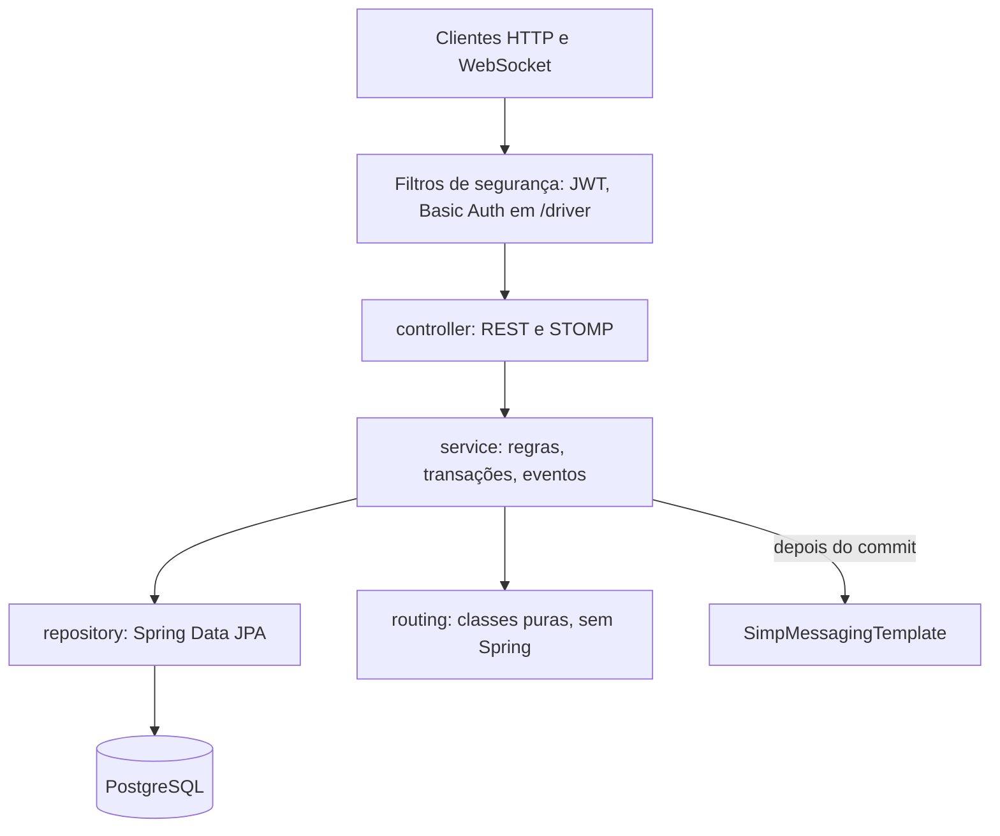

# ARCHITECTURE.md — KJ Fleets

Como o sistema é montado: camadas, stack, modelo de domínio, regras do pedido, roteirização, API, segurança, tempo real e banco. O **porquê** do produto está em [PRODUCT.md](PRODUCT.md); as **regras de código** em [SYSTEM.md](SYSTEM.md); os **fluxos** em [docs/flows.md](docs/flows.md).

## Visão geral

Uma aplicação Spring Boot única (monólito), single-tenant, falando com um PostgreSQL. Não há fila, cache nem serviço externo.



Pontos de atenção:
- Regra de negócio mora em `service`. O `controller` só converte HTTP em chamada e o resultado em resposta.
- As classes de roteirização (`RouteOptimizer`, `AssignmentSolver`, `RoadGraph`) não conhecem Spring nem banco: recebem pontos e devolvem ordem e custo. Isso as deixa testáveis com JUnit puro.
- O WebSocket é só saída (servidor publica). O motorista envia posição por REST.

## Stack

Requisitos da disciplina:
- Java, Maven, IntelliJ IDEA
- Spring Boot com Spring Data JPA, Spring Web, Lombok, PostgreSQL Driver
- PostgreSQL + pgAdmin
- Insomnia/Postman para testar
- Segurança: JWT e Basic Auth

**JDK 21 (LTS).** A disciplina lista o JDK 26, mas o 26 é recente demais e pode trazer problemas de compatibilidade com o ecossistema. Nada no projeto depende de recurso posterior ao 21. Avisar o professor. Configurar `java.version` como 21 no `pom.xml` e usar um Spring Boot estável compatível com Java 21 (conferir no Spring Initializr).

Adições necessárias (avisar o professor, se preciso): `spring-boot-starter-security`, `spring-boot-starter-websocket`, uma lib de JWT (jjwt) e `spring-boot-starter-validation`.

## Estrutura de pacotes (proposta)

Poucas pastas e poucas classes, no padrão da aula. Ajustar conforme o código for nascendo.

| Pacote | Conteúdo |
|---|---|
| `entity` | Entidades JPA e enums |
| `repository` | Interfaces Spring Data (com as queries do dashboard) |
| `service` | `OrderService` (fluxo e regras), `DispatchService`, `RoutingService`, `DashboardService`, cadastros |
| `controller` | Um controller por grupo da API (auth, pedidos, motorista, cadastros, roteirização, dashboard) |
| `dto` | Records de entrada e saída, só onde a entidade não deve vazar |
| `routing` | `RouteOptimizer`, `AssignmentSolver`, `RoadGraph` (puras) |
| `security` | Filtro JWT, config de Basic Auth em `/driver/**`, interceptor do WebSocket |
| `config` | Propriedades (`@ConfigurationProperties`), WebSocket, CORS |

## Configuração (variáveis de ambiente)

Nada de segredo no repositório: o `application.properties` lê tudo de variáveis de ambiente.
- Banco: `DB_URL`, `DB_USER`, `DB_PASSWORD`
- Segurança: `JWT_SECRET` (mínimo 32 bytes; abaixo disso a aplicação nem sobe), `ADMIN_USERNAME`, `ADMIN_PASSWORD`
- Roteirização: `ROUTING_MODE`, `ROUTING_DETOUR_FACTOR`, `ROUTING_AVG_SPEED_KMH`, `ROUTING_GRAPH_NODES`, `ROUTING_GRAPH_EDGES` (os dois últimos só no modo `road`)
## Decisões de modelagem

- Chave primária `UUID` + `publicId` legível (ex.: `order_x7k2m9`), como no Fleetbase. A API só expõe o `publicId`.
- `user` e `order` são palavras reservadas no PostgreSQL: as entidades `AppUser` e `Order` usam as tabelas `users` e `orders`.
- Sem PostGIS: lat/lng em `double`; distância por Haversine (ver [Roteirização](#roteirização)).
- `jsonb` para metadados livres do pedido (`meta`).
- Datas em `Instant` (UTC).
- Enums gravados como string (`@Enumerated(EnumType.STRING)`).
- Todos os perfis ficam na mesma tabela `users`. Motorista e cliente são entidades próprias ligadas 1:1 a um `AppUser`.
- As demais tabelas seguem o padrão do JPA, no singular (`driver`, `vehicle`, `route`, `route_stop`, `tracking_status`, `road_node`, `road_edge`).
## Modelo de domínio

Diagrama ER, tipos das colunas, índices e restrições em [docs/domain.md](docs/domain.md). Abaixo, o resumo das entidades.

Nomes e campos abaixo são a proposta do projeto. Os campos reais do Fleetbase **não foram verificados**: conferir as migrations e os models do `fleetbase/fleetops-api` (pasta `server/`) antes de fechar o ER.

| Entidade | Campos principais | Relações |
|---|---|---|
| AppUser (`users`) | username, passwordHash, role (ADMIN, DISPATCHER, FLEET_MANAGER, CUSTOMER, DRIVER), active | 0..1 Driver, 0..1 Customer |
| Customer | name, phone, email | 1:1 AppUser, N Order |
| Driver | name, phone, licenseNumber, status (AVAILABLE, BUSY, OFFLINE), lat, lng, lastSeenAt | 1:1 AppUser (role DRIVER), 0..1 Vehicle, N:N Fleet |
| Vehicle | plate, type, status | 0..1 Driver |
| Fleet | name | N:N Driver |
| Order (`orders`) | publicId, status, trackingNumber, dispatchedAt, finishedAt, podRequired, podValue, podAt, reason, notes, meta | 1 Payload, 0..1 Customer, 0..1 Driver, 0..1 Vehicle, 0..1 Route, N TrackingStatus |
| Payload | — | pickup (Place), dropoff (Place), N waypoints (Place, na ordem de cadastro), N entities (itens) |
| Place | name, address, lat, lng | usado por Payload |
| Contact | name, phone, email | opcional em Place |
| TrackingStatus | status, code, details, lat, lng, createdAt | N:1 Order |
| Route | algorithm, mode, totalKm, baselineKm, savingsPct, etaMinutes, computedAt | 1:1 Order, N RouteStop |
| RouteStop | seq, type (START, PICKUP, WAYPOINT, DROPOFF), lat, lng, legKm | N:1 Route, Place opcional |
| RoadNode | id, lat, lng | — |
| RoadEdge | fromNode, toNode, lengthM | N:1 RoadNode (origem e destino); via de mão dupla = 2 arestas |

Criar um motorista (`POST /drivers`) cria também o `AppUser` com role DRIVER (username e senha vêm no corpo). `POST /auth/register` cria um `AppUser` CUSTOMER com o `Customer`.

### Regras dos cadastros

- **Exclusão é soft delete:** `DELETE` marca `active = false` em motorista, veículo, frota e lugar. Inativo some das listagens e responde 404 em `GET`, `PUT` e `DELETE`. Não há reativação nesta fundação.
- **Username e placa continuam ocupados** depois da desativação: o username do motorista desativado e a placa do veículo desativado não podem ser reaproveitados (409 `USERNAME_TAKEN` e `PLATE_TAKEN`).
- **Normalização:** username vira minúsculo, placa vira maiúscula, e os dois perdem espaços nas bordas. O login também normaliza o username.
- **Motorista nasce `OFFLINE`.** `BUSY` é definido pelas rotas, não à mão: `PUT` com `BUSY` responde 400. Motorista `BUSY` não muda de status nem pode ser removido (409 `RESOURCE_IN_USE`).
- **Vínculo motorista-veículo:** `vehicleId` é opcional. Veículo inativo, em `MAINTENANCE` ou já vinculado a outro motorista responde 409 `RESOURCE_IN_USE`. Excluir motorista o tira das frotas; excluir veículo solta o vínculo do motorista.
- **Status do veículo:** `MAINTENANCE` é manual. `IN_USE` não pode ser definido à mão (400), e veículo `IN_USE` não muda de status nem pode ser removido (409 `RESOURCE_IN_USE`). A troca automática para `IN_USE` no despacho e para `AVAILABLE` no fim do pedido entra com os pedidos (subprojeto 2); nesta fundação o status não muda sozinho.
- **Login:** `POST /auth/login` recusa motorista (role DRIVER) e usuário inativo com 401, com a mesma resposta de credencial inválida. Motorista só se autentica por Basic Auth em `/driver/**`.

## Fluxo e regras do pedido

Estados: `CREATED → DISPATCHED → DRIVER_ENROUTE → ARRIVED → IN_PROGRESS → COMPLETED`. Terminais: `COMPLETED`, `CANCELLED`, `FAILED`. "Pedido ativo" = de `DISPATCHED` até `IN_PROGRESS`. No `activity`, `code` é o estado de destino.

Transições (centralizadas em **um** lugar, um mapa ou enum com `canGoTo`):
- `CREATED → DISPATCHED` (só por `dispatch`)
- `DISPATCHED → DRIVER_ENROUTE → ARRIVED → IN_PROGRESS`
- `IN_PROGRESS → COMPLETED | FAILED`
- Cancelar (`CANCELLED`) só até `ARRIVED`.

Regras (as quatro primeiras vêm da spec de terceiros, ver [CREDITS.md](CREDITS.md)):
1. Despachar exige motorista **e** veículo atribuídos.
2. Atribuir (`assign`, só em `CREATED`) exige motorista `AVAILABLE` e sem pedido ativo, e veículo (o informado ou o do motorista) sem pedido ativo.
3. Payload precisa de pelo menos 1 pickup e 1 dropoff, e aceita até 50 waypoints.
4. Se `podRequired`, não completa sem prova de entrega (`POST /orders/{id}/pod`, só em `IN_PROGRESS`).
5. Cada transição, **inclusive a criação**, grava um `TrackingStatus` (status, código, detalhes, lat/lng) **na mesma transação** da mudança de status. Estados terminais preenchem `finishedAt`.
6. Cada transição publica o evento `order.updated` no WebSocket depois do commit.
7. Proposta própria: um motorista só pode ter 1 pedido ativo por vez. Ele vira `BUSY` no despacho e volta a `AVAILABLE` quando o pedido chega a um estado terminal.
8. Diferencial (opcional): modo ad hoc, em que o primeiro motorista que aceita (`POST /driver/orders/{id}/accept`) leva o pedido. Aceitar atribui o motorista e o veículo dele e despacha o pedido numa operação só (pedido em `CREATED` e sem motorista), com as mesmas validações de `assign`. Resolver a concorrência com `@Version` ou `UPDATE ... WHERE driver IS NULL` conferindo as linhas afetadas.
9. Cancelar e marcar como `FAILED` exigem `reason`.
10. CUSTOMER só enxerga e cancela os próprios pedidos; DRIVER só enxerga os atribuídos a ele. Em ambos os casos, pedido de outra pessoa responde 404 (não vaza que existe).
11. O payload não é editável depois da criação (não existe `PUT` de payload).

Erros de regra:
- **422:** `ORDER_INVALID_TRANSITION`, `ORDER_PAYLOAD_INCOMPLETE`, `ORDER_DISPATCH_REQUIRES_DRIVER`, `ORDER_DISPATCH_REQUIRES_VEHICLE`, `ORDER_POD_REQUIRED`, `DRIVER_NOT_AVAILABLE`, `DRIVER_HAS_ACTIVE_ORDER`, `VEHICLE_NOT_AVAILABLE`, `ROUTE_TOO_LARGE_FOR_EXACT`, `GRAPH_NOT_LOADED`, `GRAPH_IMPORT_FAILED`, `NO_PATH_FOUND`
- **409:** `ORDER_ALREADY_TAKEN`, `USERNAME_TAKEN`
- **404:** `ROUTE_NOT_FOUND` (e recurso inexistente ou de outra pessoa)
- 400 para validação de campos; 401 sem credencial; 403 sem permissão.
## Roteirização

Tudo roda sobre uma **matriz de distâncias (km)** entre pontos. Dois modos (`ROUTING_MODE`):
- `haversine` (padrão): grafo completo, peso = distância Haversine × `ROUTING_DETOUR_FACTOR` (padrão 1.3, aproxima a distância por rua).
- `road`: grafo viário (`road_node`, `road_edge`) importado de CSV. Cada ponto é "colado" no nó mais próximo e a distância é o menor caminho. Sem grafo carregado, 422 `GRAPH_NOT_LOADED`.

ETA = km / `ROUTING_AVG_SPEED_KMH` (padrão 40).

Prioridade: o modo `haversine` é essencial e precisa funcionar sozinho. O modo `road` (com Dijkstra e A*) vem depois ("Importante" no [PRODUCT.md](PRODUCT.md)).

| Problema | Onde | Algoritmos |
|---|---|---|
| Ordem das paradas de um pedido: caminho mínimo por todos os waypoints, com pickup (início) e dropoff (fim) fixos | `POST /orders/{id}/route`, `POST /routes/optimize` | `NEAREST_NEIGHBOR` (baseline), `TWO_OPT`, `HELD_KARP` (exato, até 15 waypoints), `SIMULATED_ANNEALING` |
| Atribuir pedidos a motoristas: casamento bipartido de custo mínimo, custo = distância motorista → pickup | `POST /dispatch/plan` | `HUNGARIAN` (ótimo), `GREEDY` (baseline) |
| Menor caminho no grafo viário | `GET /graph/shortest-path` e matriz do modo `road` | `DIJKSTRA`, `ASTAR` (heurística Haversine) |

Regras da roteirização:
- Algoritmo padrão da ordem das paradas: `HELD_KARP` com até 15 waypoints, senão `TWO_OPT`. `HELD_KARP` com mais de 15 responde 422 `ROUTE_TOO_LARGE_FOR_EXACT`.
- A rota do pedido é `START` (posição do motorista, se houver) → `PICKUP` → waypoints → `DROPOFF`. Só os waypoints são reordenados; o trecho `START → PICKUP` entra nos totais.
- `baselineKm` = mesma rota com os waypoints na ordem de cadastro. `savingsPct = (baselineKm - totalKm) / baselineKm × 100` (0 se `baselineKm` for 0). Sem waypoints não há o que ordenar: a rota sai com `savingsPct` 0.
- `SIMULATED_ANNEALING` aceita `seed` opcional para resultado reproduzível.
- Dijkstra e A* devolvem também `nodesExpanded` e `ms`, para comparar os dois.
- Despacho em lote (`POST /dispatch/plan`): candidatos são motoristas `AVAILABLE`, com posição conhecida, com veículo e sem pedido ativo. O Hungarian é retangular (completa com custo zero). A resposta traz `comparison` com o `totalKm` dos dois algoritmos. Com `apply=true`, aplica tudo numa única transação, revalidando as regras; se alguma falhar, nada é aplicado. Sobras ficam em `unassigned`.
- Grafo viário: `nodes.csv` com `id,lat,lng` e `edges.csv` com `from_id,to_id,length_m,oneway` (`oneway=false` cria a aresta inversa). Os arquivos são gerados fora do repo (ex.: script Python com osmnx) e apontados por `ROUTING_GRAPH_NODES` e `ROUTING_GRAPH_EDGES`. `POST /graph/import` lê os dois, grava no banco e monta as listas de adjacência em memória.
- Código dos algoritmos em classes **puras, sem Spring**: `RouteOptimizer`, `AssignmentSolver` e `RoadGraph`. Testes esperados: Held-Karp = força bruta (até 8 paradas), 2-opt nunca pior que nearest neighbor, Hungarian nunca pior que greedy, A* com o mesmo custo do Dijkstra.
## API REST

Convenção: `{id}` é o `publicId`.

Listagens paginadas por `limit` e `offset`: padrão 20, máximo 100 (acima disso vira 100). `limit < 1` ou `offset < 0` responde 400. Resposta:

```json
{ "items": [], "total": 0, "limit": 20, "offset": 0 }
```

**Auth e usuários**
- `POST /auth/register`: cadastro público de CUSTOMER
- `POST /auth/login`: devolve o JWT (recusa motorista e usuário inativo com 401)
- `POST /users`: cria ADMIN, DISPATCHER ou FLEET_MANAGER (só ADMIN). Motorista nasce em `POST /drivers` e cliente em `POST /auth/register`
- `GET /users`: lista todos os usuários, inclusive inativos (campo `active`), ordenados por username (só ADMIN)

**Pedidos**
- `POST /orders`: cria pedido (equipe ou cliente)
- `GET /orders`: lista, filtro `status` (cliente vê só os seus)
- `GET /orders/{id}`: detalhe
- `GET /orders/{id}/tracking`: histórico
- `POST /orders/{id}/assign`: motorista (+ veículo opcional), só em `CREATED`
- `POST /orders/{id}/dispatch`
- `POST /orders/{id}/activity`: avança o fluxo (`FAILED` exige `reason`)
- `POST /orders/{id}/pod`: só em `IN_PROGRESS`
- `POST /orders/{id}/cancel`: exige `reason`
- `POST /orders/{id}/route`: calcula e grava a rota (`algorithm` e `seed` opcionais)
- `GET /orders/{id}/route`: rota gravada, 404 `ROUTE_NOT_FOUND` se não houver

**Rastreio público**
- `GET /track/{trackingNumber}`: status, linha do tempo e ETA, sem dados pessoais nem coordenadas

**API do motorista (Basic Auth, só pedidos dele)**
- `GET /driver/me`: dados do próprio motorista
- `GET /driver/orders`
- `POST /driver/orders/{id}/accept` (modo ad hoc, opcional)
- `POST /driver/orders/{id}/activity`
- `POST /driver/orders/{id}/pod`
- `GET /driver/orders/{id}/route`
- `POST /driver/location`: ping de posição

**Cadastros (CRUD: `GET`, `GET /{id}`, `POST`, `PUT /{id}`, `DELETE /{id}`)**
- `/drivers`, `/vehicles`, `/places`, `/fleets`
- `GET /drivers/nearest`: motoristas `AVAILABLE` por distância (`lat`, `lng`, `limit`). `limit` padrão 5, máximo 20 (acima disso vira 20), `< 1` responde 400

**Erros**

Mesmo formato em todas as respostas de erro: `{ "status", "code", "message", "timestamp" }`. Erros de regra de negócio têm código próprio (ver [Fluxo e regras do pedido](#fluxo-e-regras-do-pedido)). Os genéricos:

| Status | Código | Quando |
|---|---|---|
| 400 | `VALIDATION_ERROR` | campo inválido, JSON malformado, parâmetro com tipo errado ou fora da faixa (`limit`, `offset`, lat/lng) |
| 401 | `UNAUTHORIZED` | sem credencial, token inválido ou credencial errada |
| 403 | `FORBIDDEN` | autenticado, mas o papel não pode fazer a ação |
| 404 | `NOT_FOUND` | recurso inexistente, inativo ou de outra pessoa; rota inexistente |
| 405 | `METHOD_NOT_ALLOWED` | método HTTP não suportado pela rota |
| 409 | `USERNAME_TAKEN`, `PLATE_TAKEN`, `RESOURCE_IN_USE` | unicidade ou recurso em uso |
| 415 | `UNSUPPORTED_MEDIA_TYPE` | corpo que não é JSON |
| 500 | `INTERNAL_ERROR` | erro inesperado; a resposta não traz stack trace, o log fica no servidor |

**Roteirização**
- `POST /routes/optimize`: sem gravar nada (início opcional, pickup, waypoints, dropoff, `algorithm`)
- `POST /dispatch/plan`: `algorithm` (`HUNGARIAN` ou `GREEDY`), `orderIds` opcional, `apply`
- `GET /graph/shortest-path`: `fromLat`, `fromLng`, `toLat`, `toLng`, `algorithm`
- `POST /graph/import`: só ADMIN

**Dashboard**
- `GET /dashboard/summary`
- `GET /dashboard/orders-timeseries`
- `GET /dashboard/drivers-performance`
- `GET /dashboard/routing-savings`
- `GET /dashboard/live`
## Perfis e permissões

| Recurso | ADMIN | DISPATCHER | FLEET_MANAGER | CUSTOMER | DRIVER |
|---|---|---|---|---|---|
| `/users` | sim | não | não | não | não |
| Criar pedido | sim | sim | não | sim | não |
| Listar, detalhar e ver histórico de pedidos | sim | sim | sim | só os próprios | não |
| Ver a rota gravada do pedido | sim | sim | sim | não | não |
| Atribuir, despachar, avançar, POD e calcular a rota do pedido | sim | sim | não | não | não |
| Cancelar pedido | sim | sim | não | o próprio, só em `CREATED` | não |
| API do motorista `/driver/**` | não | não | não | não | só os atribuídos a ele |
| Motoristas, veículos e frotas (CRUD) | sim | só leitura | sim | não | não |
| `GET /drivers/nearest` | sim | sim | sim | não | não |
| Lugares (CRUD) | sim | sim | só leitura | não | não |
| `POST /dispatch/plan` e `POST /routes/optimize` | sim | sim | não | não | não |
| `GET /graph/shortest-path` | sim | sim | sim | não | não |
| `POST /graph/import` | sim | não | não | não | não |
| `/dashboard/**` | sim | sim | sim | não | não |
| `/auth/**` e `GET /track/{trackingNumber}` | público | público | público | público | público |
## Auth

- **JWT:** todos os perfis, menos o motorista. Tudo fora de `/auth/**`, `/track/**` e `/driver/**` exige JWT. Assinado em HS256, válido por 8 horas. `JWT_SECRET` precisa de pelo menos 32 bytes.
- **Basic Auth:** só em `/driver/**`, com o username e a senha do motorista (BCrypt). O motorista é identificado pelo principal autenticado, nunca por id na URL.
- O primeiro ADMIN é criado no startup a partir de `ADMIN_USERNAME` e `ADMIN_PASSWORD`, se ainda não existir nenhum usuário.
- Segredo do JWT e credenciais do banco em variáveis de ambiente, nunca no repositório.
## WebSocket

- STOMP sobre WebSocket, endpoint `/ws`. O motorista não usa WebSocket (só REST).
- Tópicos: `/topic/orders/{publicId}` (mudanças do pedido) e `/topic/drivers/{publicId}/location` (posição).
- Equipe (ADMIN, DISPATCHER, FLEET_MANAGER) assina qualquer tópico. CUSTOMER só assina os tópicos dos próprios pedidos.
- Validar o JWT e a permissão de assinatura com um `ChannelInterceptor` (nos frames `CONNECT` e `SUBSCRIBE`).
- Publicar via `SimpMessagingTemplate` a partir do service que muda o status ou a posição.
## Dashboard

Somente leitura, só para ADMIN, DISPATCHER e FLEET_MANAGER. Tudo agregado no banco (`GROUP BY`, `date_trunc`), nada calculado em memória sobre listas inteiras.
- `summary`: pedidos por status, motoristas por status, veículos por status, pedidos ativos, finalizados hoje, taxa de sucesso (`COMPLETED / (COMPLETED + FAILED + CANCELLED)`), tempo médio de entrega (`dispatchedAt` até `finishedAt`, só `COMPLETED`) e utilização da frota (`BUSY / (AVAILABLE + BUSY)`).
- `orders-timeseries` (`days`, padrão 7): por dia, criados, concluídos e falhos/cancelados.
- `drivers-performance` (`from`, `to`): por motorista, concluídos, falhos, tempo médio e km total.
- `routing-savings`: por algoritmo, número de rotas, economia média em % e km economizados.
- `live`: posição e status dos motoristas e os pedidos ativos (com coordenadas de pickup e dropoff), para um mapa.

Opcional: uma página estática (`src/main/resources/static/dashboard.html`, Chart.js por CDN) que faz login e consome esses endpoints, só para demonstração. Fora disso, o frontend é outro projeto.
## Banco (PostgreSQL)

- Dev: `spring.jpa.hibernate.ddl-auto=update`. Manter um `schema.sql` exportado do pgAdmin como snapshot para a entrega (`docs/schema.sql`).
- Índices: `orders(status)`, `orders(created_at)`, `orders(finished_at)`, `tracking_status(order_id, created_at)`, `driver(status)`, `route(order_id)` único, `road_edge(from_node)`.
- Evitar N+1 nas listagens (`@EntityGraph` ou fetch join onde fizer sentido).
- Testes: Testcontainers sobe um PostgreSQL 17 descartável (`postgres:17-alpine`). Precisa de Docker rodando e nunca usa o banco de desenvolvimento.

## Decisões e trade-offs

| Decisão | Por quê | Custo |
|---|---|---|
| Single-tenant | Projeto de matéria; multi-tenant espalharia `company_id` por tudo | Não serve para várias empresas no mesmo banco |
| Sem PostGIS | Menos coisa para instalar; Haversine basta para a escala do projeto | Sem índices espaciais; `drivers/nearest` varre os motoristas disponíveis |
| Haversine × fator de desvio como padrão | Funciona sem dados de mapa | Aproximação; o modo `road` corrige isso |
| Algoritmos próprios, sem OR-Tools | É o objetivo acadêmico do projeto | Mais código para testar; VRP completo fica fora |
| Fluxo de pedido fixo | Evita um motor de fluxo configurável | Não replica o `OrderConfig` do Fleetbase |
| POD em texto | Sem upload de arquivo | Sem foto nem assinatura |
| Basic Auth só no motorista | Cumpre o requisito da disciplina com um caso de uso real (dispositivo simples) | Credencial viaja a cada requisição: exigir HTTPS fora de dev |
| STOMP só para saída | Mantém o motorista simples (REST) | Motorista não recebe push; consulta `GET /driver/orders` |
| `ddl-auto=update` em dev | Rápido para iterar | Sem migrations versionadas; ver "Banco" |

## Fonte das regras

Nomes e regras de negócio vêm do Fleet-Ops do Fleetbase (domínio) e de uma spec de terceiros (ciclo de vida do pedido). Links e atribuição em [CREDITS.md](CREDITS.md). Em conflito, vale o código do `fleetops-api`; roteirização e dashboard são contribuição própria.
