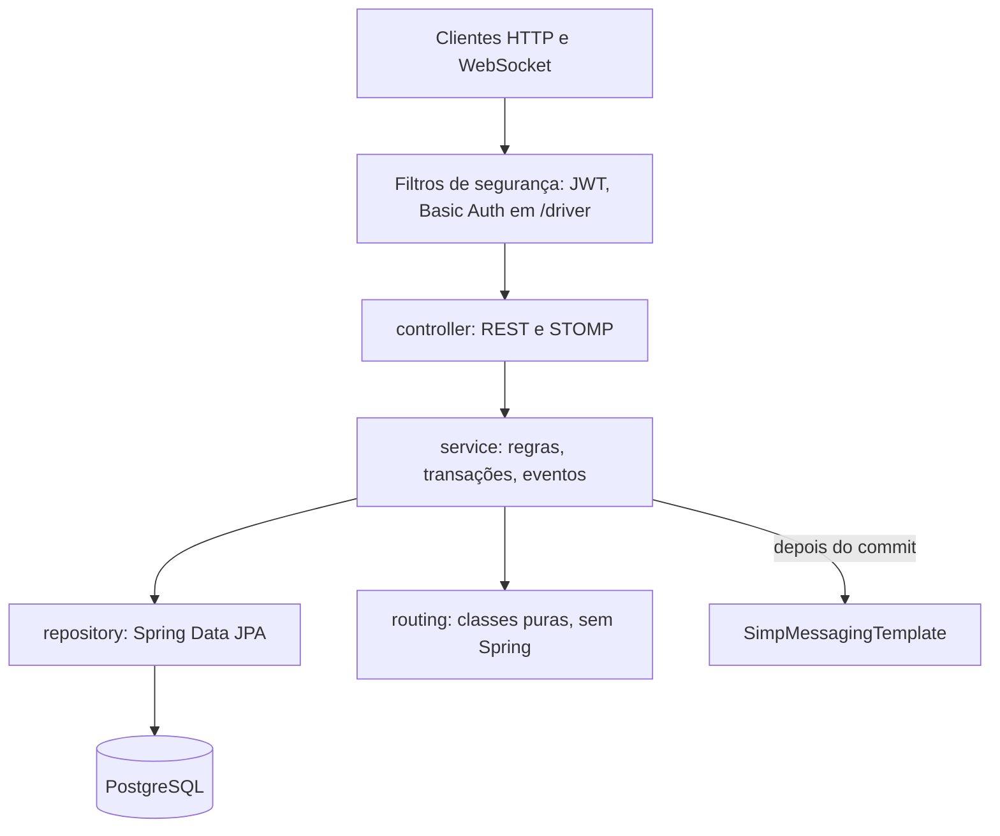

# ARCHITECTURE.md — KJ Fleets

Como o sistema é montado: camadas, stack, modelo de domínio, regras do pedido, roteirização, API, segurança, tempo real e banco. O **porquê** do produto está em [PRODUCT.md](PRODUCT.md); as **regras de código** em [SYSTEM.md](SYSTEM.md); os **fluxos** em [docs/flows/](flows/backend/flow-index.md).

## Visão geral

Uma aplicação Spring Boot única (monólito), single-tenant, falando com um PostgreSQL. Não há fila nem serviço externo. O motor de rotas (GraphHopper, só no modo `road`) roda embutido na API, e o cache do grafo fica em disco.



Pontos de atenção:
- Regra de negócio mora em `service`. O `controller` só converte HTTP em chamada e o resultado em resposta.
- As classes de roteirização (`RouteOptimizer`, `AssignmentSolver`) não conhecem Spring nem banco: recebem pontos e devolvem ordem e custo. Isso as deixa testáveis com JUnit puro. O `RoadRouter` é a exceção: encapsula o GraphHopper e é um bean que só existe no modo `road`.
- O WebSocket é só saída (servidor publica). O motorista envia posição por REST.

## Stack

Requisitos da disciplina:
- Java, Maven, IntelliJ IDEA
- Spring Boot com Spring Data JPA, Spring Web, Lombok, PostgreSQL Driver
- PostgreSQL + pgAdmin
- Insomnia/Postman para testar
- Segurança: JWT e Basic Auth

**JDK 21 (LTS).** A disciplina lista o JDK 26, mas o 26 é recente demais e pode trazer problemas de compatibilidade com o ecossistema. Nada no projeto depende de recurso posterior ao 21. Avisar o professor. Configurar `java.version` como 21 no `pom.xml` e usar um Spring Boot estável compatível com Java 21 (conferir no Spring Initializr).

Adições necessárias (avisar o professor, se preciso): `spring-boot-starter-security`, `spring-boot-starter-websocket`, uma lib de JWT (jjwt) e `spring-boot-starter-validation`.

## Estrutura de pacotes (proposta)

Poucas pastas e poucas classes, no padrão da aula. Ajustar conforme o código for nascendo.

| Pacote | Conteúdo |
|---|---|
| `entity` | Entidades JPA e enums |
| `repository` | Interfaces Spring Data (com as queries do dashboard) |
| `service` | `OrderService` (fluxo e regras), `DispatchService`, `RouteService`, `DistanceService`, `RoadRouter` (GraphHopper, só `road`), `DashboardService`, cadastros |
| `controller` | Um controller por grupo da API (auth, pedidos, motorista, cadastros, roteirização, dashboard) |
| `dto` | Records de entrada e saída, só onde a entidade não deve vazar |
| `routing` | `RouteOptimizer`, `AssignmentSolver` (puras) |
| `security` | Filtro JWT, config de Basic Auth em `/driver/**`, interceptor do WebSocket |
| `config` | Propriedades (`@ConfigurationProperties`), WebSocket, CORS |

## Configuração (variáveis de ambiente)

Nada de segredo no repositório: o `application.properties` lê tudo de variáveis de ambiente.
- Banco: `DB_URL`, `DB_USER`, `DB_PASSWORD`
- Segurança: `JWT_SECRET` (mínimo 32 bytes; abaixo disso a aplicação nem sobe), `ADMIN_USERNAME`, `ADMIN_PASSWORD`
- Roteirização: `ROUTING_MODE`, `ROUTING_DETOUR_FACTOR`, `ROUTING_AVG_SPEED_KMH`, `ROUTING_ARRIVAL_RADIUS_M` (raio para concluir parada, padrão 200), `ROUTING_POSITION_MAX_AGE_S` (idade máxima da posição do motorista, padrão 300), `ROUTING_OSM_FILE` (arquivo `.osm.pbf` do mapa, padrão `./data/osm/sul-latest.osm.pbf`) e `ROUTING_GRAPH_DIR` (cache do grafo importado, padrão `./data/graph-cache`), os dois só no modo `road`
- Dashboard: `DASHBOARD_TIMEZONE` (padrão `America/Sao_Paulo`), `DASHBOARD_STALE_UNASSIGNED_MIN` (30), `DASHBOARD_STALE_ASSIGNED_MIN` (15), `DASHBOARD_STALE_DISPATCHED_MIN` (15), `DASHBOARD_STALE_ENROUTE_MIN` (60), `DASHBOARD_STALE_ARRIVED_MIN` (20), `DASHBOARD_STALE_IN_PROGRESS_MIN` (90) e `DASHBOARD_MAINTENANCE_ALERT_DAYS` (7). Limites de parado: 1 a 1440 min; dias de manutenção: 1 a 365
- WebSocket: `WS_LOCATION_MIN_INTERVAL_S` (5, de 1 a 300 s) e `WS_LOCATION_MIN_DISTANCE_M` (20, de 0 a 1000 m): throttle de posição por motorista. Valor fora da faixa impede a aplicação de subir.
- CORS: `CORS_ALLOWED_ORIGINS` (origens separadas por vírgula). Vazio (padrão) = nenhuma origem cruzada no REST. Sem credenciais: o front manda o JWT no header `Authorization`. O `/ws` tem regra própria (ver WebSocket). Em dev o front usa o proxy do Vite e não precisa disto.

## Decisões de modelagem

- Chave primária `UUID` + `publicId` legível (ex.: `order_x7k2m9`), como no Fleetbase. A API só expõe o `publicId`.
- `user` e `order` são palavras reservadas no PostgreSQL: as entidades `AppUser` e `Order` usam as tabelas `users` e `orders`.
- Sem PostGIS: lat/lng em `double`; distância em linha reta (Haversine) ou pelas ruas no modo `road` (ver [Roteirização](#roteirização)).
- `jsonb` para metadados livres do pedido (`meta`).
- Datas em `Instant` (UTC).
- Enums gravados como string (`@Enumerated(EnumType.STRING)`).
- Todos os perfis ficam na mesma tabela `users`. Motorista e cliente são entidades próprias ligadas 1:1 a um `AppUser`.
- As demais tabelas são no plural, como as entidades do código (`drivers`, `vehicles`, `fleets`, `places`, `customers`, `payloads`, `payload_items`, `payload_waypoints`, `tracking_statuses`). Rotas (`routes`, `route_stops`) entram no subprojeto 3. O grafo viário não tem tabela: fica no cache do GraphHopper em disco (`ROUTING_GRAPH_DIR`).
## Modelo de domínio

Diagrama ER, tipos das colunas, índices e restrições em [docs/domain.md](domain.md). Abaixo, o resumo das entidades.

Nomes e campos abaixo são a proposta do projeto. Os campos reais do Fleetbase **não foram verificados**: conferir as migrations e os models do `fleetbase/fleetops-api` (pasta `server/`) antes de fechar o ER.

| Entidade | Campos principais | Relações |
|---|---|---|
| AppUser (`users`) | username, passwordHash, role (ADMIN, DISPATCHER, FLEET_MANAGER, CUSTOMER, DRIVER), active | 0..1 Driver, 0..1 Customer |
| Customer | name, phone, email | 1:1 AppUser, N Order |
| Driver | name, phone, licenseNumber, status (AVAILABLE, BUSY, OFFLINE), lat, lng, lastSeenAt | 1:1 AppUser (role DRIVER), 0..1 Vehicle, N:N Fleet |
| Vehicle | plate, type, status | 0..1 Driver |
| Fleet | name | N:N Driver |
| Order (`orders`) | publicId, status, trackingNumber, dispatchedAt, finishedAt, podRequired, podValue, podAt, reason, notes, meta | 1 Payload, 0..1 Customer, 0..1 Driver, 0..1 Vehicle, 0..1 Route, N TrackingStatus |
| Payload | — | pickup (Place), dropoff (Place), N waypoints (Place, na ordem de cadastro), N entities (itens) |
| Place | name, address, lat, lng | usado por Payload |
| Contact | name, phone, email | opcional em Place |
| TrackingStatus | status, code, details, lat, lng, createdAt | N:1 Order |
| Route | algorithm, mode, totalKm, baselineKm, savingsPct, etaMinutes, computedAt | 1:1 Order, N RouteStop |
| RouteStop (`route_stops`) | seq, type (START, PICKUP, WAYPOINT, DROPOFF), lat, lng, legKm, distanceSource (ROAD, HAVERSINE; nulo no START e em linhas antigas), visitedAt, distanceM, completedBy | N:1 Route, Place opcional (nulo no START) |

Criar um motorista (`POST /drivers`) cria também o `AppUser` com role DRIVER (username e senha vêm no corpo). `POST /auth/register` cria um `AppUser` CUSTOMER com o `Customer`.

### Regras dos cadastros

- **Exclusão é soft delete:** `DELETE` marca `active = false` em motorista, veículo, frota e lugar. Inativo some das listagens (salvo `includeInactive=true`) e responde 404 em `GET`, `PUT` e `DELETE`.
- **Reativação:** `POST /drivers/{id}/reactivate`, `POST /vehicles/{id}/reactivate` e `POST /places/{id}/reactivate` (este só para lugar da equipe). Já ativo responde 200 sem mudar nada. O motorista volta `OFFLINE`, com usuário ativo, **sem veículo e sem frotas** (o que saiu na desativação não volta). O veículo volta com o status que tinha (um `MAINTENANCE` continua `MAINTENANCE`) e sem motorista. Motorista e veículo ganham linha no histórico de status com motivo `reactivate`.
- **Username e placa continuam ocupados** depois da desativação: o username do motorista desativado e a placa do veículo desativado não podem ser reaproveitados (409 `USERNAME_TAKEN` e `PLATE_TAKEN`). Por isso a reativação não encontra colisão pela API; o check de placa na reativação do veículo é só salvaguarda.
- **Lugares têm dono opcional** (`places.customer_id`). Lugar sem dono é da equipe: aparece em `GET /places` e é editado por ADMIN e DISPATCHER. Lugar com dono é do cliente: só aparece em `/customer/places`, e só o dono o vê ou edita (para os outros, 404).
- Cliente cria lugar em `/customer/places` ou inline no pedido (lugar novo): o lugar inline é dele. Lugar novo criado pela equipe no pedido é da equipe.
- No pedido, o cliente usa `placeId` dos próprios lugares ou dos da equipe. Lugar de outro cliente responde 404 (`NOT_FOUND`). A equipe também só usa lugares da equipe ou do cliente do pedido (sem cliente no pedido, só os da equipe).
- Editar lugar do cliente usado por pedido não terminal (de `CREATED` a `IN_PROGRESS`) responde 409 `RESOURCE_IN_USE`. Desativar sempre pode (soft delete); pedidos já criados continuam apontando para o lugar.
- **Normalização:** username vira minúsculo, placa vira maiúscula, e os dois perdem espaços nas bordas. O login também normaliza o username.
- **Motorista nasce `OFFLINE`.** `BUSY` é definido pelas rotas, não à mão: `PUT` com `BUSY` responde 400. Motorista `BUSY` não muda de status nem pode ser removido (409 `RESOURCE_IN_USE`).
- **Vínculo motorista-veículo:** `vehicleId` é opcional. Veículo inativo, em `MAINTENANCE` ou já vinculado a outro motorista responde 409 `RESOURCE_IN_USE`. Excluir motorista o tira das frotas; excluir veículo solta o vínculo do motorista.
- **Status do veículo:** `MAINTENANCE` é manual. `IN_USE` não pode ser definido à mão (400), e veículo `IN_USE` não muda de status nem pode ser removido (409 `RESOURCE_IN_USE`). A troca automática para `IN_USE` no despacho e para `AVAILABLE` no fim do pedido é feita pelo próprio pedido (ver [Fluxo e regras do pedido](#fluxo-e-regras-do-pedido)).
- **Login:** `POST /auth/login` recusa motorista (role DRIVER) e usuário inativo com 401, com a mesma resposta de credencial inválida. Motorista só se autentica por Basic Auth em `/driver/**`.

## Fluxo e regras do pedido

Estados: `CREATED → DISPATCHED → DRIVER_ENROUTE → ARRIVED → IN_PROGRESS → COMPLETED`. Terminais: `COMPLETED`, `CANCELLED`, `FAILED`. "Pedido ativo" = de `DISPATCHED` até `IN_PROGRESS`.

Cada linha do histórico (`tracking_statuses`) tem dois campos: `status` é o estado do pedido depois do evento (enum em maiúsculas) e `code` é o evento em minúsculas: `created`, `assigned`, `unassigned`, `dispatched`, `driver_enroute`, `arrived`, `in_progress`, `pod_registered`, `completed`, `failed`, `cancelled`, `stop_completed` e `route_failed` (estes dois da roteirização). `assigned`, `unassigned`, `pod_registered`, `stop_completed` e `route_failed` não mudam o status. No corpo do `activity`, `code` é outra coisa: o estado de destino pedido, em maiúsculas (`"code": "ARRIVED"`).

Transições (centralizadas em **um** lugar, um mapa ou enum com `canGoTo`):
- `CREATED → DISPATCHED` (só por `dispatch` ou `accept`)
- `DISPATCHED → DRIVER_ENROUTE → ARRIVED → IN_PROGRESS`
- `IN_PROGRESS → COMPLETED | FAILED`
- Cancelar (`CANCELLED`) só até `ARRIVED`.

Regras (as quatro primeiras vêm da spec de terceiros, ver [CREDITS.md](CREDITS.md)):
1. Despachar exige motorista **e** veículo atribuídos. O veículo não pode estar em `MAINTENANCE` nem com pedido ativo (422 `VEHICLE_NOT_AVAILABLE`).
2. Atribuir (`assign`, só em `CREATED`) exige motorista ativo e `AVAILABLE` sem pedido ativo, e veículo (o informado ou o do motorista) ativo, fora de `MAINTENANCE` e sem pedido ativo. Atribuir não ocupa o motorista: ele pode ter vários pedidos `CREATED` na fila. Só o despacho o torna `BUSY`.
3. Payload precisa de pelo menos 1 pickup e 1 dropoff, e aceita até 50 waypoints.
4. Se `podRequired`, não completa sem prova de entrega (`POST /orders/{id}/pod`, só em `IN_PROGRESS`).
5. Cada transição, **inclusive a criação**, grava um `TrackingStatus` (status, código, detalhes, lat/lng) **na mesma transação** da mudança de status. Estados terminais preenchem `finishedAt`.
6. Cada transição é publicada no WebSocket depois do commit (`/topic/orders` e `/topic/orders/{publicId}`, ver WebSocket).
7. Proposta própria: um motorista só pode ter 1 pedido ativo por vez. Ele vira `BUSY` no despacho e volta a `AVAILABLE` quando o pedido chega a um estado terminal.
8. Diferencial (opcional): modo ad hoc, em que o primeiro motorista que aceita (`POST /driver/orders/{id}/accept`) leva o pedido. O aceite trava a linha do pedido (`PESSIMISTIC_WRITE`). Se ele já tem motorista, responde 409 `ORDER_ALREADY_TAKEN`. Senão, exige pedido em `CREATED` (422 `ORDER_INVALID_TRANSITION`), trava o motorista e o veículo dele e aplica as validações de `assign` (sem veículo: 422 `ORDER_DISPATCH_REQUIRES_VEHICLE`). Por fim despacha, tudo numa transação.
9. Cancelar e marcar como `FAILED` exigem `reason`.
10. CUSTOMER só enxerga e cancela os próprios pedidos. DRIVER só enxerga os atribuídos a ele, mais os pedidos `CREATED` sem motorista na listagem `?available=true`, que servem para o aceite. Em ambos os casos, pedido de outra pessoa responde 404 (não vaza que existe).
11. O payload não é editável depois da criação (não existe `PUT` de payload).
12. Atribuir motorista e veículo em `CREATED` (inclusive trocar) e soltar o pedido num cadastro desativado apagam a rota gravada, porque o `START` era de outro motorista. O despacho calcula de novo.

Cadastros x pedidos:
- Desativar motorista ou veículo com pedido ativo responde 409 `RESOURCE_IN_USE`. Com pedidos só em `CREATED`, os pedidos são soltos (motorista e/ou veículo viram `null`) com evento `unassigned` e motivo ("motorista desativado" ou "veículo desativado").
- `PUT` do motorista para `OFFLINE` e do veículo para `MAINTENANCE` é permitido com pedidos `CREATED`; o despacho barra depois.
- Pedido e histórico nunca são apagados (não existe `DELETE /orders`).

Erros de regra:
- **422:** `ORDER_INVALID_TRANSITION`, `ORDER_PAYLOAD_INCOMPLETE`, `ORDER_DISPATCH_REQUIRES_DRIVER`, `ORDER_DISPATCH_REQUIRES_VEHICLE`, `ORDER_POD_REQUIRED`, `DRIVER_NOT_AVAILABLE`, `DRIVER_HAS_ACTIVE_ORDER`, `VEHICLE_NOT_AVAILABLE`, `STOP_TOO_FAR`, `ROUTE_TOO_LARGE_FOR_EXACT`, `GRAPH_NOT_LOADED` (só em `GET /graph/route`, com o grafo fora do ar)
- **409:** `ORDER_ALREADY_TAKEN`, `USERNAME_TAKEN`
- **404:** `ROUTE_NOT_FOUND` (e recurso inexistente ou de outra pessoa)
- 400 para validação de campos; 401 sem credencial; 403 sem permissão.
## Roteirização

Tudo roda sobre uma **matriz de distâncias (km)** entre pontos. Dois modos (`ROUTING_MODE`):
- `haversine` (padrão): peso = distância Haversine × `ROUTING_DETOUR_FACTOR` (padrão 1.3, aproxima a distância por rua). Não precisa de mapa.
- `road`: peso = distância pelas ruas, calculada pelo **GraphHopper 11.1** (biblioteca Java embutida na API, sem serviço externo nem chave). Perfil `car` com Contraction Hierarchies, sobre o extrato `brazil/sul` do OpenStreetMap (Sul do Brasil; a cidade de demo é Santa Helena, PR). Os algoritmos próprios são os mesmos; só muda a fonte da distância.

ETA = km / `ROUTING_AVG_SPEED_KMH` (padrão 40) × 60, arredondado para o inteiro mais próximo. A fórmula é a mesma nos dois modos: o tempo estimado do GraphHopper não é usado.

Prioridade: o modo `haversine` precisa funcionar sozinho e é o padrão. O modo `road` é opcional e depende do arquivo OSM (["Importante" no PRODUCT.md](PRODUCT.md)).

| Problema | Onde | Algoritmos |
|---|---|---|
| Ordem das paradas de um pedido: caminho mínimo por todos os waypoints, com pickup (início) e dropoff (fim) fixos | `POST /orders/{id}/route`, `POST /routes/optimize` | `NEAREST_NEIGHBOR` (baseline), `TWO_OPT`, `HELD_KARP` (exato, até 15 waypoints), `SIMULATED_ANNEALING` |
| Atribuir pedidos a motoristas: casamento bipartido de custo mínimo, custo = distância motorista → pickup | `POST /dispatch/plan` | `HUNGARIAN` (ótimo), `GREEDY` (baseline) |

Regras da roteirização:
- Algoritmo padrão da ordem das paradas: `HELD_KARP` com até 15 waypoints pendentes, senão `TWO_OPT`. `HELD_KARP` com mais de 15 responde 422 `ROUTE_TOO_LARGE_FOR_EXACT`.
- Ordem da rota: início fixo (`START` se o motorista tiver posição; senão o pickup), depois o pickup (quando há `START`), os waypoints e o dropoff. Só os waypoints são reordenados. Um lugar repetido nos waypoints continua sendo duas paradas.
- Recálculo mantém o que já foi feito: as paradas concluídas (`visited_at`) ficam no início, na ordem em que foram feitas, com a perna original. Depois vêm o `START`, o pickup se ainda estiver pendente, os waypoints pendentes reordenados e o dropoff. O `START` só entra se o motorista tiver posição; sem posição, não nasce linha `START` nova.
- `baselineKm` = mesma base com os waypoints pendentes na ordem de cadastro. `totalKm` inclui as pernas já feitas. `savingsPct = (baselineKm - totalKm) / baselineKm × 100` (0 se `baselineKm` for 0), com duas casas. Sem waypoints pendentes, `savingsPct` sai 0.
- `POST /orders/{id}/route` (ADMIN, DISPATCHER) trava o pedido e substitui a rota gravada. Pedido terminal responde 422 `ORDER_INVALID_TRANSITION`.
- Cálculo automático: no despacho e no aceite ad hoc, na mesma transação, com o algoritmo padrão. Se falhar por regra, o despacho segue sem rota e grava `route_failed` no histórico, com o código no `details`. Falta de mapa não é falha: a perna cai para linha reta.
- ETA vivo: calculado em cada leitura de rota e no `GET /track`, nunca gravado. Com posição recente do motorista (até `ROUTING_POSITION_MAX_AGE_S`), é a distância pelo ponto único (com o fator de desvio) da posição até a próxima parada pendente (menor `seq`), somada às pernas das pendentes seguintes. Sem posição recente, soma as pernas pendentes. O ETA vivo nunca chama o GraphHopper, nem no modo `road`, porque é lido a cada evento. Pedido em `CREATED` usa o `etaMinutes` gravado no cálculo; pedido terminal ou sem rota, `null`.
- Concluir parada: `POST /orders/{id}/stops/{seq}/complete` (equipe) e `POST /driver/orders/{id}/stops/{seq}/complete` (motorista). Só `WAYPOINT` é concluída por esse endpoint. `PICKUP` é marcada pelo `ARRIVED` e `DROPOFF` pelo `COMPLETED`; `START` não é concluível (422 `ORDER_INVALID_TRANSITION`). O pedido precisa estar ativo, de `DISPATCHED` a `IN_PROGRESS`. Concluir de novo uma parada já concluída responde 200 sem mudar nada. Os waypoints podem ser concluídos fora da ordem.
- Checagem de proximidade, só para o motorista: a posição vem do corpo (`lat` e `lng`, confiados como enviados, sem validação contra GPS; também atualizam a posição do motorista) ou, sem corpo, da gravada, se tiver no máximo `ROUTING_POSITION_MAX_AGE_S` segundos. A distância é em linha reta, sem fator de desvio. Acima de `ROUTING_ARRIVAL_RADIUS_M` (padrão 200 m), ou sem posição válida, responde 422 `STOP_TOO_FAR` com a distância na mensagem, e nada é marcado. A equipe não tem essa checagem; grava `distanceM` se houver posição.
- `COMPLETED` do motorista usa a mesma checagem contra o dropoff, com ou sem rota calculada. Waypoints pendentes não bloqueiam o `COMPLETED`.
- Concluir grava `visitedAt`, `distanceM` e `completedBy` na parada e o evento `stop_completed` no histórico (`details`: tipo e `seq`, com "por <usuário>" quando é a equipe).
- Despacho em lote (`POST /dispatch/plan`): candidatos são motoristas ativos e `AVAILABLE`, com posição recente, veículo ativo fora de `MAINTENANCE` e sem pedido ativo. Quem já tem pedido `CREATED` na fila também entra (inspirado no Fleetbase, ver a decisão na spec); o custo é medido da posição atual dele. Cada motorista recebe no máximo um pedido por plano. O húngaro é retangular (completa com custo zero). A resposta traz `comparison` com o `totalKm` dos dois algoritmos.
- Com `apply=true` o lote só atribui (não despacha) e é tudo ou nada: trava pedidos, motoristas e veículos, nessa ordem, e aplica um `assign` por par, numa transação. Se um par falhar, nada é gravado e a resposta é 422 com o código da regra. Sobras ficam em `unassigned`.
- Otimização avulsa (`POST /routes/optimize`) não grava nada. `compare=true` roda os algoritmos e devolve `totalKm` e `ms` de cada um; `HELD_KARP` entra só até 15 waypoints. Mais de 50 waypoints responde 400.
- `SIMULATED_ANNEALING` aceita `seed` opcional para resultado reproduzível.
- Código dos algoritmos em classes **puras, sem Spring**: `RouteOptimizer` e `AssignmentSolver`. Testes: Held-Karp = força bruta (até 8 paradas), 2-opt nunca pior que nearest neighbor, Hungarian nunca pior que greedy.
- Modo `road` (`RoadRouter`, só com `ROUTING_MODE=road`):
  - Carga: ao subir, a API importa o `.osm.pbf` de `ROUTING_OSM_FILE` numa thread em segundo plano e grava o cache em `ROUTING_GRAPH_DIR`. A API sobe sem esperar. Medido no extrato Sul (430 MB): primeira importação ~350 s com `-Xmx6g`, pico de ~3 GB de memória, cache de ~373 MB. Nas subidas seguintes o cache é carregado em ~2,7 s (medido com `-Xmx2g`).
  - Durante a importação, as pernas em `road` caem para linha reta e `GET /graph/status` mostra `loaded=false` com `reason="importando"`. Sem o arquivo, o `reason` traz `erro: ...`. Nada disso bloqueia o despacho. Na demo, espere `loaded=true` antes de usar.
  - Cada perna gravada em `route_stops.distance_source` é `ROAD` ou `HAVERSINE`. Uma perna cai para `HAVERSINE` se não houver caminho para carro entre os dois pontos, se algum ponto estiver a mais de 500 m de qualquer via (snap) ou se o grafo não estiver carregado. Só essa perna cai; as demais seguem pelas ruas. Um waypoint fora do grafo derruba duas pernas (a que chega nele e a que sai dele).
  - `fallbackLegs` na rota conta as pernas `HAVERSINE` de uma rota `road` (em `haversine` é 0). Falha de mapa nunca vira erro de rota nem de despacho.
  - Matriz **simétrica** de propósito: mede A→B para i<j e espelha. Os otimizadores assumem simetria e o número de chamadas cai pela metade. Trade-off: mão única é ignorada na ordenação; as pernas gravadas usam o sentido real A→B da rota.
  - Geometria não é gravada. `path` (`[[lat, lng], ...]`) é calculado na leitura da rota (equipe, motorista e resposta de `POST /routes/optimize`) e só para pernas `ROAD` com o grafo carregado naquele momento. Se o grafo estiver fora do ar, `path` vem nulo e o front desenha a perna tracejada. Recalcular a rota refaz as pernas pendentes; as visitadas mantêm o que foi gravado.
  - Dispatch em lote também mede motorista→pickup pelas ruas no modo `road` (sem gravar `distanceSource`).
  - Testes do modo `road` usam um OSM sintético pequeno em `src/test/resources/osm/`.

## API REST

Convenção: `{id}` é o `publicId`.

Listagens paginadas por `limit` e `offset`: padrão 20, máximo 100 (acima disso vira 100). `limit < 1` ou `offset < 0` responde 400. Resposta:

```json
{ "items": [], "total": 0, "limit": 20, "offset": 0 }
```

**Busca (`q`)** nas listagens de pedidos, motoristas, veículos, lugares e clientes: texto literal, sem diferenciar maiúsculas. `%`, `_` e `\` valem como caractere comum, não como curinga. Depois de aparar espaços, até 100 caracteres (mais que isso responde 400 `VALIDATION_ERROR`). `q` vazio não filtra. Campos pesquisados: pedido (código de rastreio, nome da origem e do destino), motorista (nome, username e CNH), veículo (placa e tipo), lugar (nome e endereço) e cliente (nome e e-mail).

**Ordenação de pedidos**: `sort` aceita `createdAt` (padrão) ou `status`, e `dir` aceita `asc` ou `desc` (padrão `desc`). O desempate é sempre `createdAt` e `publicId`, em ordem decrescente. `sort=status` ordena pelo texto do enum, não pela ordem do fluxo.

**Auth e usuários**
- `POST /auth/register`: cadastro público de CUSTOMER
- `POST /auth/login`: devolve o JWT (recusa motorista e usuário inativo com 401)
- `GET /me`: usuário logado. `publicId` é o do cliente (CUSTOMER) ou o do usuário (`usr_...`) para a equipe; `name`, `email` e `phone` vêm só para CUSTOMER
- `PUT /me/password`: troca a senha (`currentPassword` e `newPassword`, com 8 ou mais caracteres). Responde 204; senha atual errada responde 400 `VALIDATION_ERROR`
- `POST /users`: cria ADMIN, DISPATCHER ou FLEET_MANAGER (só ADMIN). Motorista nasce em `POST /drivers` e cliente em `POST /auth/register`
- `GET /users`: lista todos os usuários, inclusive inativos (campo `active`), ordenados por username, com `publicId` (só ADMIN)
- `PUT /users/{id}`: troca o papel (ADMIN, DISPATCHER ou FLEET_MANAGER). Só ADMIN
- `POST /users/{id}/deactivate` e `POST /users/{id}/reactivate`: desativa ou reativa (204, idempotente). Só ADMIN


**Pedidos**
- `POST /orders`: cria pedido (equipe ou cliente)
- `GET /orders`: paginado, filtros `status` (repetível), `driverId`, `customerId`, `active=true`, `from` e `to` (ISO-8601 sobre `createdAt`), `q`, `sort` e `dir` (ver Busca e Ordenação acima). Cliente vê só os seus e ignora `driverId` e `customerId`
- `GET /orders/{id}`: detalhe
- `GET /orders/{id}/tracking`: histórico. Para o cliente vem sem `details`, `lat` e `lng` e sem os eventos internos (`assigned`, `unassigned`, `stop_completed`, `route_failed`), a mesma regra do `GET /track`: o cliente nunca vê a posição do motorista
- `POST /orders/{id}/assign`: motorista (+ veículo opcional), só em `CREATED`; o motorista pode estar em vários pedidos `CREATED`
- `POST /orders/{id}/dispatch`
- `POST /orders/{id}/activity`: avança o fluxo (`FAILED` exige `reason`)
- `POST /orders/{id}/pod`: só em `IN_PROGRESS`
- `POST /orders/{id}/cancel`: exige `reason`; cliente só nos próprios, em `CREATED`
- `POST /orders/{id}/route`: calcula e grava a rota (`algorithm` e `seed` opcionais); substitui a anterior e mantém as paradas concluídas
- `GET /orders/{id}/route`: rota gravada com `etaMinutes` vivo e paradas com `visitedAt`; 404 `ROUTE_NOT_FOUND` se não houver
- `POST /orders/{id}/stops/{seq}/complete`: conclui uma parada `WAYPOINT` (equipe, sem checagem de distância)

**Clientes**
- `GET /customers`: paginado, filtro `q` (nome ou e-mail, sem diferenciar maiúsculas). Só leitura (ADMIN, DISPATCHER, FLEET_MANAGER)
- `GET /customers/{id}`: detalhe, só leitura, com o mesmo acesso da listagem

**Meus endereços (CUSTOMER)**
- `GET /customer/places`: paginado, filtro `q`, só os lugares do cliente logado (inativos ficam de fora)
- `POST /customer/places`, `GET /customer/places/{id}`, `PUT /customer/places/{id}` e `DELETE /customer/places/{id}` (soft delete)

**Rastreio público**
- `GET /track/{trackingNumber}`: status, `createdAt`, `finishedAt`, linha do tempo (sem `assigned`, `unassigned`, `stop_completed` e `route_failed`) e `etaMinutes` vivo (`null` sem rota ou em pedido terminal). Sem dados pessoais, coordenadas, `details` nem `reason`

**API do motorista (Basic Auth, só pedidos dele)**
- `GET /driver/me`: dados do próprio motorista
- `GET /driver/orders`: os dele, ativos primeiro, depois `CREATED`, depois os finalizados; filtro `status`
- `GET /driver/orders?available=true`: pedidos `CREATED` sem motorista, para escolher no aceite (sem cliente, `notes` nem `meta`)
- `GET /driver/orders/{id}`: detalhe de um pedido dele (sem cliente nem `meta`)
- `POST /driver/orders/{id}/accept` (modo ad hoc, opcional)
- `POST /driver/orders/{id}/activity`
- `POST /driver/orders/{id}/pod`
- `GET /driver/orders/{id}/route`: rota do pedido dele, com ETA vivo
- `POST /driver/orders/{id}/stops/{seq}/complete`: conclui uma parada `WAYPOINT` perto dela (ver Roteirização)
- `POST /driver/location`: ping de posição

**Cadastros (CRUD: `GET`, `GET /{id}`, `POST`, `PUT /{id}`, `DELETE /{id}`)**
- `/drivers`, `/vehicles`, `/places`, `/fleets`. `GET /drivers` aceita `q` e `status` (`AVAILABLE`, `BUSY`, `OFFLINE`); `GET /vehicles` aceita `q` e `status` (`AVAILABLE`, `IN_USE`, `MAINTENANCE`); `GET /places` aceita `q`. Todos aceitam `includeInactive`. Status inválido responde 400. As respostas trazem `active`; o motorista traz `fleets` (`publicId` e `name`) e o veículo traz `driverName`
- `includeInactive=true`: em motorista e veículo só ADMIN e FLEET_MANAGER; em lugar só ADMIN e DISPATCHER. Outro papel responde 403
- Reativação: `POST /drivers/{id}/reactivate`, `POST /vehicles/{id}/reactivate` e `POST /places/{id}/reactivate` (ver Regras dos cadastros)
- `GET /drivers/nearest`: motoristas `AVAILABLE` por distância (`lat`, `lng`, `limit`). `limit` padrão 5, máximo 20 (acima disso vira 20), `< 1` responde 400

**Erros**

Mesmo formato em todas as respostas de erro: `{ "status", "code", "message", "timestamp" }`. Erros de regra de negócio têm código próprio (ver [Fluxo e regras do pedido](#fluxo-e-regras-do-pedido)). Os genéricos:

| Status | Código | Quando |
|---|---|---|
| 400 | `VALIDATION_ERROR` | campo inválido, JSON malformado, parâmetro com tipo errado ou fora da faixa (`limit`, `offset`, lat/lng) |
| 401 | `UNAUTHORIZED` | sem credencial, token inválido ou credencial errada |
| 403 | `FORBIDDEN` | autenticado, mas o papel não pode fazer a ação |
| 404 | `NOT_FOUND` | recurso inexistente, inativo ou de outra pessoa; rota inexistente |
| 405 | `METHOD_NOT_ALLOWED` | método HTTP não suportado pela rota |
| 409 | `USERNAME_TAKEN`, `PLATE_TAKEN`, `RESOURCE_IN_USE` | unicidade ou recurso em uso |
| 415 | `UNSUPPORTED_MEDIA_TYPE` | corpo que não é JSON |
| 500 | `INTERNAL_ERROR` | erro inesperado; a resposta não traz stack trace, o log fica no servidor |

**Roteirização**
- `POST /routes/optimize`: sem gravar nada (início opcional, pickup, waypoints, dropoff, `algorithm`, `seed`, `compare`)
- `POST /dispatch/plan`: `algorithm` (`HUNGARIAN` ou `GREEDY`), `orderIds` opcional, `apply` (só atribui, não despacha)
- Resposta de rota (`GET /orders/{id}/route`, `POST /orders/{id}/route`, `GET /driver/orders/{id}/route`, `POST /routes/optimize`): paradas com `distanceSource` (`ROAD`, `HAVERSINE`, nulo no START) e `path` (só em perna `ROAD` com grafo carregado); a rota traz `mode` e `fallbackLegs`.

**Grafo viário** (staff: ADMIN, DISPATCHER, FLEET_MANAGER; só responde com dados no modo `road`)
- `GET /graph/status`: `{mode, loaded, region, osmFile, nodes, edges, importedAt, loadMillis, reason}`. Em `haversine`, `loaded=false` e `reason="modo haversine"`.
- `GET /graph/route`: `fromLat`, `fromLng`, `toLat`, `toLng` → `{km, path, distanceSource, ms}`. Ponto a ponto, para conferir o grafo. Sem caminho pelas ruas, responde linha reta (`distanceSource=HAVERSINE`, `path` com os dois pontos). 422 `GRAPH_NOT_LOADED` se o grafo não estiver carregado.

**Dashboard** (somente leitura; detalhes em [Dashboard](#dashboard))
- Tópicos: `GET /dashboard/orders/summary`, `/dashboard/orders/funnel`, `/dashboard/dispatch/queue`, `/dashboard/fleet/status`, `/dashboard/drivers/performance`, `/dashboard/routing/savings`, `/dashboard/trends/yearly`, `/dashboard/alerts`
- Painéis: `GET /dashboard/admin`, `/dashboard/dispatch`, `/dashboard/fleet`, `/customer/dashboard` (CUSTOMER) e `/driver/dashboard` (Basic Auth do motorista)

## Perfis e permissões

| Recurso | ADMIN | DISPATCHER | FLEET_MANAGER | CUSTOMER | DRIVER |
|---|---|---|---|---|---|
| `/users/**` (listar, criar, editar papel, desativar e reativar) | sim | não | não | não | não |
| `/me` e `/me/password` | sim | sim | sim | sim | não |
| Criar pedido (cliente usa lugares próprios ou da equipe) | sim | sim | não | sim | não |
| Listar, detalhar e ver histórico de pedidos | sim | sim | sim | só os próprios | não |
| `GET /customers` e `GET /customers/{id}` | sim | sim | sim | não | não |
| `/customer/places` (meus endereços) | não | não | não | sim | não |
| Ver a rota gravada do pedido | sim | sim | sim | não | não |
| Concluir parada da rota (`POST /orders/{id}/stops/{seq}/complete`) | sim | sim | não | não | não |
| Atribuir, despachar, avançar, POD e calcular a rota do pedido | sim | sim | não | não | não |
| Cancelar pedido | sim | sim | não | o próprio, só em `CREATED` | não |
| API do motorista `/driver/**` | não | não | não | não | só os atribuídos a ele (e os sem motorista, em `?available=true`) |
| Motoristas, veículos e frotas (CRUD) | sim | só leitura | sim | não | não |
| Reativar motorista ou veículo, e `includeInactive=true` em `/drivers` e `/vehicles` | sim | não | sim | não | não |
| `GET /drivers/nearest` | sim | sim | sim | não | não |
| Lugares (CRUD, reativar e `includeInactive=true`) | sim | sim | só leitura (sem `includeInactive`) | não | não |
| `POST /dispatch/plan` e `POST /routes/optimize` | sim | sim | não | não | não |
| `GET /graph/status` e `GET /graph/route` | sim | sim | sim | não | não |
| `GET /dashboard/orders/summary` | sim | sim | sim | só os próprios | não |
| `GET /dashboard/orders/funnel`, `dispatch/queue`, `routing/savings` | sim | sim | não | não | não |
| `GET /dashboard/fleet/status` | sim | sim (sem a lista completa de motoristas) | sim | não | não |
| `GET /dashboard/drivers/performance` | sim | não | sim | não | não |
| `GET /dashboard/trends/yearly` | sim | não | sim | só os próprios, sem km, economia, ciclo nem motorista | não |
| `GET /dashboard/alerts` | sim | sim | sim | não | não |
| `GET /dashboard/admin` | sim | não | não | não | não |
| `GET /dashboard/dispatch` | sim | sim | não | não | não |
| `GET /dashboard/fleet` | sim | não | sim | não | não |
| `GET /customer/dashboard` | não | não | não | sim | não |
| `GET /driver/dashboard` | não | não | não | não | só o próprio |
| `/auth/**` e `GET /track/{trackingNumber}` | público | público | público | público | público |
## Auth

- **JWT:** todos os perfis, menos o motorista. Tudo fora de `/auth/**`, `/track/**` e `/driver/**` exige JWT. Assinado em HS256, válido por 8 horas. `JWT_SECRET` precisa de pelo menos 32 bytes.
- **Basic Auth:** só em `/driver/**`, com o username e a senha do motorista (BCrypt). O motorista é identificado pelo principal autenticado, nunca por id na URL.
- O primeiro ADMIN é criado no startup a partir de `ADMIN_USERNAME` e `ADMIN_PASSWORD`, se ainda não existir nenhum usuário.
- Segredo do JWT e credenciais do banco em variáveis de ambiente, nunca no repositório.

### Perfil e usuários

- `/me` e `/me/password` exigem JWT (o motorista não tem). Trocar a senha não derruba os tokens já emitidos: eles seguem válidos até expirar (sem revogação).
- Só ADMIN **ativo** administra usuários. Usuário desativado leva 401 na próxima requisição (o `JwtFilter` nem o autentica); quem foi rebaixado leva 403 pela checagem de papel. A checagem interna de ADMIN ativo (403) cobre só a corrida entre duas mudanças.
- Papel e desativação valem na próxima requisição: o `JwtFilter` relê o usuário (papel e `active`) do banco a cada chamada, e o STOMP relê no `SUBSCRIBE`. O papel dentro de um token antigo fica desatualizado, mas não é usado para autorizar.
- CUSTOMER e DRIVER são geridos pelos próprios cadastros: como alvo ou como novo papel de `PUT /users/{id}`, respondem 400.
- ADMIN não rebaixa nem desativa a si mesmo (409 `RESOURCE_IN_USE`). Como quem age é um ADMIN ativo que não pode tirar o próprio cargo, sempre sobra pelo menos um ADMIN ativo. As mutações travam os ADMINs ativos (ordem por id) antes de decidir, para duas mudanças simultâneas não zerarem a lista.

## WebSocket

STOMP sobre WebSocket puro (sem SockJS) no endpoint `/ws`. O broker é simples e em memória, com destinos em `/topic`: uma instância só. O motorista não usa WebSocket; ele só envia posição por REST.

### Conexão

- `CONNECT` precisa do header `Authorization: Bearer <JWT>`. Sem token, com token inválido, usuário inativo ou role `DRIVER`, a conexão é recusada. Um segundo `CONNECT` (ou `STOMP`) na mesma sessão também é recusado.
- Sessão que não fez `CONNECT` válido é fechada pela mesma varredura de 30 s, assim que passa de 10 s aberta (na prática, entre 10 e 40 s).
- Sessão cujo JWT venceu (`exp`, 8 h) é fechada com código 1008 e motivo "Sessão expirada". A varredura roda a cada 30 s (fixo, não configurável), então a sessão pode durar até 30 s além do `exp`.
- Não há refresh: o cliente faz login de novo, reconecta e recarrega o estado por REST.
- O cliente não envia nada: `SEND` para qualquer destino é recusado. Passam só `SUBSCRIBE`, `UNSUBSCRIBE` e `DISCONNECT`.
- Origem liberada (`*`). A autenticação é o token no `CONNECT`, não cookie, então restringir a origem não protegeria nada.

### Assinatura

Cada `SUBSCRIBE` relê o usuário no banco: se ele estiver inativo, a assinatura é recusada na hora. Destino fora desta lista também é recusado.

| Tópico | Quem assina | Payload |
|---|---|---|
| `/topic/fleet/locations` | ADMIN, DISPATCHER, FLEET_MANAGER | `{driverId, name, status, lat, lng, at}` (`lat` e `lng` são null para motorista que nunca enviou posição) |
| `/topic/orders` | ADMIN, DISPATCHER, FLEET_MANAGER | `{orderId, code, status, driverId, at}` |
| `/topic/orders/{publicId}` | equipe, ou o CUSTOMER dono do pedido | `{orderId, code, status, etaMinutes, stopsDone, stopsTotal, at}` |

- `driverId` e `orderId` são os `publicId`. `status` vem em maiúsculas (enum) e `code` em minúsculas, como no histórico do pedido.
- Nenhum tópico traz `details` ou `reason`. Em `/topic/orders/{publicId}` também não há posição do motorista: é uma decisão de privacidade, o cliente acompanha status, ETA e paradas, e o mapa de acompanhamento para o cliente fica para v2.
- `/topic/orders/{publicId}` não recebe `assigned`, `unassigned` e `route_failed` (os mesmos códigos que o `GET /track` esconde). Esses três saem só em `/topic/orders`, para a equipe.
- `stop_completed` vai para o tópico do pedido com `stopsDone`, `stopsTotal` e `etaMinutes`, para o cliente ver o progresso ao vivo.
- `etaMinutes` segue a regra do ETA vivo: em `CREATED` é o estimado gravado; em pedido terminal ou sem rota é null. Ele só é recalculado quando há evento do pedido. Ping de posição não gera mensagem para o cliente.

### Publicação

- Tudo sai depois do commit (`@TransactionalEventListener(AFTER_COMMIT)`). Transação com rollback não chega a nenhum assinante.
- Eventos de pedido vêm de `OrderService.track` (ponto único) e da parada concluída (`RouteService`). Posição vem de `DriverService.updateLocation`, da atividade do pedido e da conclusão de parada. Mudança de status do motorista vem de `StatusHistoryService`.
- Falha na publicação só gera log. Ela não derruba a requisição, que já foi commitada.
- Posição passa pelo throttle por motorista: no máximo uma mensagem a cada `WS_LOCATION_MIN_INTERVAL_S`, e só se o motorista andou mais de `WS_LOCATION_MIN_DISTANCE_M`. O primeiro ping sempre sai. Cada ping continua gravado no banco; o throttle só decide o que vai para o socket.
- Mudança de status do motorista sai na hora e não passa pelo throttle. Ela conta como última mensagem enviada, então os pings seguintes respeitam o intervalo a partir dela.
- O ping não consulta o banco: o evento já traz nome, status e coordenadas. O estado do throttle fica em memória (`ConcurrentHashMap` por motorista); reiniciar a aplicação zera o estado, sem prejuízo.
- Exclusão de motorista limpa a entrada dele no throttle.

### Sem replay

O socket não reenvia o que passou. Ao (re)conectar, o cliente recarrega o estado por REST: a equipe em `GET /dashboard/fleet/status` e `GET /dashboard/dispatch/queue`, e o cliente em `GET /orders/{id}` ou `GET /track/{trackingNumber}`. Mensagem perdida numa queda não volta.

### Comparação com o Fleetbase

Pelo que foi lido na pesquisa da spec: no Fleetbase a autorização de canal é opcional (`SOCKETCLUSTER_AUTH_MODE`) e está desligada no Fleetbase Cloud, não há throttle de localização documentado, e o payload de localização traz telefone. Aqui a autorização é sempre ligada, há throttle e o payload não tem telefone. O restante do Fleetbase não foi verificado.

### Fora de escopo

Posição no tópico do cliente, replay, webhooks, broker externo, WebSocket para o motorista e números do dashboard pelo socket.

## Dashboard

Somente leitura. Há dois tipos de consulta: **tópicos** (um número ou uma lista) e **painéis** (um agregado por perfil que reúne os tópicos certos). Tudo é agregado no banco (`GROUP BY`, `FILTER`, `LATERAL`, `date_trunc`); nada soma lista inteira em Java. Sem cache na v1: cada chamada refaz as consultas.

### Período e fuso

- `period`: `today` (padrão), `7d`, `15d` ou `1m`. Outro valor responde 400.
- `from` é o início do dia no fuso `DASHBOARD_TIMEZONE` e `to` é o instante da consulta. `7d` e `15d` contam o dia de hoje. `1m` são 30 dias corridos, não o mês civil.
- `compare=true` em `/dashboard/orders/summary` (só ADMIN) devolve `previous`: a janela de mesmo tamanho logo antes de `from`.
- Toda resposta traz `meta` (`generatedAt`, `timezone`, `period`, `from`, `to`). Blocos "agora" (fila, funil, frota, alertas) não têm janela: `period` vira `now` e `from` e `to` ficam nulos.
- Taxas vêm como `{ "rate", "n" }`. `rate` vai de 0 a 1 (0,25 = 25%) e é nulo quando `n` é 0, para não parecer 0%.

### Tópicos

- `GET /dashboard/orders/summary` (`period`, `compare`): pedidos criados no período e por status; cancelamentos por autor (cliente, equipe ou desconhecido); `successRate`, `failureRate` e `cancelRate` sobre os pedidos que terminaram; top 5 motivos de falha; espera média (criação até despacho) e ciclo médio (despacho até conclusão); `podRate` (só ADMIN).
- `GET /dashboard/orders/funnel`: pedidos ativos por etapa e quantos estão parados em cada uma. As etapas são `UNASSIGNED` (criado, sem motorista), `ASSIGNED` (criado, com motorista), `DISPATCHED`, `DRIVER_ENROUTE`, `ARRIVED` e `IN_PROGRESS`.
- `GET /dashboard/dispatch/queue`: quatro listas com total, até 50 itens cada: sem motorista, atribuídos sem despacho, em andamento (com ETA vivo e paradas concluídas de total) e parados.
- `GET /dashboard/fleet/status` (`fleetId`, opcional, no formato `fleet_xxxxxx`): motoristas e veículos por status, pedidos esperando e motoristas disponíveis com posição recente. DISPATCHER não recebe `drivers` (lista completa). Frota inexistente responde 404. As linhas de motorista (`DriverRow`) trazem `lat` e `lng` para o mapa inicial, nulos sem posição.
- `GET /dashboard/drivers/performance` (`period`, `fleetId`): por motorista, concluídos, falhos, taxa de sucesso, pedidos, despacho até chegada (média em minutos) e `busyPct` (tempo em `BUSY` sobre o tempo em `AVAILABLE` mais `BUSY`, no período, de 0 a 100). `idleDriverIds` lista quem não concluiu nada.
- `GET /dashboard/routing/savings` (`period`): rotas concluídas, km planejados e de base, km economizados, economia média no total e por algoritmo, e `batchDispatchPct` (percentual de despachos em lote).
- `GET /dashboard/trends/yearly`: 13 meses (12 fechados e o atual) no fuso do painel, zerados quando vazios. `byDriver` traz os concluídos por motorista e mês, de todos os motoristas (inclusive desativados), sem filtro de frota. Cliente recebe só contagens e taxa de sucesso, sem km, economia, ciclo nem motorista.
- `GET /dashboard/alerts`: alertas do perfil (ver abaixo).

Tendência anual é uma **coorte pela data de criação do pedido**: concluídos, falhos, cancelados, ciclo e economia caem no mês em que o pedido foi criado, mesmo que a conclusão seja no mês seguinte.

### Painéis

- `GET /dashboard/admin` (ADMIN, `period`): resumo com comparação, funil, contagens da frota, economia e contagem dos 8 tipos de alerta.
- `GET /dashboard/dispatch` (ADMIN e DISPATCHER, `period`): fila, motoristas disponíveis, contagens, resumo e alertas do DISPATCHER.
- `GET /dashboard/fleet` (ADMIN e FLEET_MANAGER, `period`): status da frota, alertas do FLEET_MANAGER, desempenho dos motoristas e `sizing` (por dia: pedidos criados e motoristas que entregaram).
- `GET /customer/dashboard` (CUSTOMER, `period`): `active` (pedidos ativos, incluindo `CREATED`; `etaMinutes` só em `DRIVER_ENROUTE`, `ARRIVED` e `IN_PROGRESS`), `attention` (falhas no período e pedidos parados), resumo dos próprios pedidos e as 10 últimas entregas.
- `GET /driver/dashboard` (DRIVER, Basic Auth, sem `period`): pedido em andamento mais antigo, fila de atribuídos, resumo de hoje (concluídos, falhos e paradas concluídas; só conta paradas concluídas pelo próprio motorista, as concluídas pela equipe ficam de fora) e GPS (`lastSeenAt`, idade da posição e se ela é válida). "Hoje" é sempre o dia no fuso do painel.

### Alertas

Resposta com `items` (até 100) e `counts` por tipo. Cada alerta traz `type`, `severity` (`LOW`, `MEDIUM`, `HIGH`), `subjectType`, `subjectId`, `message`, `suggestedAction` e `since`. Os limites de parado (`DASHBOARD_STALE_*`) são por etapa e valem tanto para `STALE_ORDER` quanto para a atenção do painel do cliente.

| Tipo | Regra | Severidade | Quem recebe a lista |
|---|---|---|---|
| `STALE_ORDER` | Pedido passou do limite da etapa. O relógio começa no último evento de mudança de etapa (ou na criação) | MEDIUM; HIGH acima de 2x o limite | DISPATCHER, ADMIN |
| `DRIVER_NO_SIGNAL` | Motorista `BUSY` ou `AVAILABLE` sem posição há mais de 2x `ROUTING_POSITION_MAX_AGE_S` (padrão 10 min). Motorista que nunca enviou posição fica de fora | HIGH se tem pedido em andamento; senão MEDIUM | DISPATCHER, FLEET_MANAGER, ADMIN |
| `STATUS_INCONSISTENT` | Motorista `BUSY` sem pedido ativo, ou `AVAILABLE` com pedido ativo | HIGH | FLEET_MANAGER, ADMIN |
| `VEHICLE_MAINTENANCE_ON_AVAILABLE_DRIVER` | Motorista `AVAILABLE` com veículo em `MAINTENANCE` | MEDIUM | DISPATCHER, FLEET_MANAGER, ADMIN |
| `DEMAND_OVER_CAPACITY` | Pedidos sem motorista maiores que os motoristas livres (`AVAILABLE`, veículo `AVAILABLE`, posição recente) | HIGH | DISPATCHER, ADMIN |
| `SUSPICIOUS_STOP` | Parada concluída nas últimas 24h sem distância registrada (concluída pela equipe) ou a mais de 80% de `ROUTING_ARRIVAL_RADIUS_M` | LOW | FLEET_MANAGER, ADMIN |
| `ROUTE_MISSING` | Pedido ativo sem rota calculada. A mensagem traz o último `route_failed` | MEDIUM | DISPATCHER, ADMIN |
| `LONG_MAINTENANCE` | Veículo em `MAINTENANCE` há mais de `DASHBOARD_MAINTENANCE_ALERT_DAYS` dias | LOW | FLEET_MANAGER, ADMIN |

ADMIN recebe contagem e lista dos 8 tipos. DISPATCHER e FLEET_MANAGER veem contagem e lista só dos tipos do próprio papel. Os painéis `dispatch` e `fleet` mostram os alertas desse operador, mesmo quando quem chama é ADMIN.

### Histórico de status

`status_changes` guarda cada mudança de status de motorista e de veículo, com `from_status`, `to_status`, `changed_at`, `changed_by` (username ou `system`) e `reason` (`manual`, `dispatch`, `finish`, `delete` ou `baseline`). Na subida da aplicação, quem ainda não tem histórico ganha uma linha `baseline` com o status atual, que é o ponto de partida dos tempos. Excluir grava `delete` mesmo sem mudança de status, para a saída aparecer no histórico. Em `tracking_statuses`, `actor_username` e `actor_role` dizem quem gerou cada evento do pedido; é isso que separa o cancelamento do cliente do da equipe.

### Orçamento e evolução

- Cada painel deve responder em menos de 500 ms e com no máximo 20 consultas SQL. `DashboardBudgetTest` mede isso com 5 mil pedidos.
- Sem cache na v1. Redis fica como evolução para a v2, se a carga pedir.
- Não há página estática do dashboard na API; a interface fica em `frontend/`, no mesmo repositório, e consome os endpoints.

## Banco (PostgreSQL)

- Dev: `spring.jpa.hibernate.ddl-auto=update`. Manter um `schema.sql` exportado do pgAdmin como snapshot para a entrega (`docs/schema.sql`).
- Índices: `orders(status)`, `orders(created_at)`, `orders(finished_at)`, `tracking_statuses(order_id, created_at)`, `orders(status, created_at)`, `orders(driver_id, finished_at)`, `status_changes(subject_type, subject_id, changed_at)`, `drivers(status)` e `routes(order_id)` único.
- Evitar N+1 nas listagens (`@EntityGraph` ou fetch join onde fizer sentido).
- Testes: Testcontainers sobe um PostgreSQL 17 descartável (`postgres:17-alpine`). Precisa de Docker rodando e nunca usa o banco de desenvolvimento.

## Decisões e trade-offs

| Decisão | Por quê | Custo |
|---|---|---|
| Single-tenant | Projeto de matéria; multi-tenant espalharia `company_id` por tudo | Não serve para várias empresas no mesmo banco |
| Sem PostGIS | Menos coisa para instalar; Haversine basta para a escala do projeto | Sem índices espaciais; `drivers/nearest` varre os motoristas disponíveis |
| Haversine × fator de desvio como padrão | Funciona sem dados de mapa | Aproximação; o modo `road` corrige isso |
| Motor de rotas embutido (GraphHopper na API), não serviço externo (OSRM, Google, Valhalla) | Sem serviço para subir, sem chave e sem limite de uso. Na pesquisa da spec, o Fleetbase delega a motor externo e devolve rota vazia na falha; aqui a falha vira linha reta por perna, marcada | A API carrega o mapa na memória (pico de ~3 GB na importação do extrato Sul) e a primeira subida leva ~6 min |
| Geometria não gravada; `path` calculado na leitura | Não incha o banco; o cache do grafo é a única fonte do traçado | Cada leitura de rota em `road` chama o GraphHopper; sem grafo, o traçado some e a perna aparece tracejada |
| Matriz simétrica no modo `road` | Metade das chamadas, e os otimizadores assumem simetria | Mão única é ignorada na ordem das paradas; a perna gravada usa o sentido real |
| ETA com a fórmula de linha reta, não o tempo do GraphHopper | Mesma fórmula nos dois modos, leitura barata e sem chamada ao grafo | O ETA não considera o tempo real pelas ruas (velocidade média fixa) |
| Algoritmos próprios, sem OR-Tools | É o objetivo acadêmico do projeto | Mais código para testar; VRP completo fica fora |
| Fluxo de pedido fixo | Evita um motor de fluxo configurável | Não replica o `OrderConfig` do Fleetbase |
| POD em texto | Sem upload de arquivo | Sem foto nem assinatura |
| Basic Auth só no motorista | Cumpre o requisito da disciplina com um caso de uso real (dispositivo simples) | Credencial viaja a cada requisição: exigir HTTPS fora de dev |
| STOMP só para saída | Mantém o motorista simples (REST) | Motorista não recebe push; consulta `GET /driver/orders` |
| `ddl-auto=update` em dev | Rápido para iterar | Sem migrations versionadas; ver "Banco" |
| Ordem fixa de trava: pedido, motorista, veículo (`PESSIMISTIC_WRITE`) | Evita deadlock entre `assign`, `dispatch`, `accept`, o lote e a soltura nos cadastros | Operações concorrentes sobre o mesmo motorista esperam uma à outra |
| ETA calculado na leitura, não gravado | Reflete a última posição sem escrever nada a mais a cada ping | Cada leitura refaz a conta (são poucas pernas) |
| Conclusão de parada por ação explícita, com raio rígido | Prova que o motorista esteve perto, não só que o GPS passou ali | Motorista sem posição recente não conclui; a equipe conclui sem checagem |
| Recálculo congela as paradas concluídas | Não reordena o que já foi feito e mantém a economia medida sobre a mesma base | A rota nova pode não ser a ótima global |
| Lote só atribui (`apply`) e é tudo ou nada | A equipe confere o plano antes de despachar; nada fica pela metade | Não despacha sozinho: o operador ainda chama `dispatch` por pedido |
| Agregação no banco (`GROUP BY`, `FILTER`, `LATERAL`) | Números certos sem carregar tabelas na memória; orçamento de 20 consultas por painel, testado | SQL mais longo e mais difícil de ler que o equivalente em Java |
| Sem cache na v1 | Número sempre do momento, sem invalidação | Cada chamada refaz as consultas; Redis fica para a v2 |
| Tendência anual por coorte de criação | Taxa, ciclo e economia de um pedido caem no mês em que ele foi criado | Pedido criado num mês e concluído no seguinte só aparece no mês de criação; o mês atual mostra número parcial |
| `status_changes` separado de `tracking_statuses` | Motorista e veículo não têm pedido, e o histórico do pedido fica só com eventos do pedido | Duas tabelas de histórico para manter |
| Alerta de sinal ignora quem nunca enviou posição | Evita alerta permanente para quem ainda não usou o app | Motorista que nunca enviou posição não aparece como sem sinal |
| Broker simples em memória | Sem infraestrutura extra; basta uma instância | Não escala para várias instâncias; relay externo (RabbitMQ ou Redis) fica para v2 |
| Throttle de posição por tempo e distância | Mapa não vira ruído a cada ping; a posição continua gravada | A posição na tela pode ficar até `WS_LOCATION_MIN_INTERVAL_S` atrás |
| Cliente não recebe posição do motorista | Privacidade: o cliente vê status, ETA e paradas, não onde o motorista está | Sem mapa de acompanhamento para o cliente (v2) |
| Autorização em todo `SUBSCRIBE` | Desativar um usuário vale na hora | Uma consulta ao banco por assinatura (nunca por ping) |
| Sem replay no socket | O estado é sempre o do banco; reconectar é recarregar por REST | Evento perdido numa queda não volta |
| Publicar só depois do commit | Rollback nunca chega ao socket | Se o envio falhar, só há log (sem outbox) |
| Expiração por varredura de 30 s | Não valida o token a cada mensagem | Sessão pode durar até 30 s além do `exp` |
| Lugar com dono opcional (`places.customer_id`) em vez de só compartilhado | O cliente cadastra e edita os próprios endereços sem poluir nem alterar o cadastro da equipe | Duas visões da mesma tabela; toda consulta filtra pelo dono e o lugar alheio responde 404 |
| Busca literal com `ILIKE`/`LIKE` sobre `lower()` (`q`), sem índice | Simples, sem extensão do Postgres e sem curinga surpresa (`%`, `_` e `\` são literais) | Varredura completa da tabela a cada busca; aceito na escala do projeto (`pg_trgm` fica para depois) |
| Sem revogação de token na troca de senha ou desativação | Evita lista de tokens revogados; o `JwtFilter` e o STOMP relêem papel e `active` do banco a cada requisição, então desativar e rebaixar valem na hora | Token antigo continua válido até expirar depois de trocar a senha; custa uma consulta por requisição |
| Nome reservado enquanto o cadastro está inativo (`username`, `plate`) | Reativar nunca colide e o histórico mantém a identidade | O nome de quem foi desativado não pode ser reaproveitado por outro cadastro |
| Origem `*` no endpoint | A auth é o token no `CONNECT`, não cookie | A origem não protege nada; depende do token |

## Fonte das regras

Nomes e regras de negócio vêm do Fleet-Ops do Fleetbase (domínio) e de uma spec de terceiros (ciclo de vida do pedido). Links e atribuição em [CREDITS.md](CREDITS.md). Em conflito, vale o código do `fleetops-api`; roteirização e dashboard são contribuição própria.
