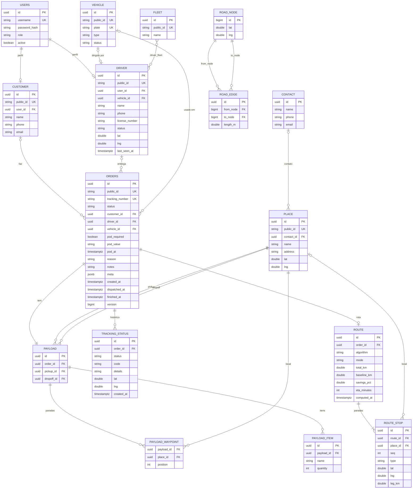

# Modelo de dados

Diagrama ER e dicionário das tabelas. As regras de negócio estão em [ARCHITECTURE.md](../ARCHITECTURE.md#fluxo-e-regras-do-pedido); aqui fica só a forma dos dados.

> Os nomes e campos são **proposta deste projeto**. Os campos reais do Fleetbase não foram verificados (ver [CREDITS.md](../CREDITS.md)). Itens marcados com `*` são decisões minhas para fechar o desenho e podem mudar.

## Diagrama

## Dicionário

### Enums (gravados como string)

| Enum | Valores |
|---|---|
| `users.role` | `ADMIN`, `DISPATCHER`, `FLEET_MANAGER`, `CUSTOMER`, `DRIVER` |
| `orders.status` e `tracking_status.status` | `CREATED`, `DISPATCHED`, `DRIVER_ENROUTE`, `ARRIVED`, `IN_PROGRESS`, `COMPLETED`, `CANCELLED`, `FAILED` |
| `driver.status` | `AVAILABLE`, `BUSY`, `OFFLINE` |
| `vehicle.status` | `AVAILABLE`, `IN_USE`, `MAINTENANCE` `*` |
| `route.algorithm` | `NEAREST_NEIGHBOR`, `TWO_OPT`, `HELD_KARP`, `SIMULATED_ANNEALING` |
| `route.mode` | `HAVERSINE`, `ROAD` |
| `route_stop.type` | `START`, `PICKUP`, `WAYPOINT`, `DROPOFF` |

### Tabelas

| Tabela | Observações |
|---|---|
| `users` | Todos os perfis na mesma tabela. `password_hash` em BCrypt. O primeiro ADMIN vem das variáveis de ambiente. |
| `customer` | 1:1 com `users` (role `CUSTOMER`). Criado em `POST /auth/register`. |
| `driver` | 1:1 com `users` (role `DRIVER`), criado em `POST /drivers`. `vehicle_id` é único: um veículo por motorista e vice-versa `*`. `lat`, `lng` e `last_seen_at` guardam só a última posição. |
| `vehicle` | `plate` único. |
| `fleet` e `driver_fleet` | N:N entre frota e motorista. `driver_fleet(driver_id, fleet_id)` tem chave composta. |
| `orders` | `tracking_number` é o código do rastreio público. `reason` só é preenchido em `CANCELLED` e `FAILED`. `version` existe para o aceite ad hoc (lock otimista). Sem `updated_at` porque o histórico fica em `tracking_status`. |
| `payload` | 1:1 com `orders` e **imutável** depois da criação. Exige `pickup_id` e `dropoff_id`. |
| `payload_waypoint` | Paradas intermediárias na ordem de cadastro (`position`), no máximo 50 por payload. Chave `(payload_id, position)`. |
| `payload_item` | Itens transportados `*`: nome e quantidade. |
| `place` | Local reutilizável. `contact_id` é opcional. |
| `contact` | Pessoa de contato de um local. |
| `tracking_status` | Uma linha por transição, **inclusive a criação**. Nunca é alterada nem apagada. Guarda a posição quando houver. |
| `route` | 1:1 com `orders` (`order_id` único). Recalcular substitui a rota anterior. |
| `route_stop` | Paradas já na ordem final (`seq`). `place_id` é nulo no `START` (posição do motorista). |
| `road_node` | Vem de `nodes.csv`. O `id` é o do arquivo, não um UUID. |
| `road_edge` | Vem de `edges.csv`. Via de mão dupla vira duas linhas. |

### Índices e restrições

- Índices de desempenho: `orders(status)`, `orders(created_at)`, `orders(finished_at)`, `tracking_status(order_id, created_at)`, `driver(status)`, `road_edge(from_node)`.
- Únicos: `users.username`, `orders.public_id`, `orders.tracking_number`, `route.order_id`, `vehicle.plate`, `driver.vehicle_id`, `driver.user_id`, `customer.user_id`, `payload.order_id`.
- Chaves estrangeiras sem `ON DELETE CASCADE` nos dados de pedido: o histórico não é apagado. Excluir motorista ou veículo com pedidos associados deve falhar (ou desativar em vez de excluir).

### Regras que o banco não garante sozinho

Ficam no `service` e têm teste (ver [SYSTEM.md](../SYSTEM.md#10-testes)):
- um motorista só ter um pedido ativo por vez;
- a transição de status ser permitida;
- o máximo de 50 waypoints;
- `pod_value` preenchido antes de `COMPLETED` quando `pod_required`;
- `reason` obrigatório em cancelamento e falha.
