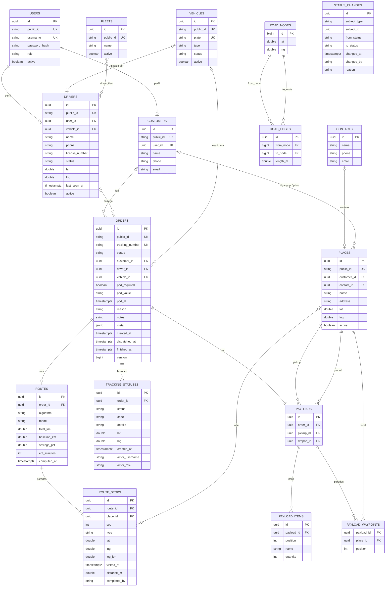

# Modelo de dados

Diagrama ER e dicionário das tabelas. As regras de negócio estão em [ARCHITECTURE.md](ARCHITECTURE.md#fluxo-e-regras-do-pedido); aqui fica só a forma dos dados.

> Os nomes e campos são **proposta deste projeto**. Os campos reais do Fleetbase não foram verificados (ver [CREDITS.md](CREDITS.md)). Itens marcados com `*` são decisões minhas para fechar o desenho e podem mudar.

## Diagrama

## Dicionário

### Enums (gravados como string)

| Enum | Valores |
|---|---|
| `users.role` | `ADMIN`, `DISPATCHER`, `FLEET_MANAGER`, `CUSTOMER`, `DRIVER` |
| `orders.status` e `tracking_statuses.status` | `CREATED`, `DISPATCHED`, `DRIVER_ENROUTE`, `ARRIVED`, `IN_PROGRESS`, `COMPLETED`, `CANCELLED`, `FAILED` |
| `drivers.status` | `AVAILABLE`, `BUSY`, `OFFLINE` |
| `vehicles.status` | `AVAILABLE`, `IN_USE`, `MAINTENANCE` `*` |
| `routes.algorithm` | `NEAREST_NEIGHBOR`, `TWO_OPT`, `HELD_KARP`, `SIMULATED_ANNEALING` |
| `routes.mode` | `HAVERSINE`, `ROAD` |
| `route_stops.type` | `START`, `PICKUP`, `WAYPOINT`, `DROPOFF` |
| `status_changes.subject_type` | `DRIVER`, `VEHICLE` |
| `status_changes.reason` | `baseline` (linha inicial), `manual`, `dispatch`, `finish` e `delete` |

### Tabelas

Motorista, veículo, frota e lugar são excluídos por soft delete: a coluna `active` vira `false` e o registro some das listagens. A linha continua no banco, então o `username` do motorista e a `plate` do veículo seguem ocupados. Motorista, veículo e lugar podem ser reativados (`POST .../reactivate`): o motorista volta `OFFLINE` e sem veículo nem frotas.

| Tabela | Observações |
|---|---|
| `users` | Todos os perfis na mesma tabela. `public_id` (`usr_...`) é único; a coluna nasceu anulável, o startup preenche os antigos e o código passa a exigir. `password_hash` em BCrypt. O primeiro ADMIN vem das variáveis de ambiente. `active = false` bloqueia login e REST e STOMP na próxima requisição. |
| `customers` | 1:1 com `users` (role `CUSTOMER`). Criado em `POST /auth/register`. Lista só leitura em `GET /customers`. |
| `drivers` | 1:1 com `users` (role `DRIVER`), criado em `POST /drivers`. `vehicle_id` é único: um veículo por motorista e vice-versa `*`. `lat`, `lng` e `last_seen_at` guardam só a última posição. |
| `vehicles` | `plate` único. |
| `fleets` e `driver_fleet` | N:N entre frota e motorista. `driver_fleet(driver_id, fleet_id)` tem chave composta. |
| `orders` | `tracking_number` é o código do rastreio público, no formato `KJ` + 8 caracteres de `A-Z` e `0-9`. `reason` só é preenchido em `CANCELLED` e `FAILED`. `notes` tem até 500 caracteres. `version` é o `@Version` do JPA. Atribuir, despachar e aceitar travam a linha com `PESSIMISTIC_WRITE`, na ordem pedido, motorista, veículo. Sem `updated_at` porque o histórico fica em `tracking_statuses`. |
| `payloads` | 1:1 com `orders` e **imutável** depois da criação. Exige `pickup_id` e `dropoff_id`. |
| `payload_waypoints` | Paradas intermediárias na ordem de cadastro (`position`), no máximo 50 por payload. Chave `(payload_id, position)`. |
| `payload_items` | Itens transportados `*`: `name`, `quantity` e `position` (ordem de cadastro). No máximo 100 por payload. A FK `payload_id` fica aqui (relação unidirecional a partir de `payloads`). |
| `places` | Local reutilizável. Lugar novo criado dentro de um pedido também vira linha aqui. `contact_id` é opcional. `customer_id` é opcional: nulo = lugar da equipe (listado em `/places`); preenchido = lugar do cliente (só em `/customer/places`, e usável nos pedidos dele). |
| `contacts` | Pessoa de contato de um local. |
| `tracking_statuses` | Uma linha por evento, **inclusive a criação**. `status` é o estado do pedido depois do evento; `code` é o evento em texto, minúsculas (lista em [ARCHITECTURE.md](ARCHITECTURE.md#fluxo-e-regras-do-pedido)). Nunca é alterada nem apagada. Guarda a posição quando houver. `actor_username` e `actor_role` dizem quem gerou o evento (nulos em eventos do sistema). |
| `status_changes` | Histórico de status de motorista e de veículo (`subject_type` escolhe a tabela de `subject_id`, sem FK). `changed_by` é o username ou `system`. Na subida da aplicação, quem ainda não tem histórico ganha uma linha `baseline` com o status atual. Excluir grava uma linha `delete` com `from_status` igual a `to_status`. É lida pelo painel de desempenho (tempo em `BUSY`) e pelos alertas de status e de manutenção. |
| `routes` | 1:1 com `orders` (`order_id` único). Recalcular substitui a rota anterior. `eta_minutes` é o do cálculo; o ETA vivo não é gravado. |
| `route_stops` | Paradas já na ordem final (`seq`). `place_id` é nulo no `START` (posição do motorista). `visited_at` marca a conclusão; `distance_m` é a distância do motorista até a parada (nulo se a equipe concluiu sem posição); `completed_by` é o username de quem concluiu. |
| `road_nodes` | Subprojeto 6. Vem de `nodes.csv`. O `id` é o do arquivo, não um UUID. |
| `road_edges` | Subprojeto 6. Vem de `edges.csv`. Via de mão dupla vira duas linhas. |

### Índices e restrições

- Índices de desempenho: `orders(status)`, `orders(created_at)`, `orders(finished_at)`, `orders(status, created_at)`, `orders(driver_id, finished_at)`, `tracking_statuses(order_id, created_at)`, `status_changes(subject_type, subject_id, changed_at)`, `drivers(status)`, `routes(computed_at)`, `places(customer_id)` (`idx_places_customer`), `road_edges(from_node)` (subprojeto 6).
- Únicos: `users.username`, `users.public_id`, `orders.public_id`, `orders.tracking_number`, `routes.order_id`, `vehicles.plate`, `drivers.vehicle_id`, `drivers.user_id`, `customers.user_id`, `payloads.order_id`.
- Chaves estrangeiras sem `ON DELETE CASCADE` nos dados de pedido: o histórico não é apagado. Excluir motorista ou veículo com pedidos associados deve falhar (ou desativar em vez de excluir).

### Regras que o banco não garante sozinho

Ficam no `service` e têm teste (ver [SYSTEM.md](SYSTEM.md#10-testes)):
- um motorista só ter um pedido ativo por vez (o despacho e o aceite conferem isso com a linha dele travada);
- a transição de status ser permitida;
- o máximo de 50 waypoints e de 100 itens;
- `pod_value` preenchido antes de `COMPLETED` quando `pod_required`;
- `reason` obrigatório em cancelamento e falha;
- parada `WAYPOINT` concluída uma vez só (repetir não muda nada) e conclusão pelo motorista só dentro do raio (`STOP_TOO_FAR`).
