# Fluxos da KJ Fleets

Diagramas em Mermaid (renderizam no GitHub, no preview de Markdown do IntelliJ e em https://mermaid.live). Nos caminhos, `id` representa o `publicId` do recurso.

## 1. Fluxo geral

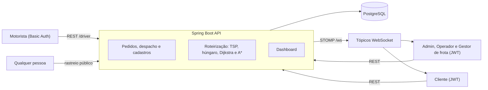

## 2. Ciclo de vida do pedido

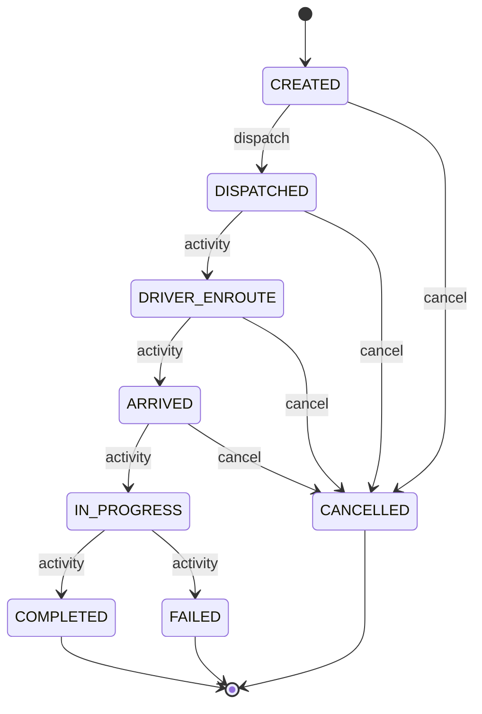

## 3. Criar pedido (equipe ou cliente)

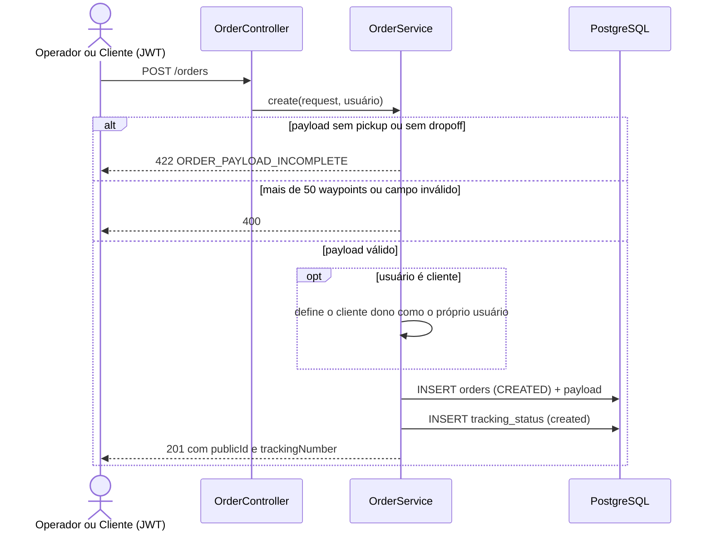

## 4. Despachar pedido (validações)

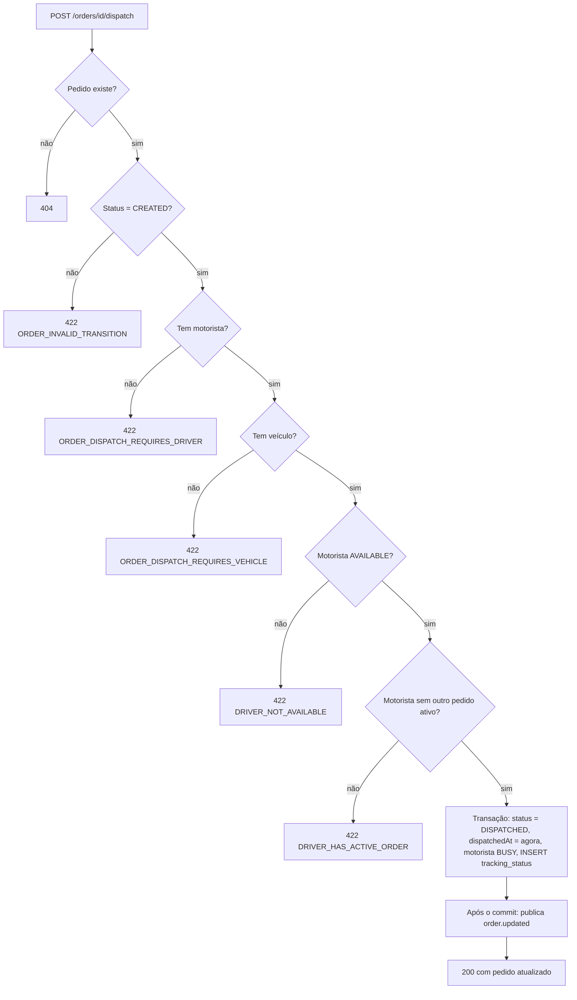

## 5. Avançar o fluxo (activity)

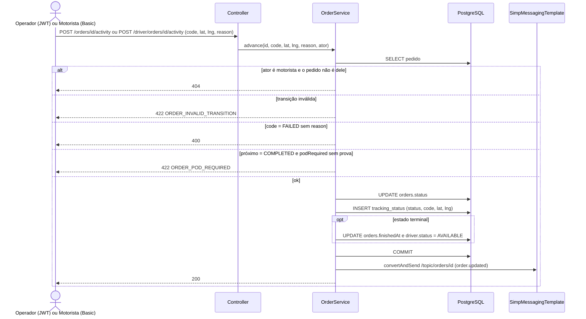

## 6. Ping de localização do motorista

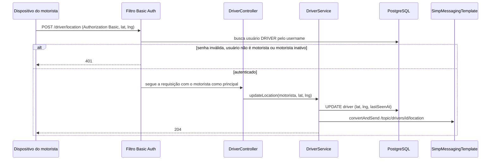

## 7. Cadastro, login e WebSocket

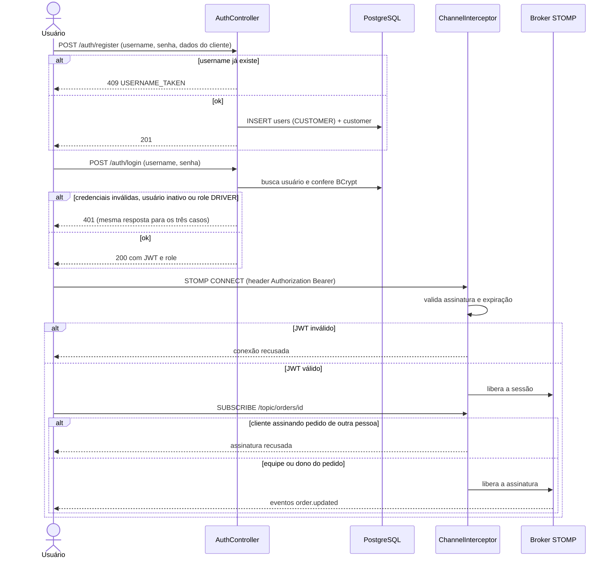

## 8. Aceite ad hoc concorrente (diferencial opcional)

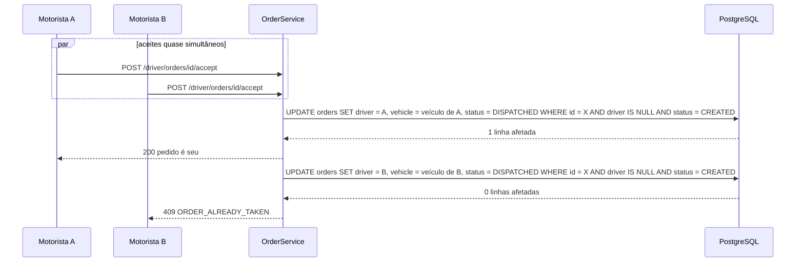

## 9. Atribuir motorista e veículo (antes do despacho)

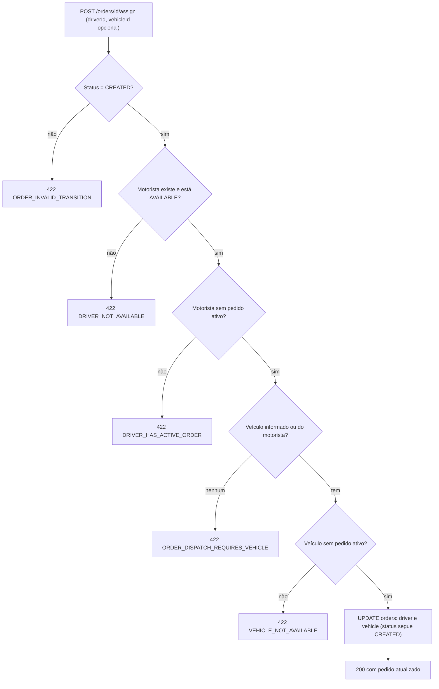

## 10. Cancelar pedido

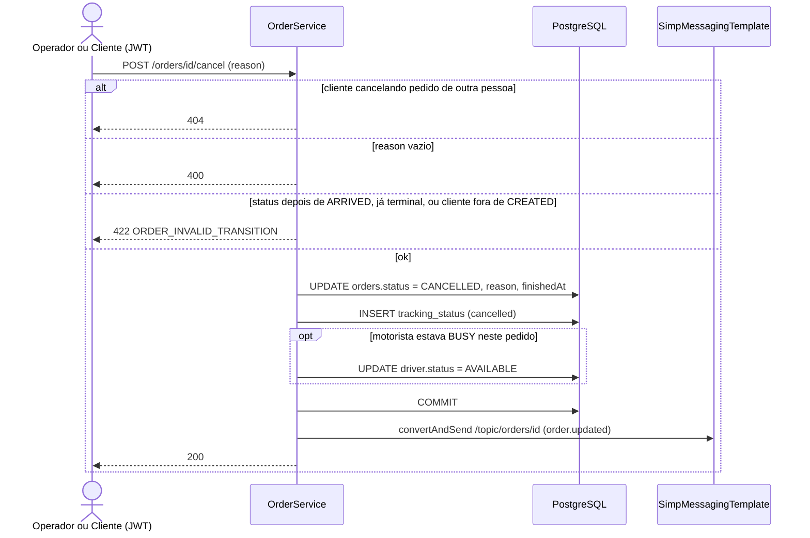

## 11. Registrar prova de entrega (POD)

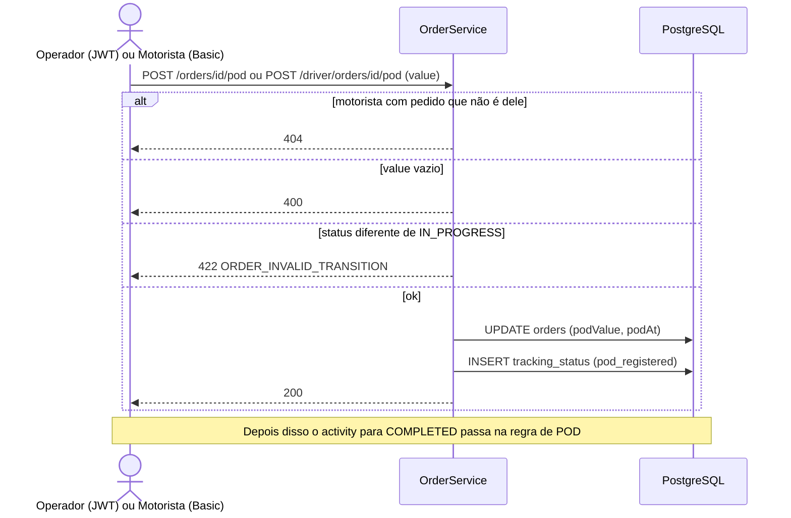

## 12. Motoristas mais próximos

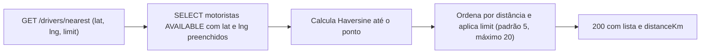

## 13. Otimizar a rota de um pedido

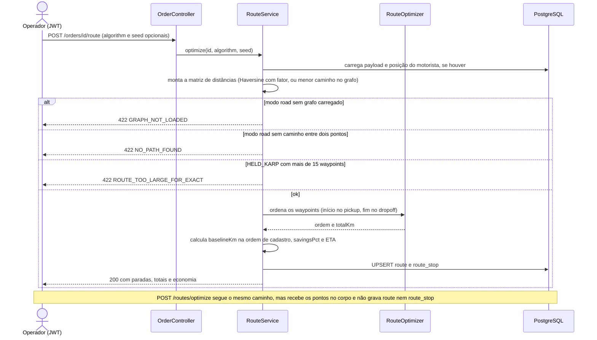

## 14. Despacho em lote (plano e aplicação)

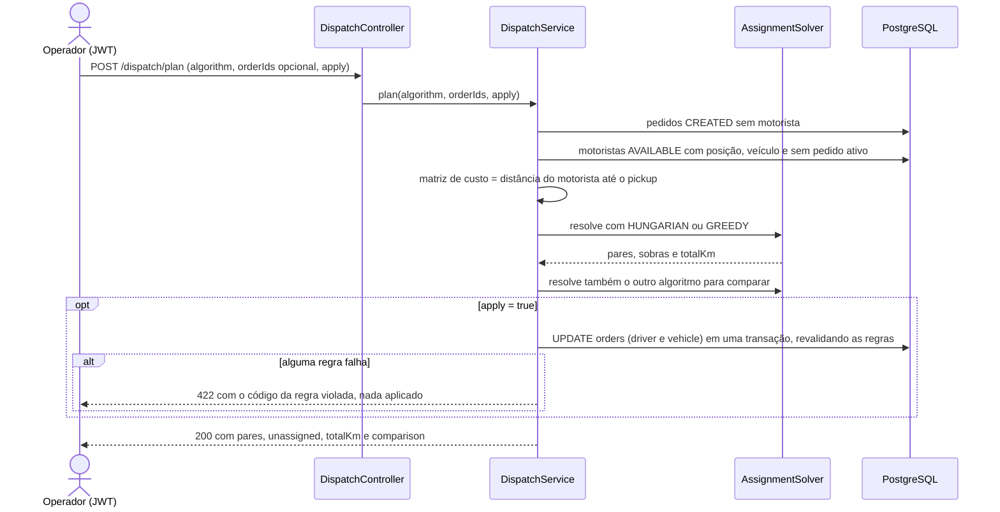

## 15. Menor caminho no grafo viário e importação

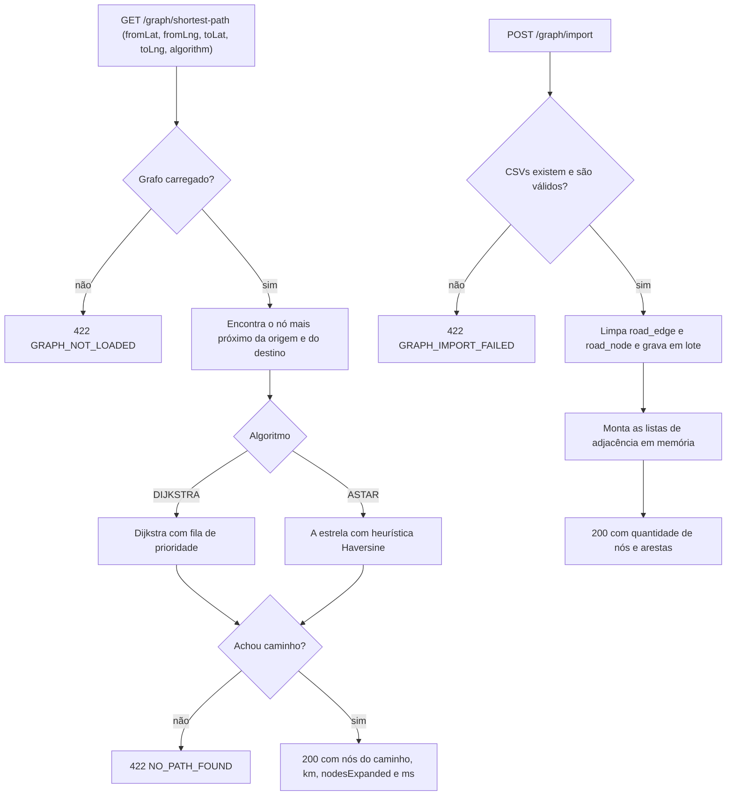

## 16. Dashboard

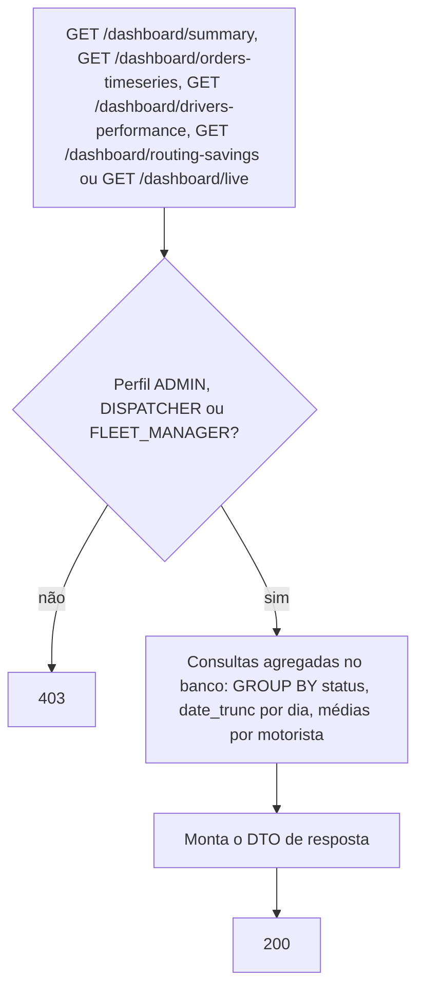

## 17. Rastreio público

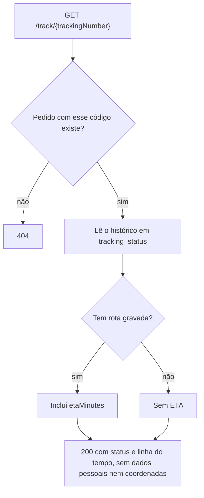
