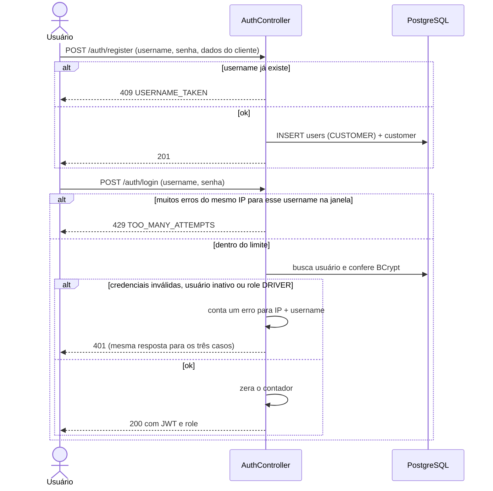
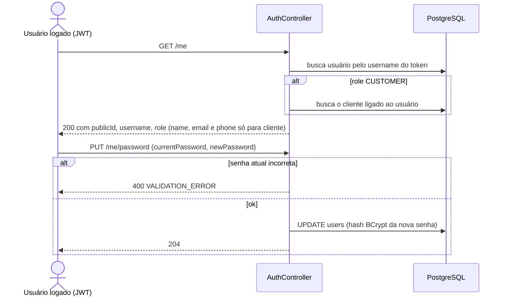
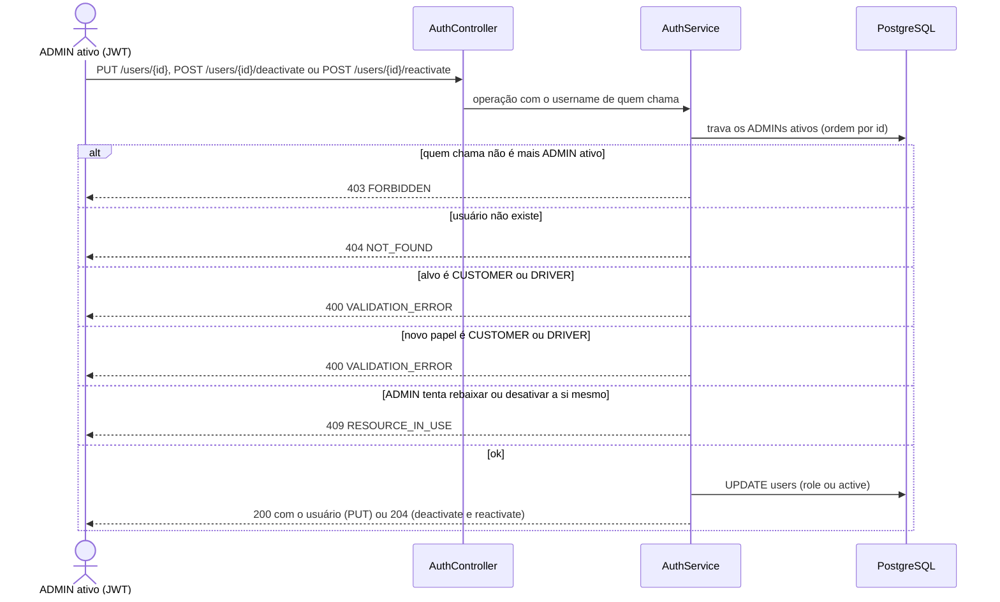

# Fluxos — Autenticação

Cadastro, login, perfil e administração de usuários. A conexão WebSocket está nos fluxos 22 a 24, em [flow-websocket.md](flow-websocket.md). Índice em [flow-index.md](flow-index.md).

## 7. Cadastro e login

## 25. Perfil e troca de senha

Tokens já emitidos continuam válidos até expirar. A troca não revoga nada.

## 26. Usuários da equipe (ADMIN)

Desativar ou trocar o papel vale na próxima requisição, porque o filtro JWT relê o usuário do banco a cada chamada: usuário desativado recebe 401 (não é autenticado) e rebaixado recebe 403 pela regra de papel. Reativar é idempotente: usuário já ativo responde 204 sem mudar nada.
