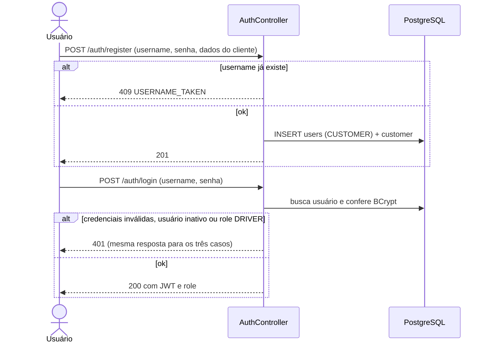

# Fluxos — Autenticação

Cadastro e login. A conexão WebSocket está nos fluxos 22 a 24, em [flow-websocket.md](flow-websocket.md). Índice em [flow-index.md](flow-index.md).

## 7. Cadastro e login

