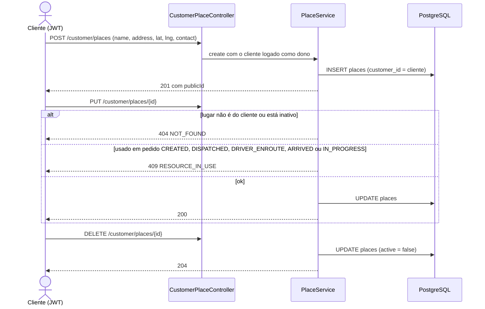
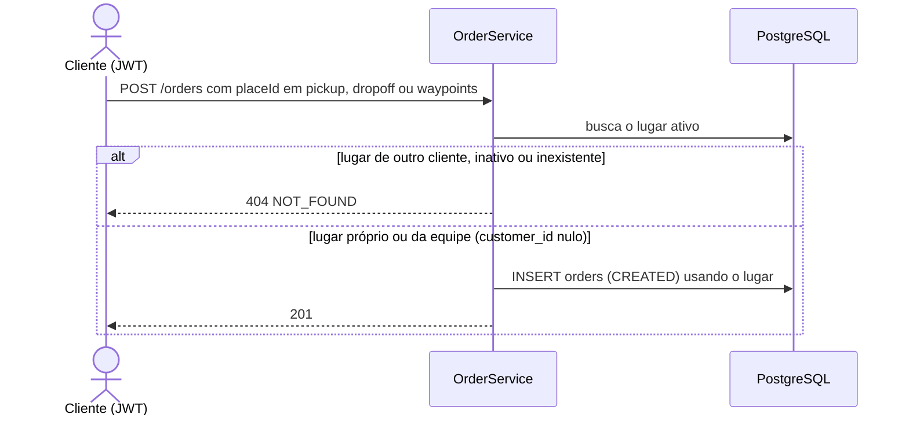

# Fluxos — Lugares do cliente

Meus endereços: o cliente cadastra e edita os próprios lugares e os usa nos pedidos. Índice em [flow-index.md](flow-index.md).

## 27. Meus endereços e uso no pedido

Lugar novo enviado dentro do pedido (name, lat e lng, sem `placeId`) vira lugar do próprio cliente. O `GET /customer/places` lista só os lugares dele, sem os inativos. Lugares da equipe não aparecem aqui.
