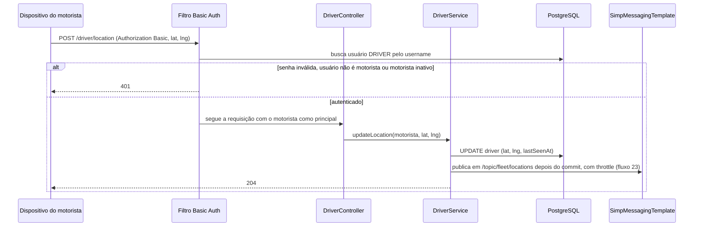
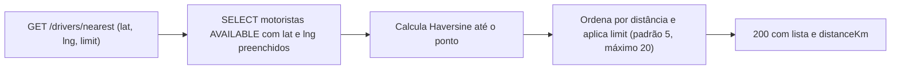
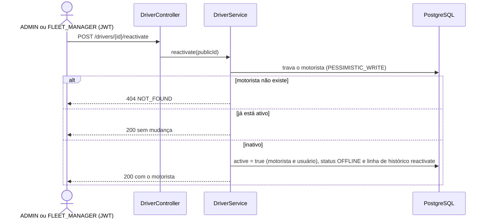

# Fluxos — Motoristas

Posição do motorista e busca dos mais próximos. Índice em [flow-index.md](flow-index.md).

## 6. Ping de localização do motorista

## 12. Motoristas mais próximos

## 28. Reativação de motorista e veículo

O motorista volta `OFFLINE`, sem veículo e sem frotas. O veículo segue a mesma ideia com `POST /vehicles/{id}/reactivate`, mas mantém o status que tinha e não recebe motorista de volta. A reativação não colide com outro cadastro, porque `username` e `plate` continuam reservados enquanto o cadastro está inativo.
