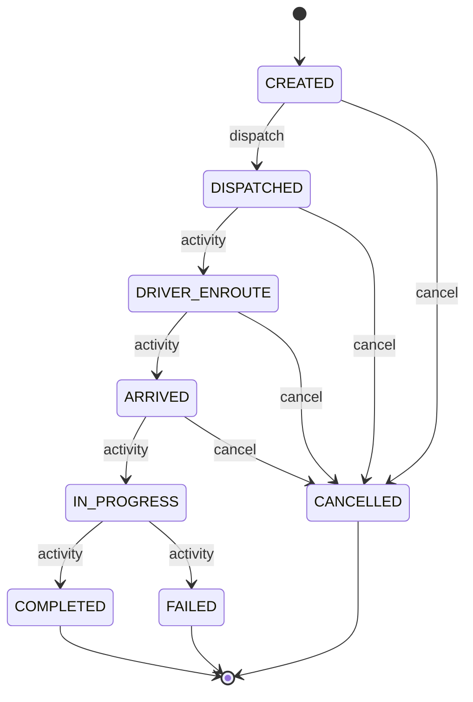
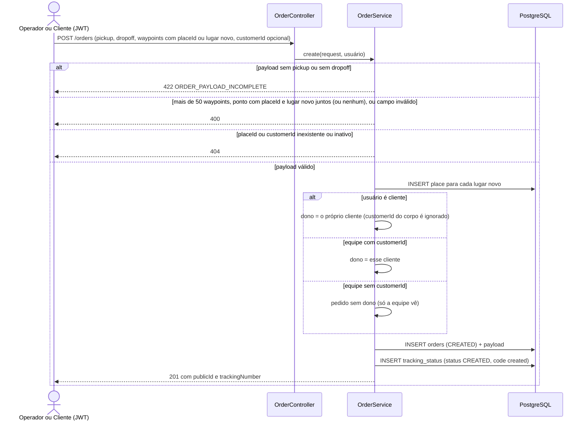
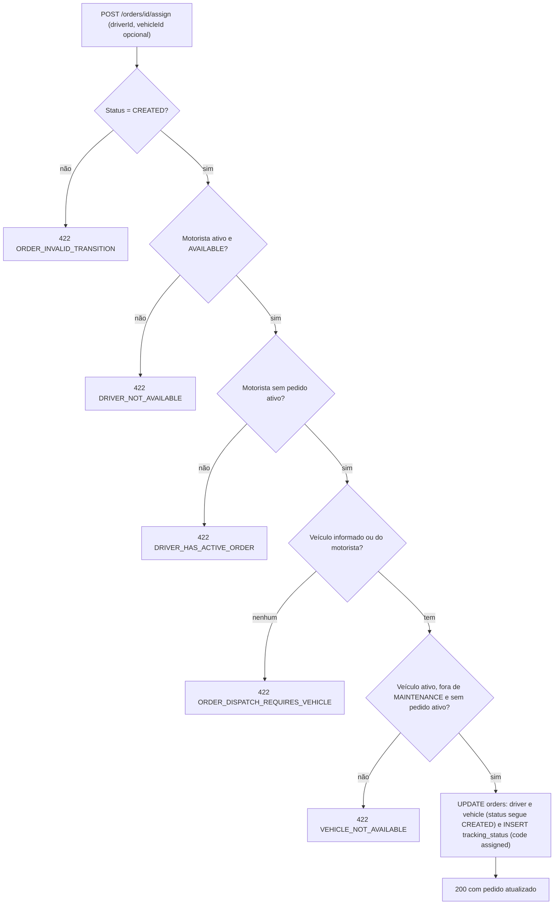
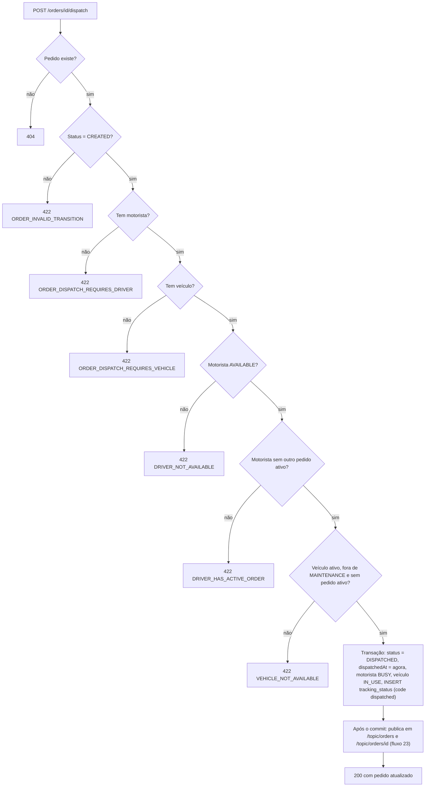
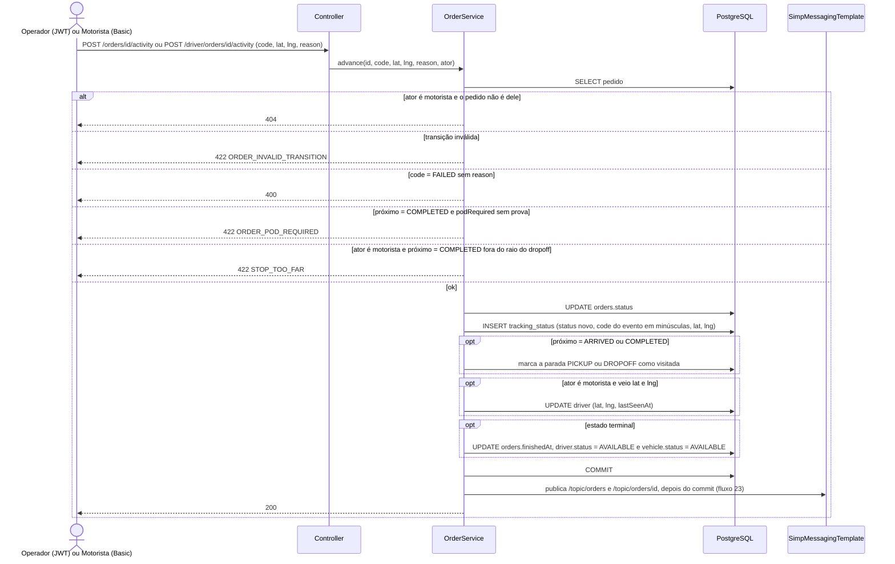
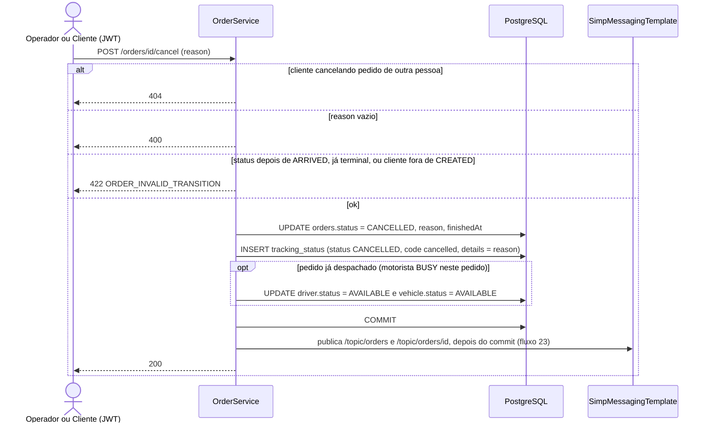
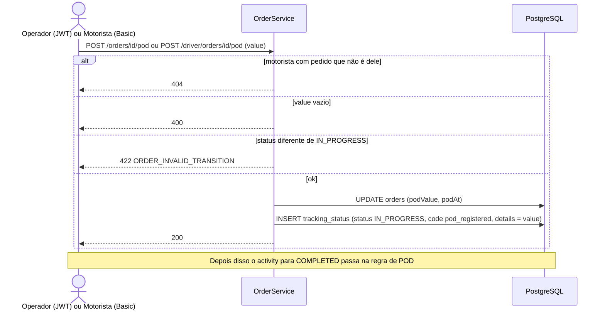
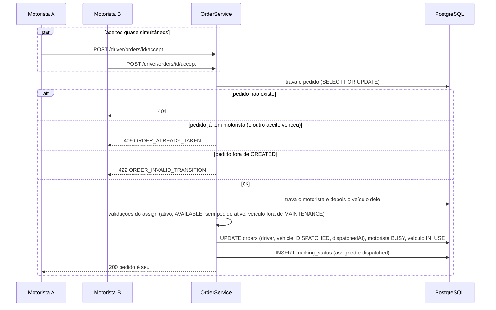

# Fluxos — Pedidos

Ciclo de vida do pedido: criar, atribuir, despachar, avançar, cancelar, POD e aceite ad hoc. Índice em [flow-index.md](flow-index.md).

## 2. Ciclo de vida do pedido

## 3. Criar pedido (equipe ou cliente)

Lugares criados no pedido viram `Place` comum e aparecem em `GET /places`. A equipe acha o `customerId` em `GET /customers` (só leitura).

### Códigos do histórico (`tracking_status.code`)

`status` é o estado do pedido depois do evento (enum em maiúsculas). `code` é o evento, em minúsculas: `created`, `assigned`, `dispatched`, `driver_enroute`, `arrived`, `in_progress`, `pod_registered`, `completed`, `failed`, `cancelled`, `unassigned`, `stop_completed` e `route_failed` (roteirização). `assigned`, `unassigned`, `pod_registered`, `stop_completed` e `route_failed` não mudam o status. `route_failed` traz o código da falha em `details`. `unassigned` aparece quando um motorista ou veículo é desativado e solto de pedidos `CREATED`. O `code` do corpo de `activity` é outra coisa: o estado de destino pedido, em maiúsculas (`"code": "ARRIVED"`).

## 9. Atribuir motorista e veículo (antes do despacho)

Atribuir não ocupa o motorista: o mesmo motorista pode estar em vários pedidos `CREATED` (fila). Só o despacho o torna `BUSY`; enquanto ele estiver ocupado, despachar ou atribuir outro pedido a ele responde 422 `DRIVER_NOT_AVAILABLE`. Um novo `assign` em `CREATED` substitui o anterior.

## 4. Despachar pedido (validações)

## 5. Avançar o fluxo (activity)

O motorista só pede `DRIVER_ENROUTE`, `ARRIVED`, `IN_PROGRESS`, `COMPLETED` ou `FAILED`. Quando a equipe avança em nome dele, o `details` registra quem fez (ex.: `por operador1`). `ARRIVED` marca a parada de coleta como visitada, sem checagem de distância. `COMPLETED` marca a de entrega e, para o motorista, só vale dentro do raio do dropoff (ver fluxo 18).

## 10. Cancelar pedido

## 11. Registrar prova de entrega (POD)

## 8. Aceite ad hoc concorrente (diferencial opcional)

Só um aceite leva o pedido: quem chega depois encontra o motorista gravado e recebe 409. A trava segue a ordem fixa do sistema (pedido, motorista, veículo).
