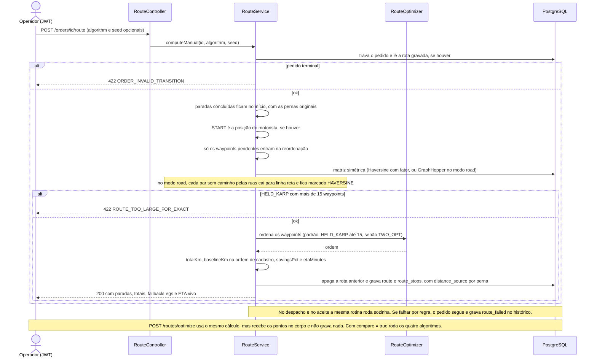
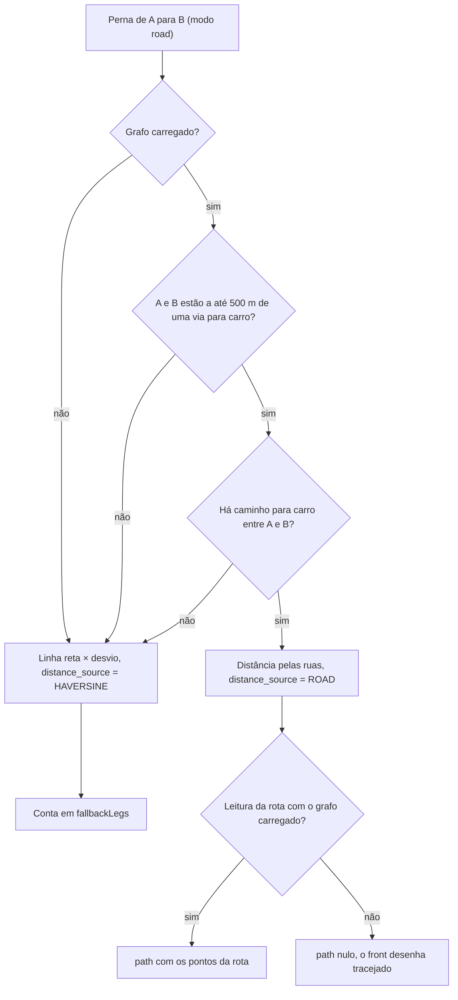
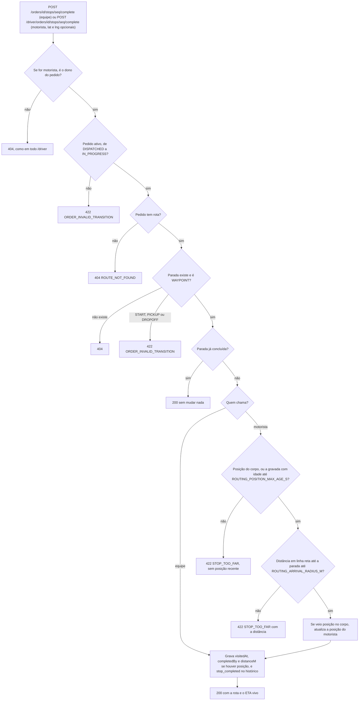
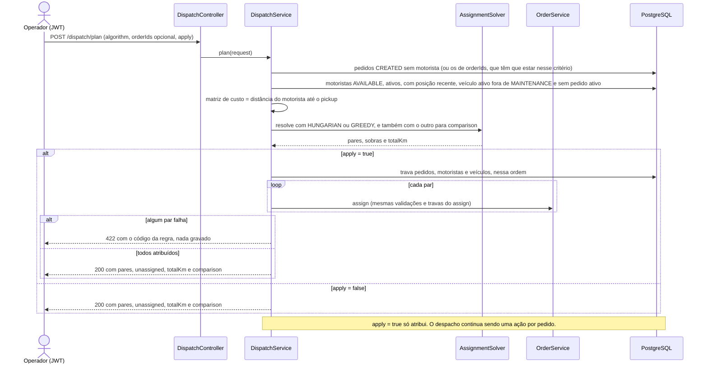
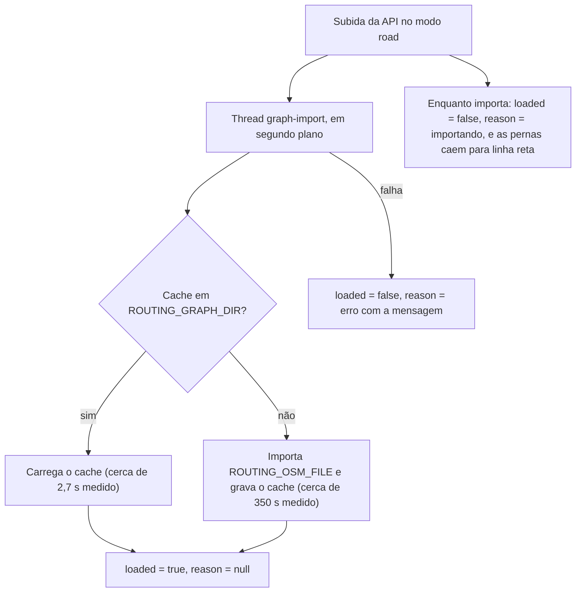
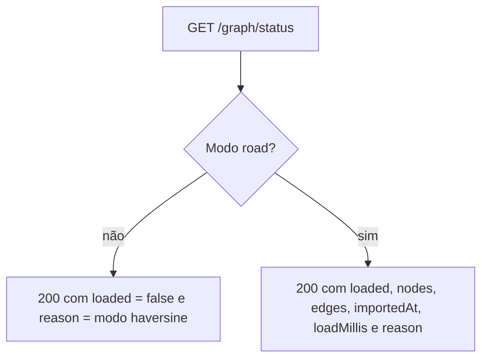
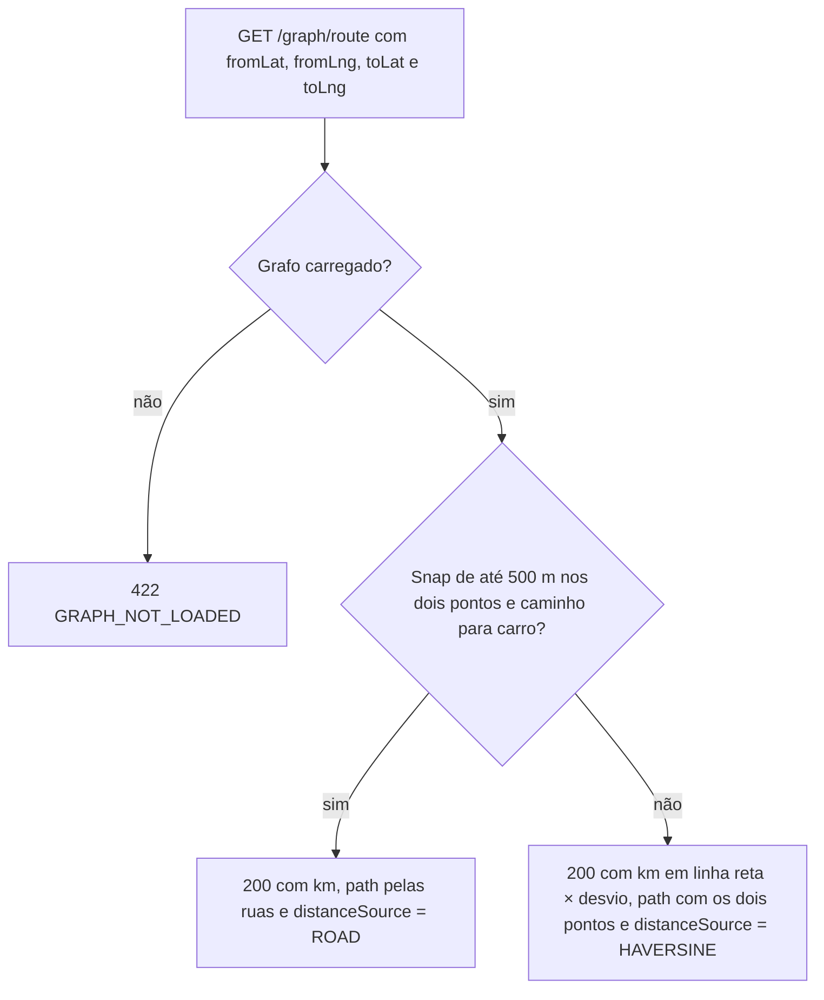

# Fluxos — Roteirização

Rota do pedido, conclusão de paradas, despacho em lote e grafo viário. Índice em [flow-index.md](flow-index.md).

## 13. Calcular a rota de um pedido

Decisão de cada perna no modo `road`. A perna nunca falha: ou vem das ruas, ou cai para linha reta e é contada em `fallbackLegs`. Um waypoint fora do grafo gera 2 pernas de fallback (a que chega e a que sai).

## 18. Concluir parada

`ARRIVED` marca o `PICKUP` e `COMPLETED` marca o `DROPOFF`, pelo fluxo 5. O `COMPLETED` do motorista usa a mesma checagem de raio, mas contra o dropoff, com ou sem rota calculada.

## 14. Despacho em lote (plano e aplicação)

## 15. Grafo viário: status, importação e rota ponto a ponto

Só `road` tem dados. Os três fluxos abaixo são de staff (ADMIN, DISPATCHER, FLEET_MANAGER).

