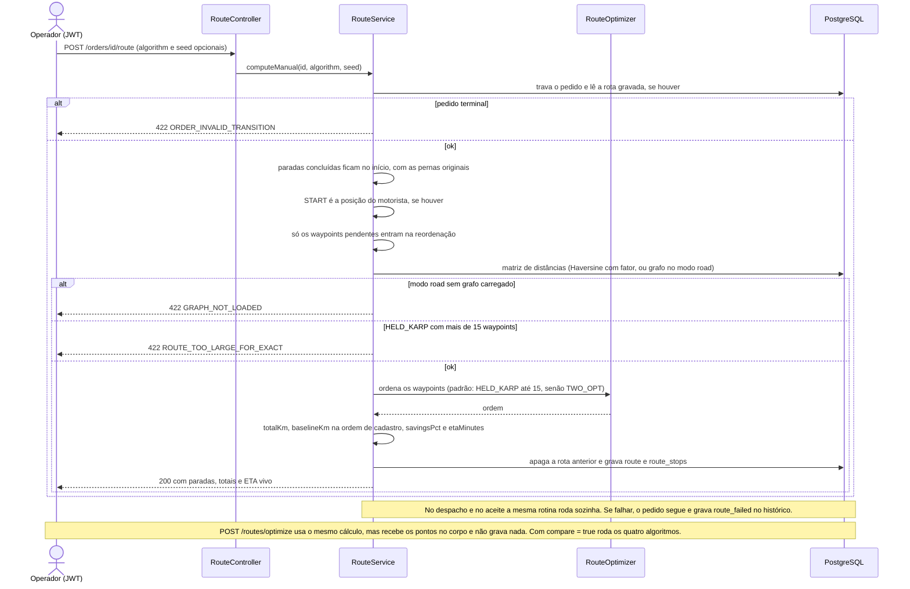
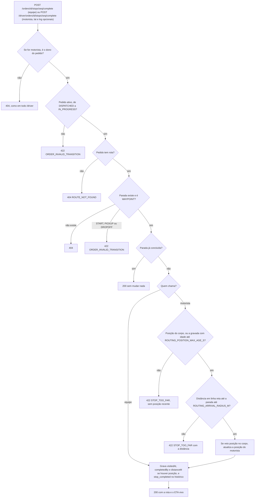
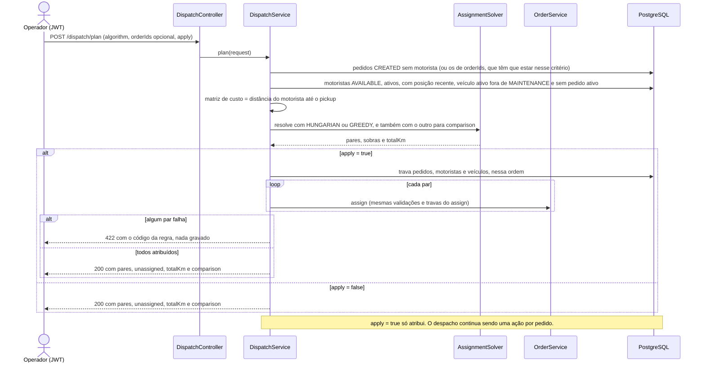
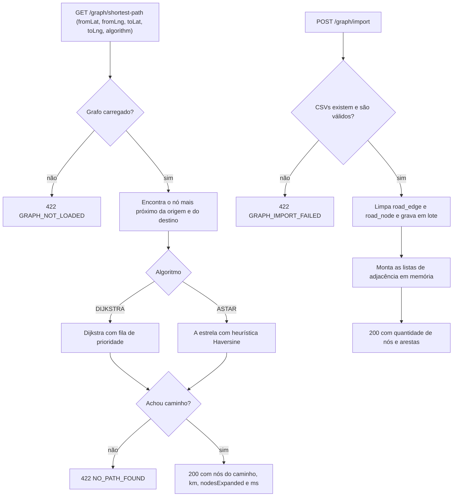

# Fluxos — Roteirização

Rota do pedido, conclusão de paradas, despacho em lote e grafo viário. Índice em [flow-index.md](flow-index.md).

## 13. Calcular a rota de um pedido

## 18. Concluir parada

`ARRIVED` marca o `PICKUP` e `COMPLETED` marca o `DROPOFF`, pelo fluxo 5. O `COMPLETED` do motorista usa a mesma checagem de raio, mas contra o dropoff, com ou sem rota calculada.

## 14. Despacho em lote (plano e aplicação)

## 15. Menor caminho no grafo viário e importação

