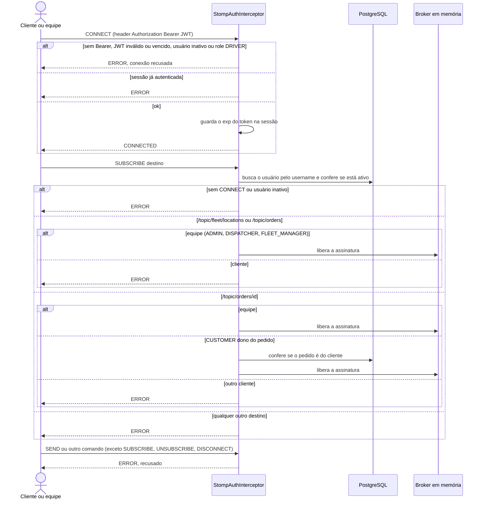
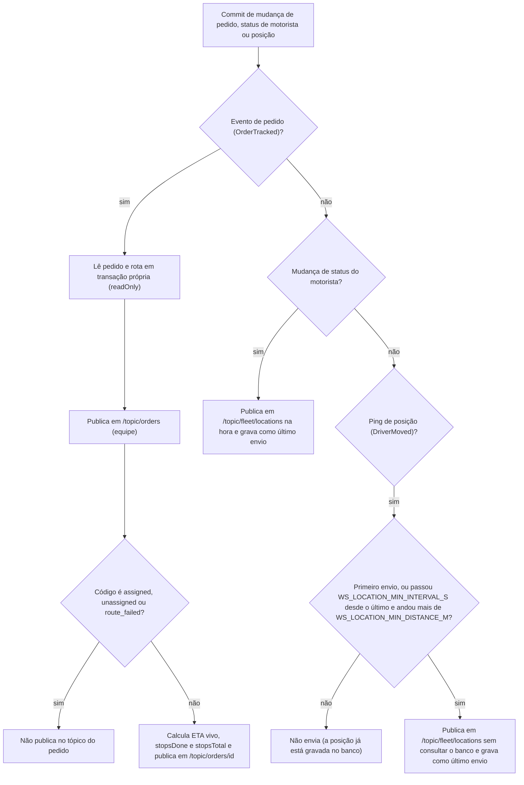
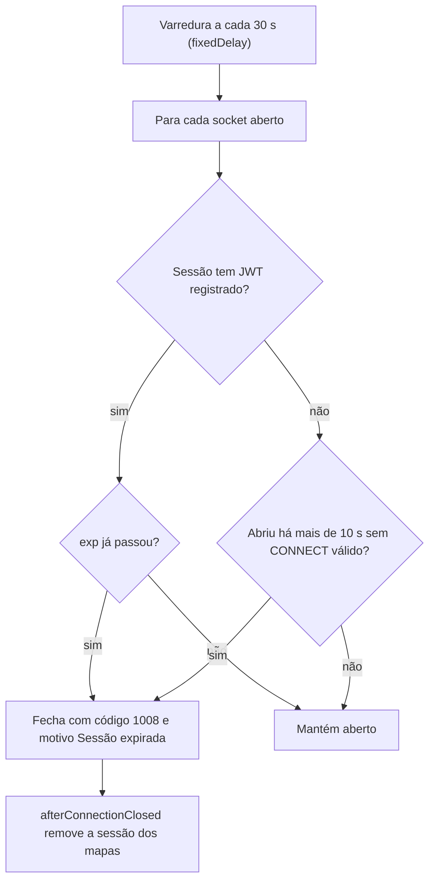

# Fluxos — WebSocket

Conexão STOMP, autorização das assinaturas, publicação com throttle e expiração de sessão. Índice em [flow-index.md](flow-index.md). Payloads e regras em [ARCHITECTURE.md](../../../ARCHITECTURE.md#websocket).

## 22. Conexão e assinatura

## 23. Publicação depois do commit, com throttle de posição

Rollback não gera nada: os listeners são `AFTER_COMMIT`. Falha no envio só gera log e não afeta a resposta da API.

## 24. Varredura de expiração

