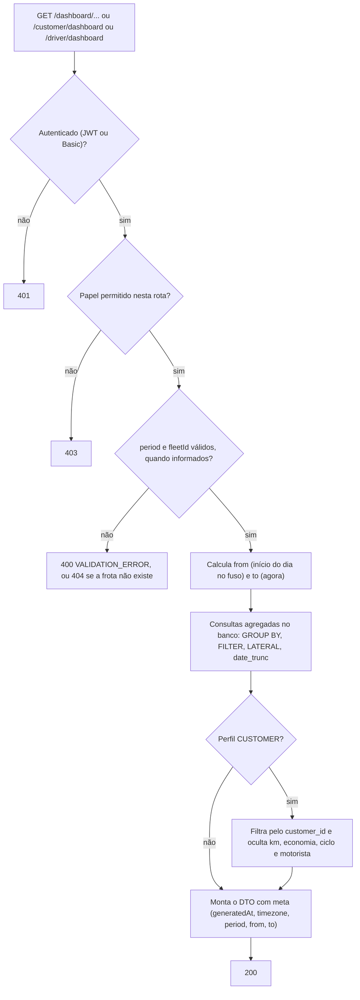
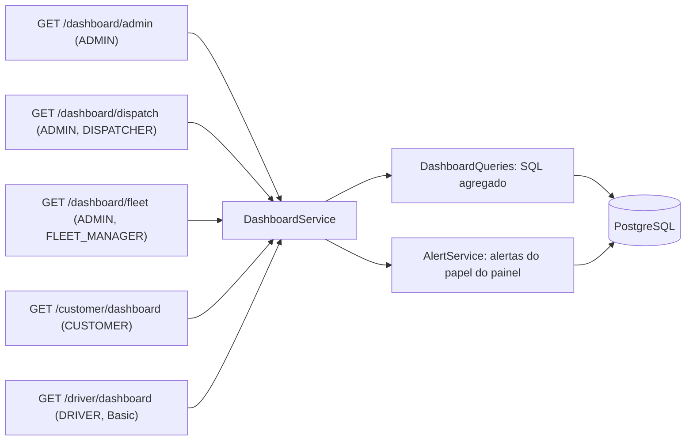
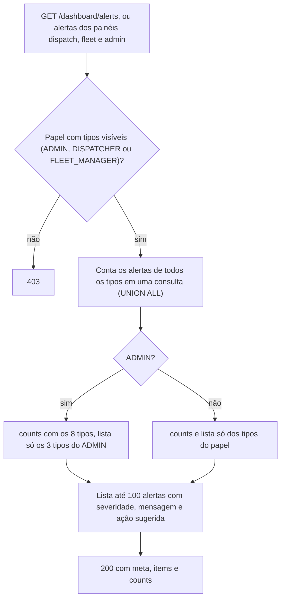
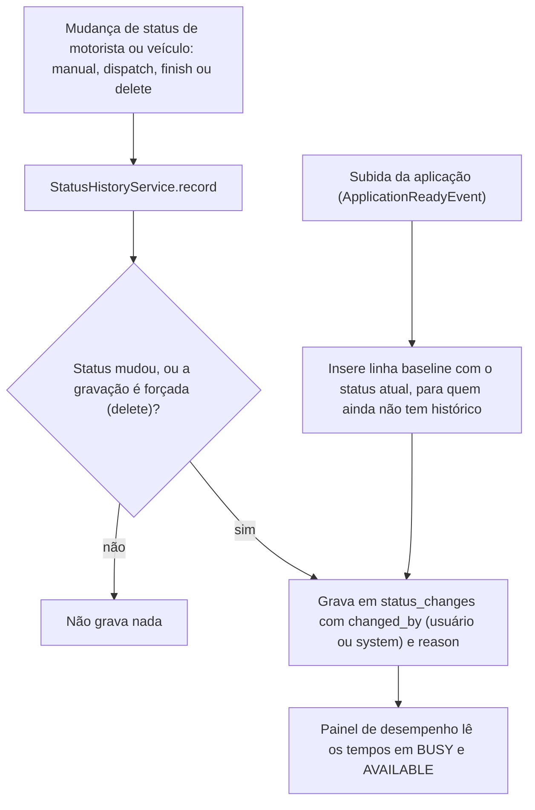

# Fluxos — Dashboard

Tópicos (um número ou lista por vez), painéis por perfil, alertas e histórico de status que alimenta os tempos. Índice em [flow-index.md](flow-index.md). Regras e tabelas em [ARCHITECTURE.md](../ARCHITECTURE.md#dashboard).

## 16. Dashboard: tópicos e painéis

Endpoints sem `period` (funil, fila, status da frota sem `fleetId`, tendência anual, alertas) pulam a validação de período; o painel do motorista usa sempre o dia de hoje.

## 19. Painel por perfil

Cada painel reúne tópicos do mesmo `DashboardService`. A equipe filtra alertas pelo papel do painel, mesmo quando quem chama é ADMIN.

## 20. Alertas

## 21. Histórico de status

Motorista e veículo guardam o histórico em `status_changes`. Os tempos de ocupação do painel de desempenho leem essa tabela.

