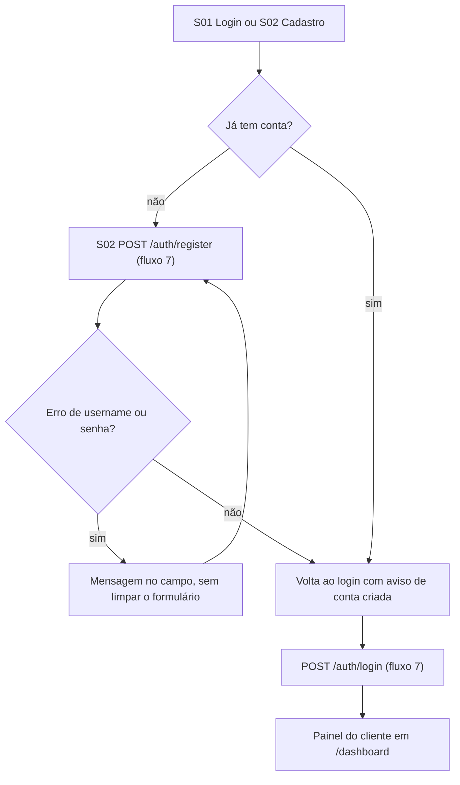
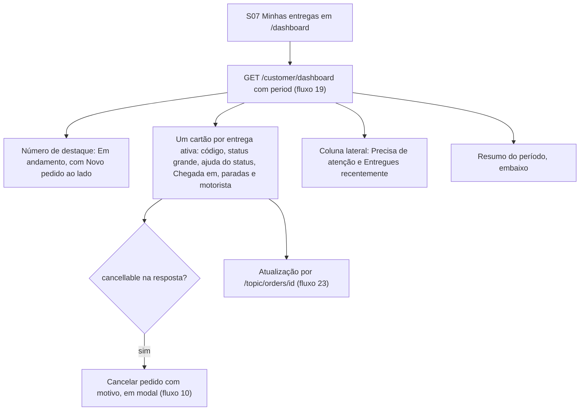
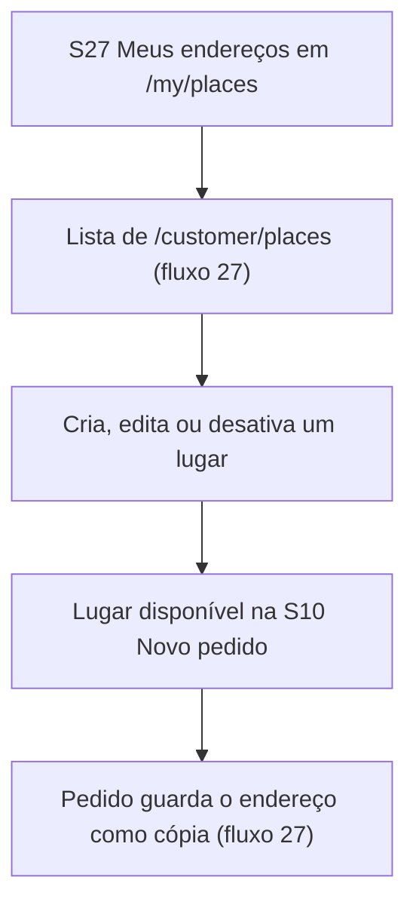
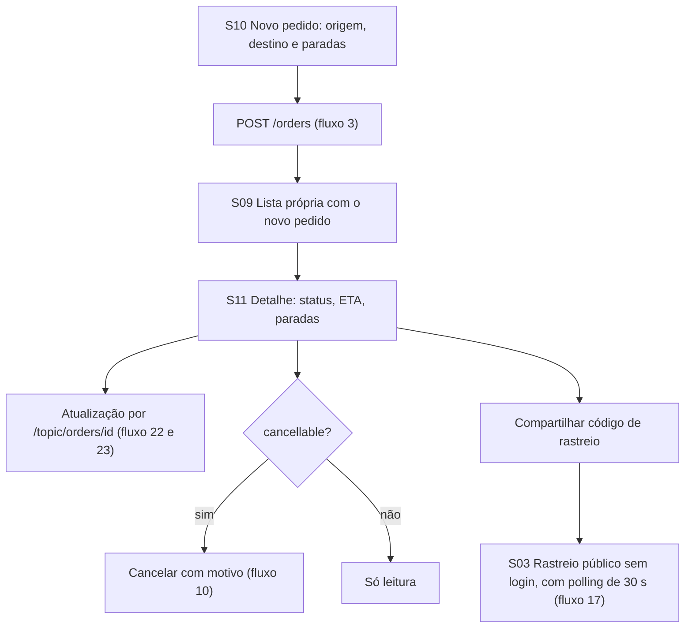
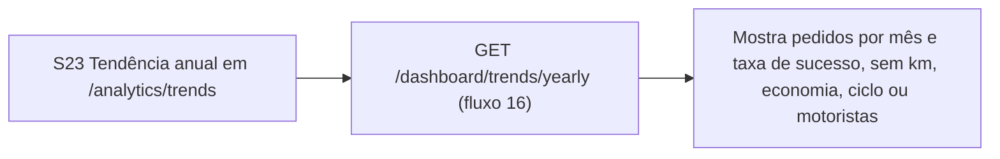
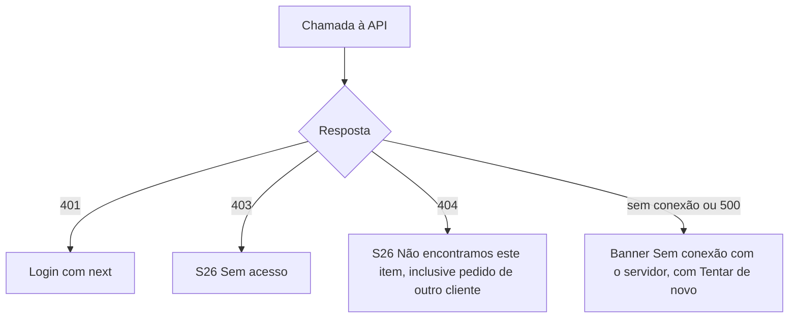

# Fluxos — Jornada do cliente

O que o cliente percorre no navegador, do cadastro ao acompanhamento do pedido. Índice em [flow-index.md](flow-index.md).

Nenhuma tela do cliente usa o mapa contínuo. Todas ficam sobre o fundo ambiente, com o conteúdo em cartões de vidro, menos o login e o cadastro, que ficam sobre um mapa estático.

## Cadastro e entrada

S01 e S02 são um cartão de vidro centrado sobre o mapa estático, sem interação. O cartão de login tem os links "Criar conta" e "Rastrear pedido".

## Painel do cliente

O seletor de período fica no bloco de título. "Precisa de atenção" só aparece quando há pedido que falhou ou está parado. Sem nenhum pedido, a tela mostra só o estado vazio com "Novo pedido".

## Endereços

A S27 mostra a lista de endereços ao lado de um mapa em vidro com os pinos. Escolher um endereço na lista mostra "Editar" e "Remover". "Novo endereço" e "Editar" abrem o `SidePanel` com o formulário, e o clique no mapa marca o ponto. "Remover" pede confirmação em modal.

## Pedido e acompanhamento

O cliente nunca vê posição do motorista, fila, desempenho nem histórico interno. A S11 mostra só as paradas, o ETA que a API informa e o motorista pelo nome.

A S11 do cliente tem duas colunas de cartões, que viram uma só abaixo de 1100 px:

- **Situação do pedido:** status grande com a frase de ajuda, "Chegada estimada" em número de destaque, o trilho da jornada, o progresso das paradas que chega pelo evento do pedido e o motorista pelo nome.
- **Paradas:** linha do tempo com o endereço de cada parada.
- **Linha do tempo:** o nome e a hora de cada evento, sem detalhes nem coordenadas.
- **Carga:** itens, prova de entrega, motivo e observação.
- **Bloco de título:** "Copiar link público" e, enquanto o pedido está em CREATED, "Cancelar pedido".

A S03 é um cartão de vidro sobre o fundo ambiente, com o campo do código e o botão "Rastrear". O resultado mostra o status grande, a ajuda do status, "Chegada estimada" e a linha do tempo dos eventos.

## Minha conta

A S28 tem dois cartões: os dados do usuário, com o busto e a figura inteira do perfil, e "Trocar senha" (`PUT /me/password`, fluxo 25).

## Análises do cliente

## Erros que o cliente vê

Os códigos seguem o contrato de erro da API (`ErrorResponse`), e a mensagem de cada um vem de `frontend/src/api/errors.ts`.
