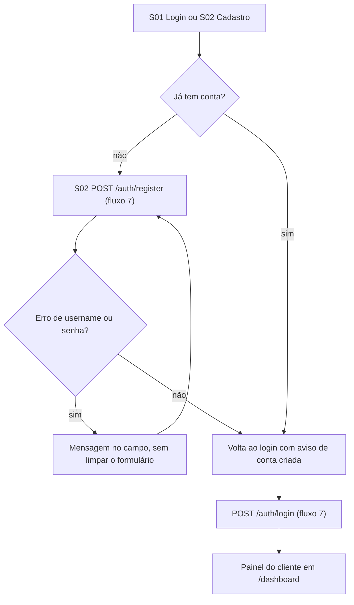
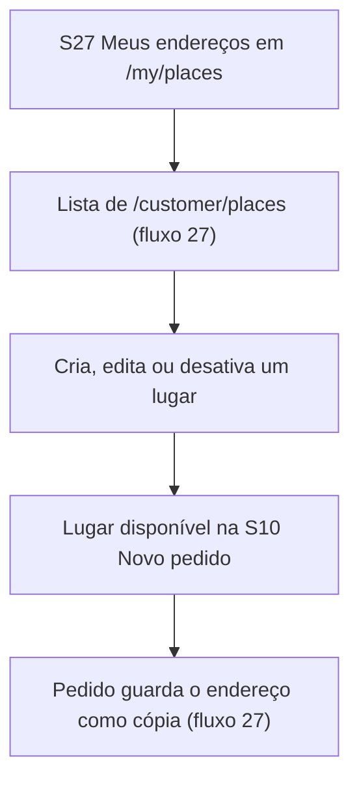
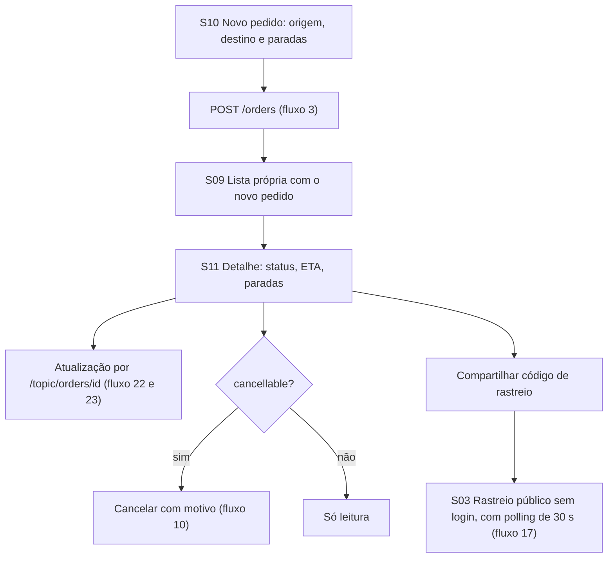
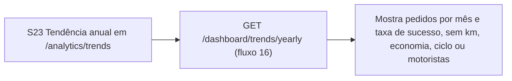
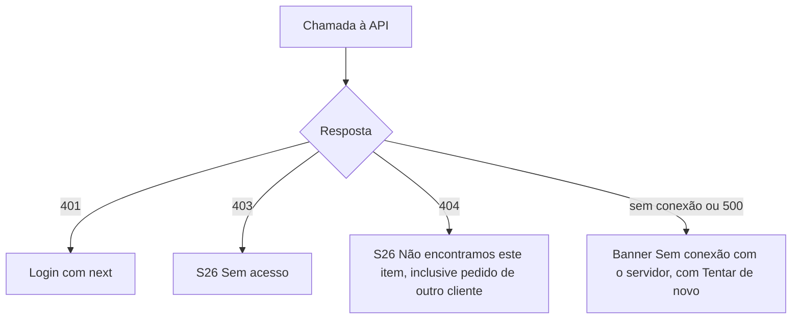

# Fluxos — Jornada do cliente

O que o cliente percorre no navegador, do cadastro ao acompanhamento do pedido. Índice em [flow-index.md](flow-index.md).

## Cadastro e entrada

## Endereços

## Pedido e acompanhamento

O cliente nunca vê posição do motorista, fila, desempenho nem histórico interno. A S11 mostra só as paradas, o ETA que a API informa e o motorista pelo nome.

## Análises do cliente

## Erros que o cliente vê

Os códigos seguem o contrato de erro da API (`ErrorResponse`), e a mensagem de cada um vem de `frontend/src/api/errors.ts`.
