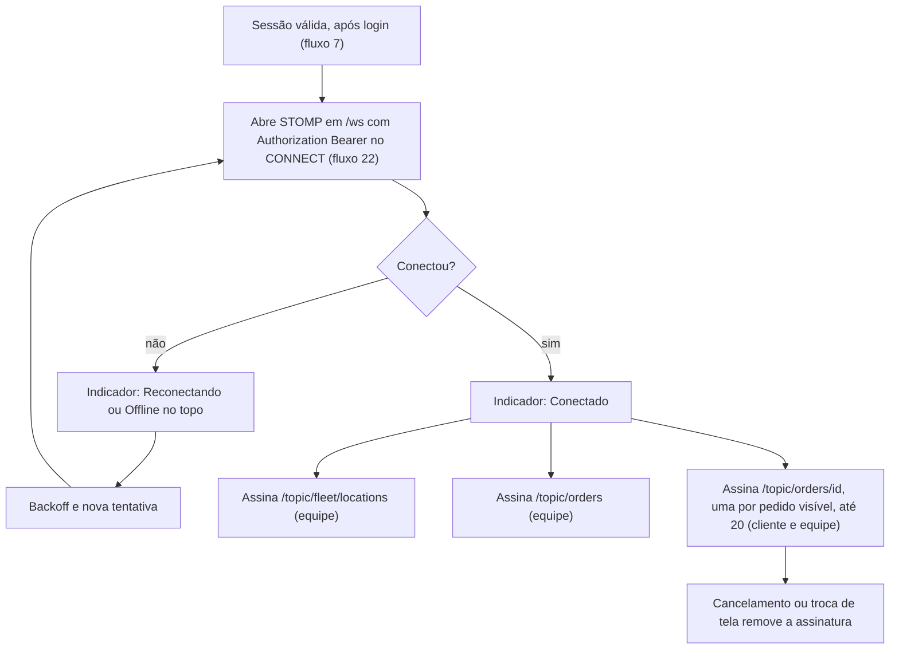
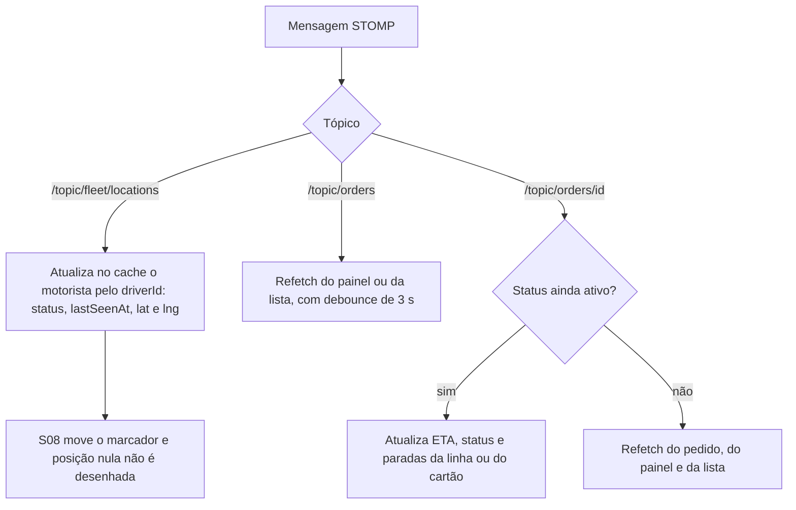
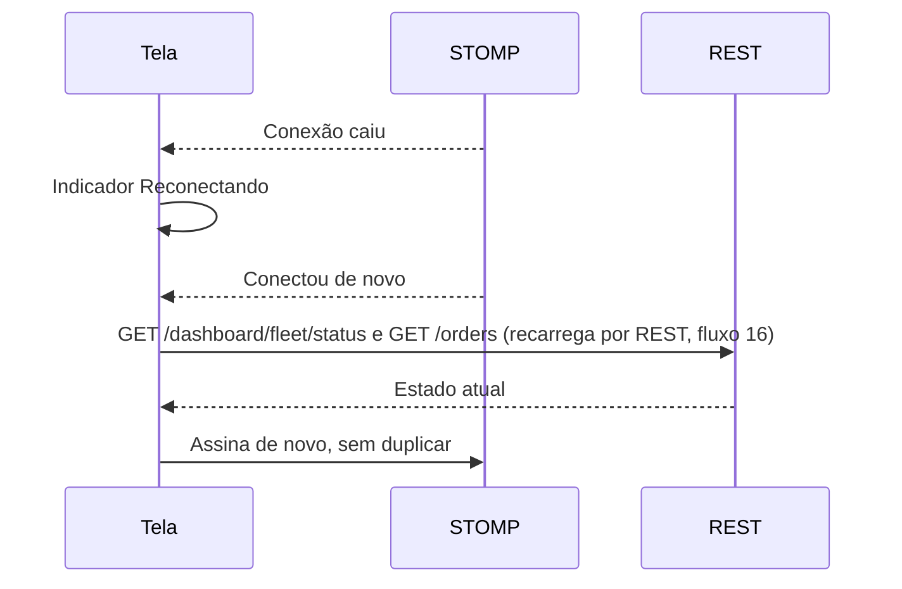
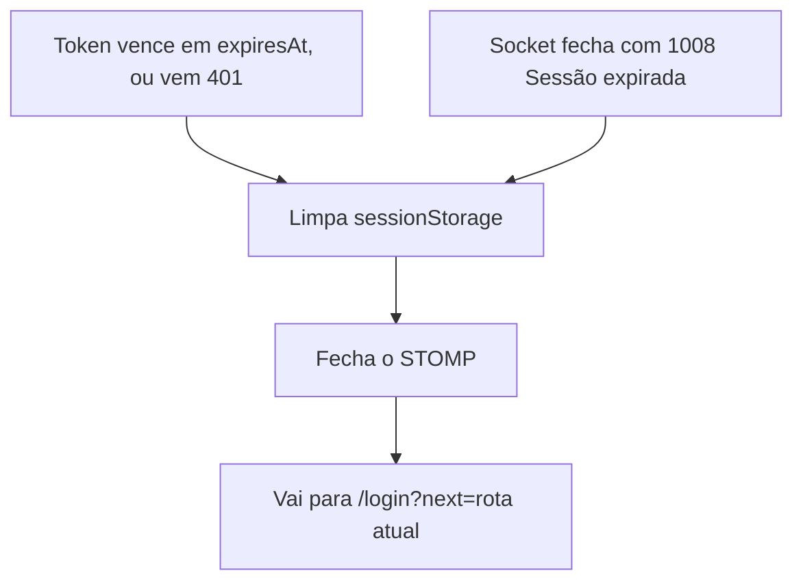

# Fluxos — Mapa ao vivo

Como a tela S08 e as listas de despacho e frota se atualizam: REST para o estado inicial, STOMP para as mudanças. Índice em [flow-index.md](flow-index.md). Os tópicos estão no [fluxo 22 do backend](../backend/flow-websocket.md).

## Conexão e assinaturas

Uma conexão por sessão. As assinaturas são refeitas a cada mudança da lista visível, sem duplicar.

## Evento chega

O evento de localização traz posição e status, e não traz nome nem cliente. Por isso a linha da tabela de motoristas é atualizada pelo `driverId` que já está na lista.

## Reconexão

O servidor não reenvia o que passou (não há replay), então a tela sempre recarrega por REST depois de reconectar.

## Fim da sessão

Os dois caminhos chegam no mesmo login, sem laço de redirecionamento (fluxo 22 do backend fecha com 1008 quando o token vence).
