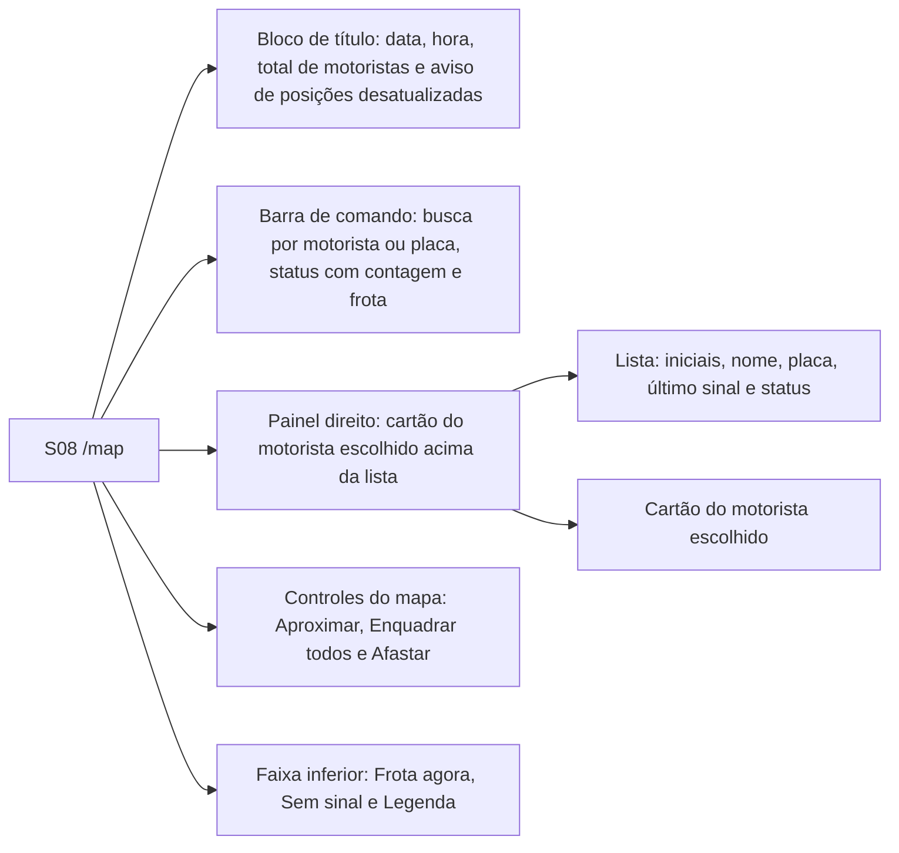
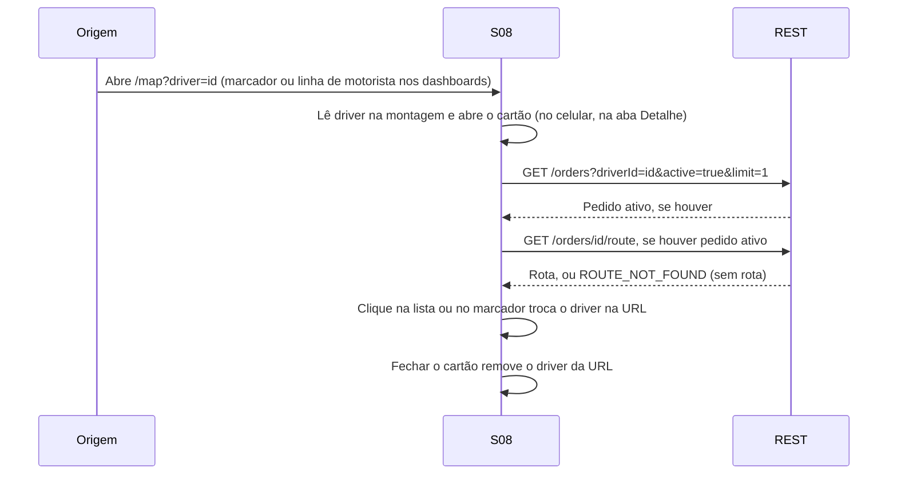
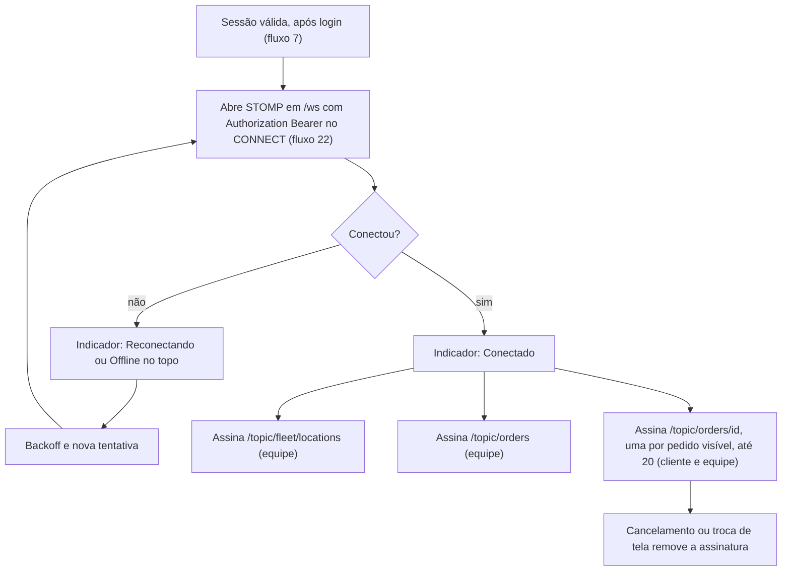
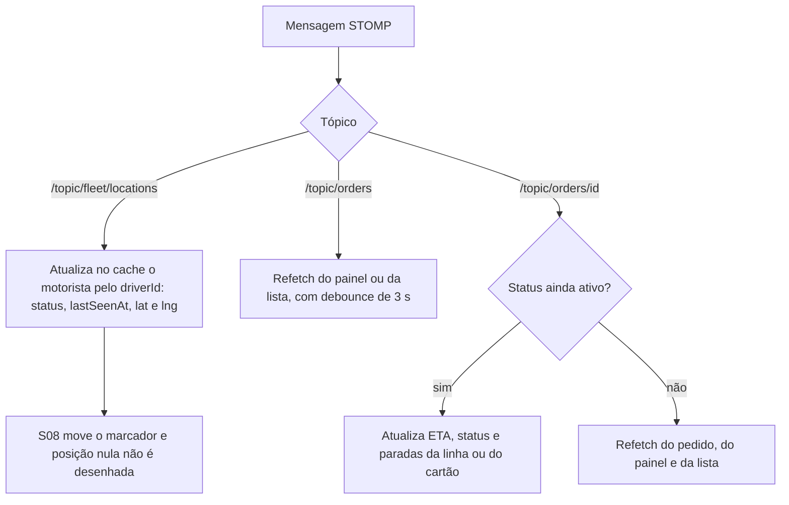
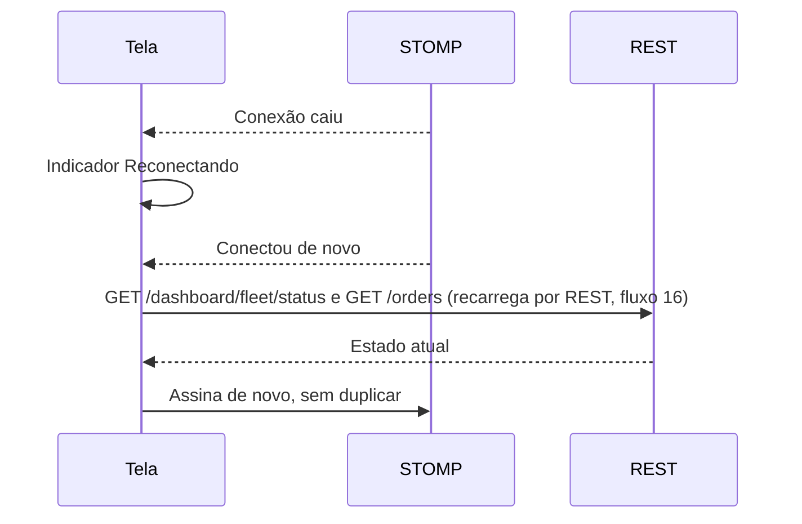
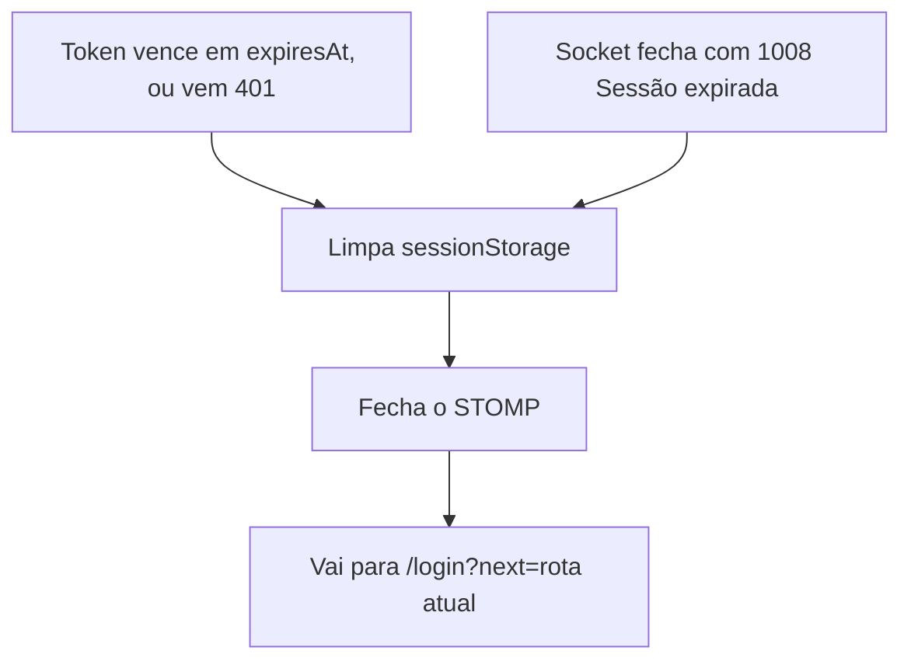

# Fluxos — Mapa ao vivo

Como a tela S08 e as listas de despacho e frota se atualizam: REST para o estado inicial, STOMP para as mudanças. Índice em [flow-index.md](flow-index.md). Os tópicos estão no [fluxo 22 do backend](../backend/flow-websocket.md).

## Composição da S08

A S08 fica sobre o mapa contínuo, plano (inclinação 0°, sem relevo). Os motoristas vêm de `GET /drivers`, página a página.

- **Barra de comando:** a busca e a frota filtram a lista e os marcadores. O segmento de status (Todos, Disponível, Ocupado, Offline) mostra a contagem dentro do recorte atual.
- **Cartão do motorista escolhido:**
  - o render do veículo em 3/4, na cor cadastrada, saindo do cartão, quando o modelo tem render;
  - nome, status e o selo "Sem sinal";
  - Placa, Veículo (`vehicleName` e o tipo), Último sinal e Frota;
  - o pedido ativo, com código, status, passos das paradas, total, ETA e próxima parada;
  - os botões "Abrir pedido" (S11) e "Ver motorista".
- **Mapa:** com um motorista escolhido em rota, o mapa desenha a rota do pedido ativo, com paradas e pílulas de distância, e enquadra a rota. Sem rota, enquadra os motoristas visíveis.
- **Faixa inferior:**
  - "Frota agora": barra empilhada por status;
  - "Sem sinal": total acima do limite e os nomes, para quem não é DISPATCHER;
  - "Legenda": os tipos de linha da rota em foco.
- **Larguras:**
  - de 1024 a 1279 px: o bloco "Sem sinal" some;
  - no tablet: o cartão e a lista vão para a folha inferior, e a faixa inferior some;
  - no celular: a folha inferior tem as abas "Lista" e "Detalhe", e "Detalhe" fica desligada até escolher um motorista. Os controles do mapa ficam à direita, acima da folha, e somem com a folha cheia.

O Mapa ao vivo não tem câmera de acompanhamento nem botão "Seguir veículo". Essa câmera é do detalhe do pedido ([flow-pedido-telas.md](flow-pedido-telas.md)). "Enquadrar todos" enquadra todos os marcadores da cena.

## Motorista escolhido e `?driver=`

- A URL é trocada com `replace`, sem criar entrada no histórico.
- O parâmetro só é lido ao montar a tela. Um id que não está na lista não abre cartão.
- O clique num marcador só escolhe o motorista quando o id é de um motorista da lista.

## Conexão e assinaturas

Uma conexão por sessão. As assinaturas são refeitas a cada mudança da lista visível, sem duplicar.

O indicador é o chip do bloco de título, em toda tela autenticada: "Tempo real" quando conectado, "Reconectando" ou "Offline". Fora do ar, a S08 acrescenta aos metadados "As posições podem estar desatualizadas".

## Evento chega

O evento de localização traz posição e status, e não traz nome nem cliente. Por isso a linha da tabela de motoristas é atualizada pelo `driverId` que já está na lista.

## Reconexão

O servidor não reenvia o que passou (não há replay), então a tela sempre recarrega por REST depois de reconectar.

## Fim da sessão

Os dois caminhos chegam no mesmo login, sem laço de redirecionamento (fluxo 22 do backend fecha com 1008 quando o token vence).
