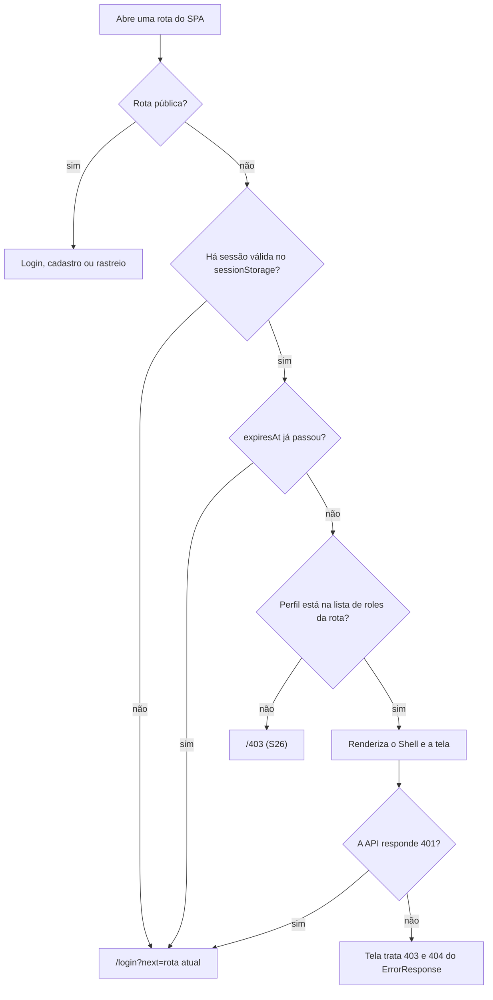
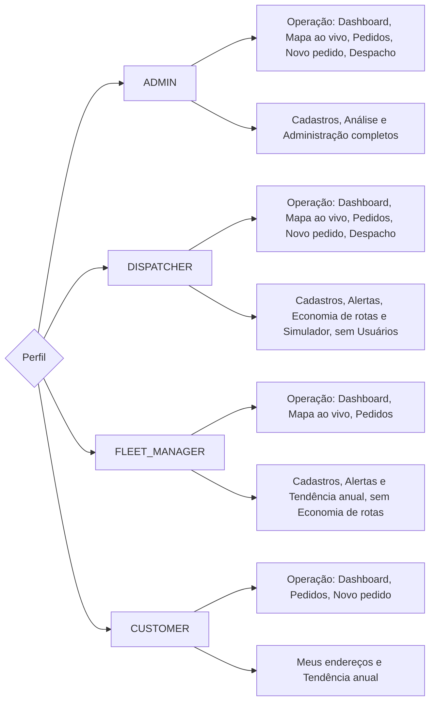
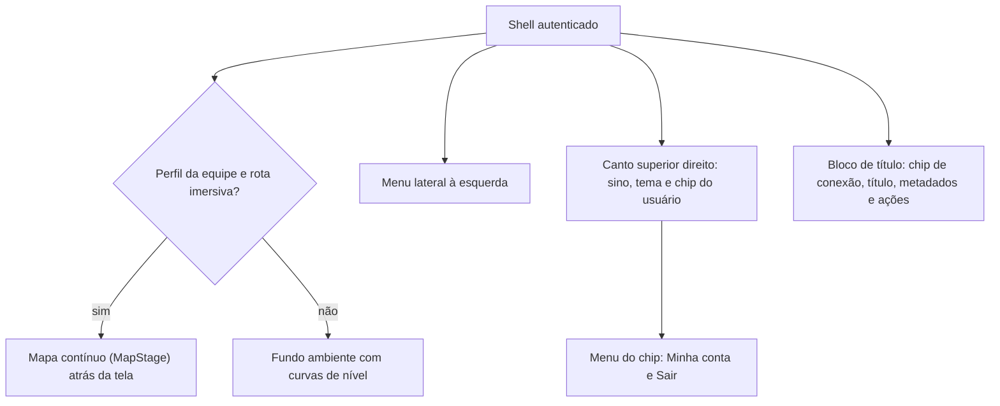
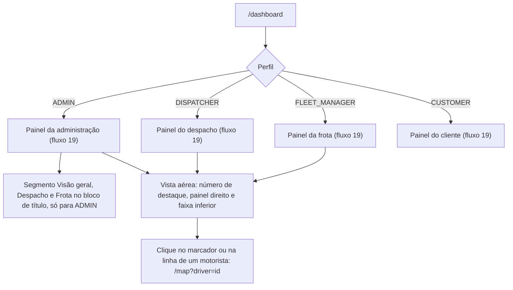
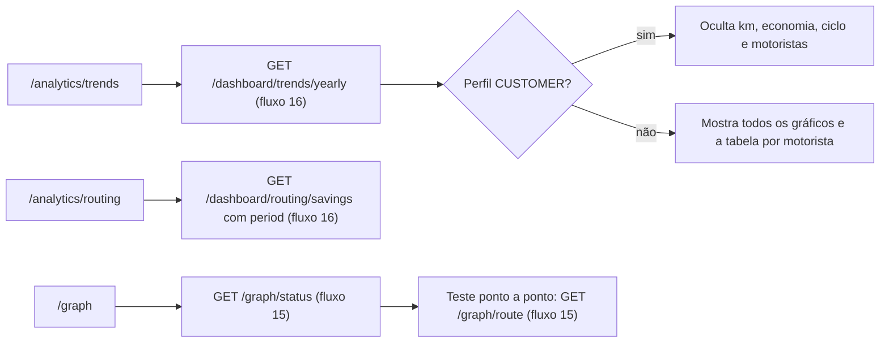

# Fluxos — Navegação por perfil

Guardas de rota, sidebar e sessão no navegador. Índice em [flow-index.md](flow-index.md). As rotas ficam em `frontend/src/routes.ts`, e a API decide o acesso de verdade (403 vai para S26).

## Entrada e guarda de rota

Esse fluxo consome o login da API (fluxo 7) e o perfil atual de `GET /me` (fluxo 25). Um 401 em qualquer chamada limpa a sessão e volta ao login, sem loop.

## Sidebar por perfil

Grupos sem item para o perfil somem da sidebar. Quem não tem acesso a uma rota digitada na URL cai em `/403`.

A sidebar é o menu lateral de vidro (`Rail`), recolhido em ícones, com dica ao passar o mouse. Expandido, ele fica por cima do conteúdo, sem empurrá-lo, e fecha ao navegar, ao clicar fora ou com Esc.

## Shell

- As rotas imersivas, só da equipe, são `/dashboard`, `/dashboard/dispatch`, `/dashboard/fleet`, `/map`, `/dispatch`, `/routes/optimize` e `/orders/:id` (menos `/orders/new`). A lista fica em `frontend/src/map/immersive.ts`.
- O `MapStage` fica montado para a equipe durante a sessão e só fica oculto e inerte nas telas sem mapa. Por isso a câmera viaja de uma cena para a outra.
- O CUSTOMER nunca tem tela imersiva.
- O sino da equipe lista os alertas de `GET /dashboard/alerts` e leva a `/alerts`. O do cliente usa `GET /customer/dashboard`, com link para cada pedido e para o painel.
- O chip do usuário mostra a figura 3D do perfil, o `username` e o perfil por extenso.
- O chip de conexão do bloco de título mostra "Tempo real", "Reconectando" ou "Offline" ([mapa ao vivo](flow-mapa-ao-vivo.md)).

## Faixas de largura

As faixas saem de `viewportFor` (`frontend/src/map/responsive.ts`), e `useViewport` relê a faixa a cada `resize`.

| Faixa | Largura | O que muda |
|---|---|---|
| `full` | ≥ 1280 px | Composição completa |
| `compact` | 1024 a 1279 px | Painéis laterais mais estreitos, blocos secundários da faixa inferior ocultos, barra de comando reposicionada junto ao título e `SidePanel` com 360 px |
| `tablet` | 768 a 1023 px | Menu lateral sempre recolhido. O painel direito do Mapa ao vivo e o `SidePanel` viram folha inferior com alça e três alturas (recolhida, média e cheia), e a faixa inferior do Mapa ao vivo some. Câmera com inclinação de no máximo 60° |
| `phone` | < 768 px | Barra superior com o botão "Abrir menu", e o menu vira gaveta opaca. Nas telas imersivas, o mapa fica no topo e os painéis vêm em uma coluna, e o Mapa ao vivo usa folha inferior com as abas "Lista" e "Detalhe". O `SidePanel` ocupa a tela inteira, opaco. Tabelas viram cartões de registro. Câmera sem terreno, sem giro de entrada e com inclinação de no máximo 45° |

## Painel do dashboard

Os três painéis da equipe usam a mesma composição sobre o mapa contínuo, com relevo e giro de entrada:

- **Número de destaque** sobre o céu, com os números secundários abaixo. O destaque é a taxa de sucesso (ADMIN), os pedidos aguardando (DISPATCHER) ou os motoristas disponíveis (FLEET_MANAGER).
- **Painel direito:** frota agora, a lista de motoristas e os alertas, conforme o perfil. Cada motorista leva a `/map?driver=id` ([mapa ao vivo](flow-mapa-ao-vivo.md)).
- **Faixa inferior:** os painéis do perfil, como "Funil agora", "Motivos de falha" e "Economia de rotas" no da administração.
- **Bloco de título:** seletor de período. O painel da frota tem também o seletor de frota (`?fleetId=`).

Abaixo de 1280 px, o painel direito e a faixa inferior saem das bordas e rolam em grade sob o número de destaque. O painel do cliente fica em [flow-cliente.md](flow-cliente.md).

## Análises

S23 não tem seletor de período, porque o endpoint não aceita `period`. S24 tem. S25 é só da equipe e chama `GET /graph/status` e `GET /graph/route` (fluxo 15).

As três ficam sobre o fundo ambiente. S23 abre com "Pedidos no ano" em número de destaque, seguido dos cartões de gráfico. S24 abre com "km economizados" e tem o seletor de período no bloco de título. S25 mostra o status do grafo ao lado de um mapa em vidro. Com o grafo carregado, dois cliques no mapa marcam a origem (A) e o destino (B) do teste.
