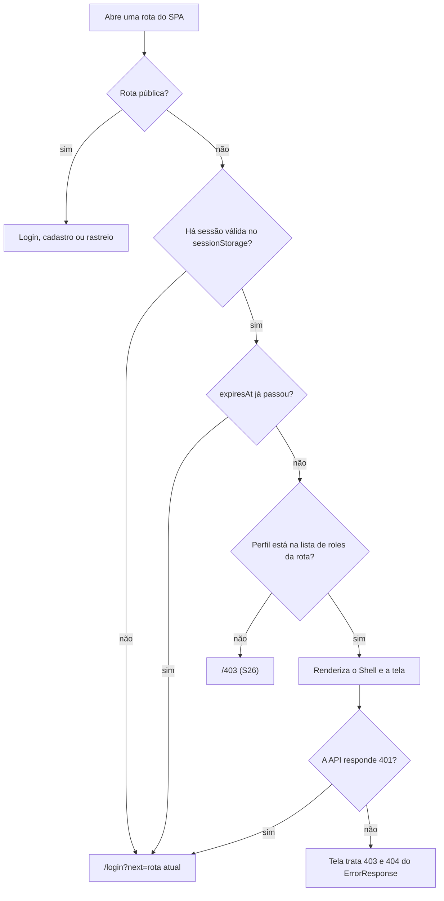
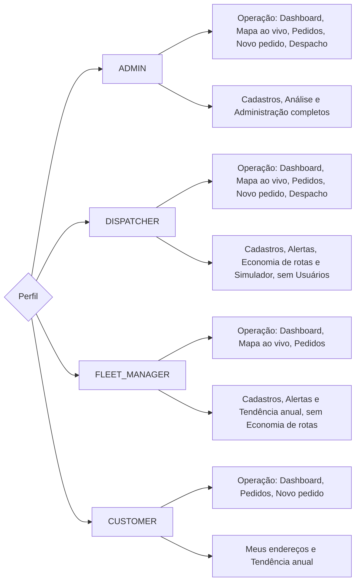
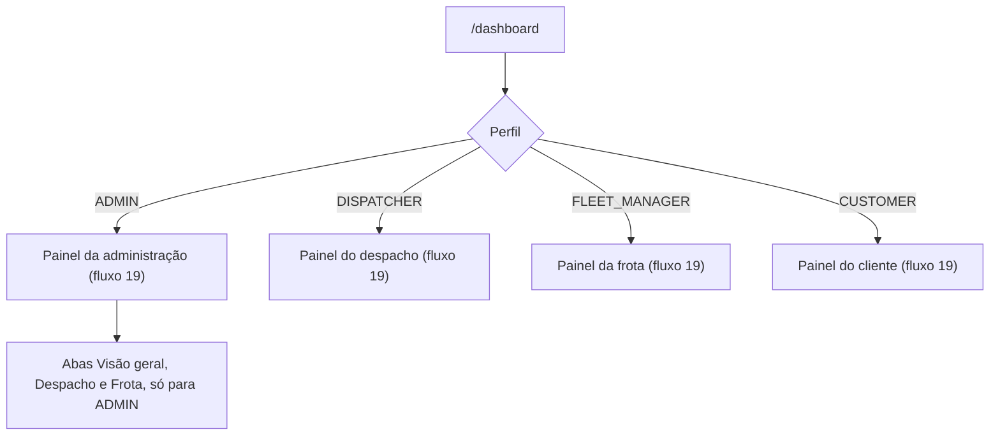
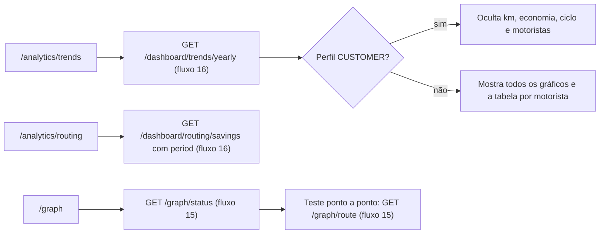

# Fluxos — Navegação por perfil

Guardas de rota, sidebar e sessão no navegador. Índice em [flow-index.md](flow-index.md). As rotas ficam em `frontend/src/routes.ts`, e a API decide o acesso de verdade (403 vai para S26).

## Entrada e guarda de rota

Esse fluxo consome o login da API (fluxo 7) e o perfil atual de `GET /me` (fluxo 25). Um 401 em qualquer chamada limpa a sessão e volta ao login, sem loop.

## Sidebar por perfil

Grupos sem item para o perfil somem da sidebar. Quem não tem acesso a uma rota digitada na URL cai em `/403`.

## Painel do dashboard

## Análises

S23 não tem seletor de período, porque o endpoint não aceita `period`. S24 tem. S25 é só da equipe e chama `GET /graph/status` e `GET /graph/route` (fluxo 15).
