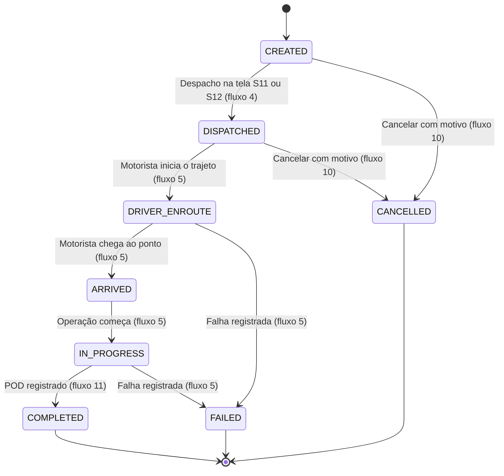
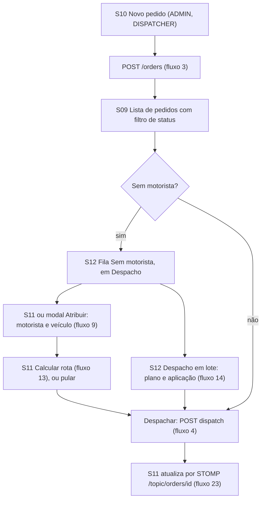
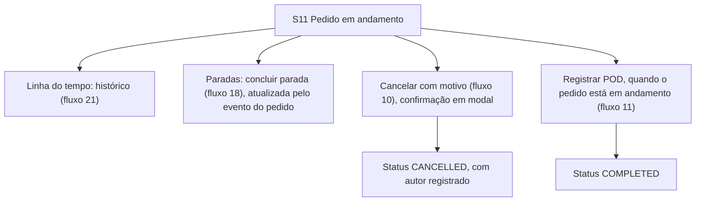
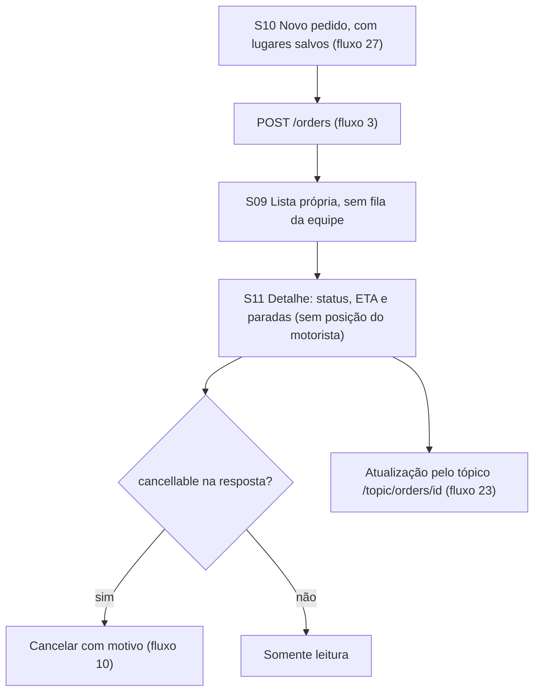

# Fluxos — Pedido nas telas

Ciclo de vida de um pedido vista pelas telas da equipe (S09 a S12) e pelo cliente (S09 a S11). A regra de transição está no [fluxo 2 do backend](../backend/flow-pedidos.md). Índice em [flow-index.md](flow-index.md).

## Estados e quem move cada um

`UNASSIGNED` e `ASSIGNED` não são status: são etapas do funil (S04) para pedido sem motorista e com motorista sem despacho. O cancelamento e a falha exigem motivo, e o histórico (fluxo 21) mostra quem fez cada passo.

## Equipe: da criação ao despacho

Na tela S12, cada ação de atribuição e de despacho chama uma operação por pedido, e o plano em lote grava só o que o usuário confirmou.

## Equipe: andamento e encerramento

## Cliente: o mesmo pedido, em versão reduzida

A tela do cliente nunca mostra motorista internos, fila nem histórico de operação. O rastreio público (fluxo 17) vale para quem tem o código, sem login.
