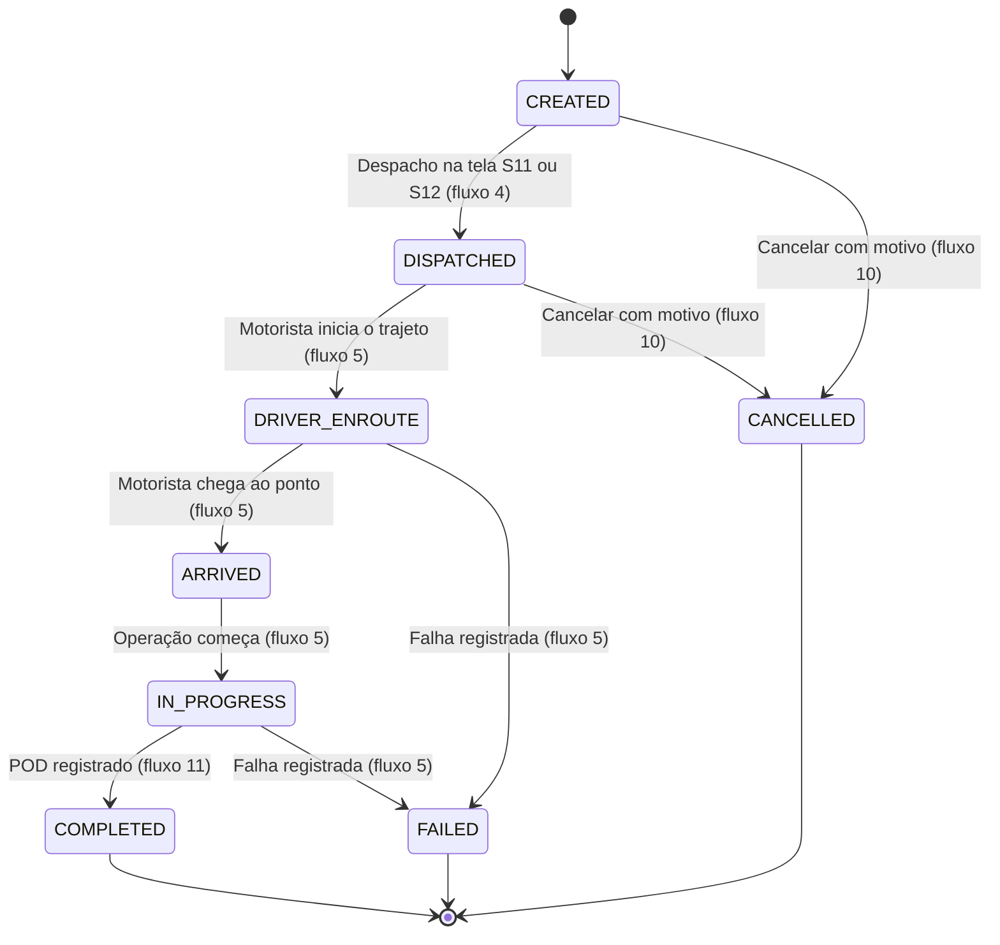
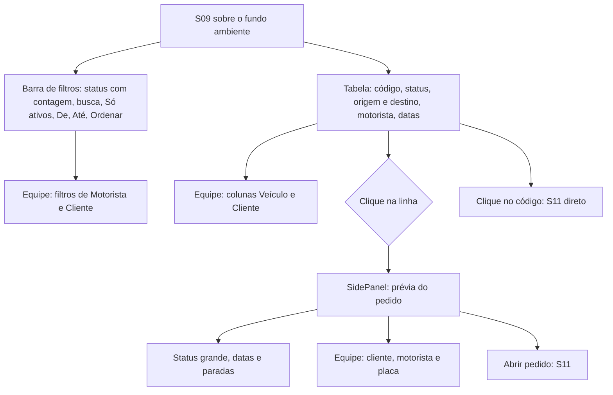
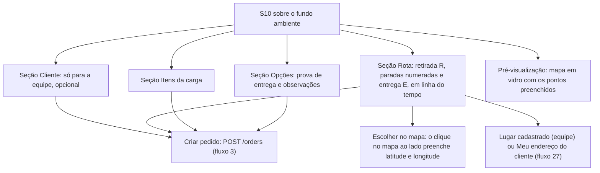
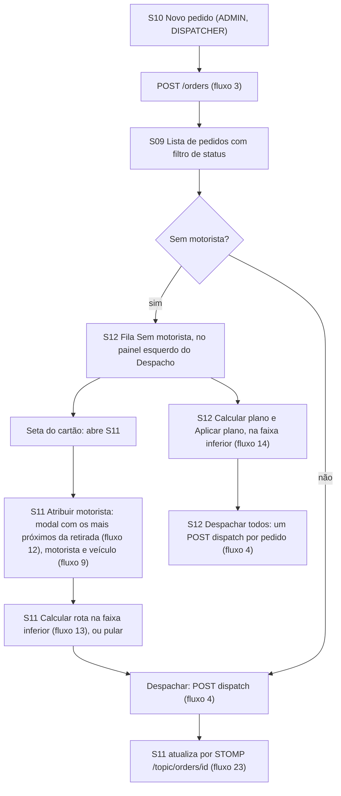
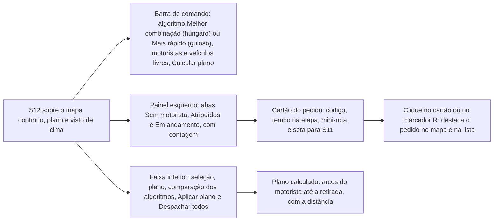
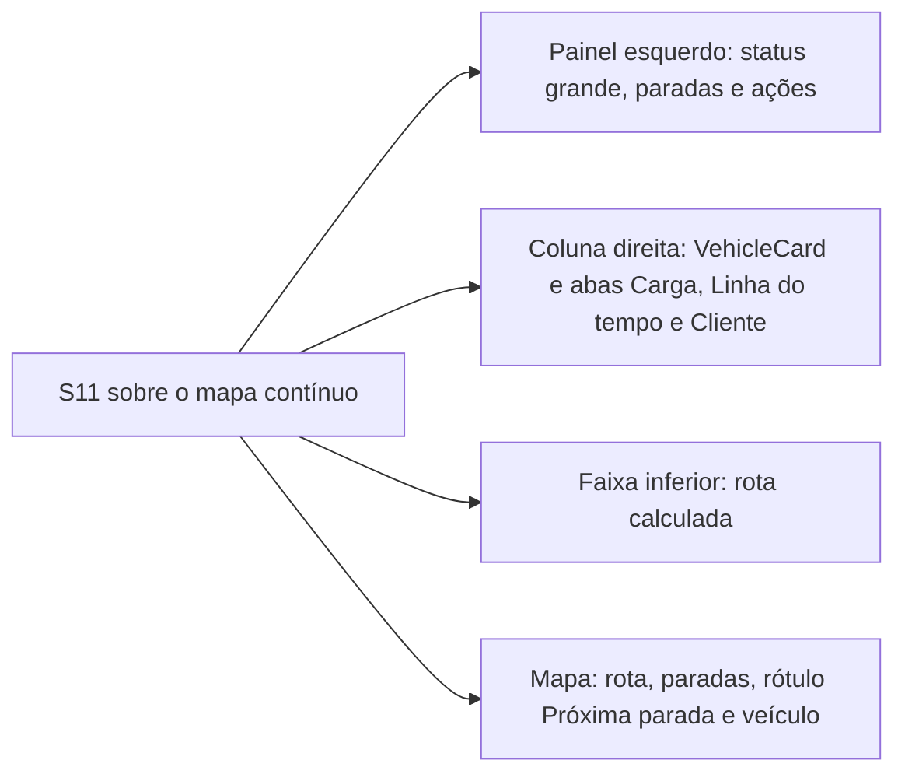
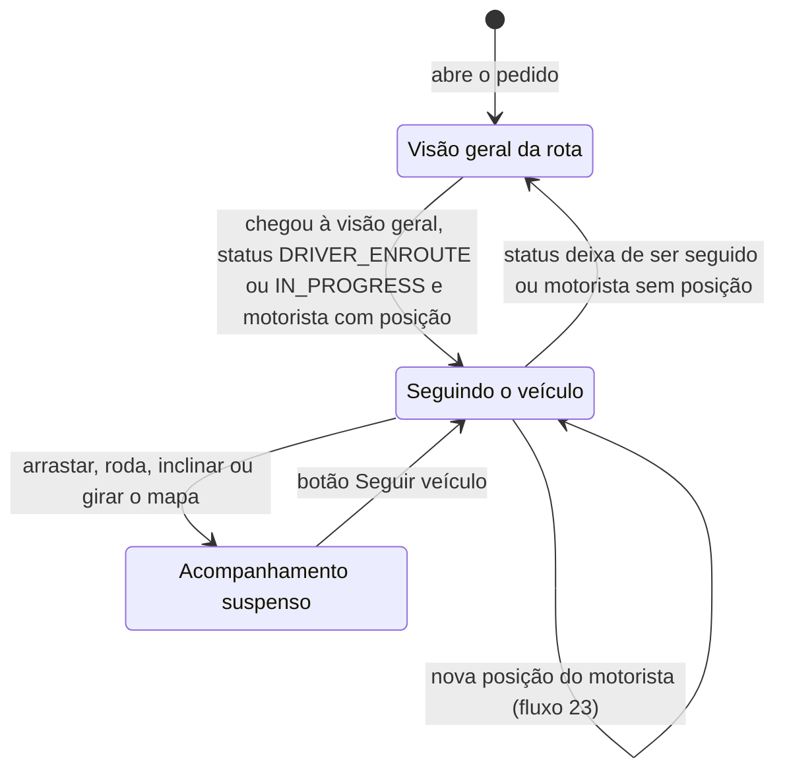
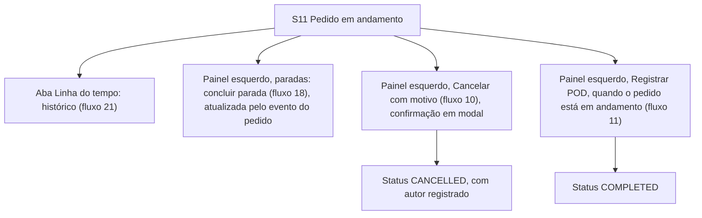
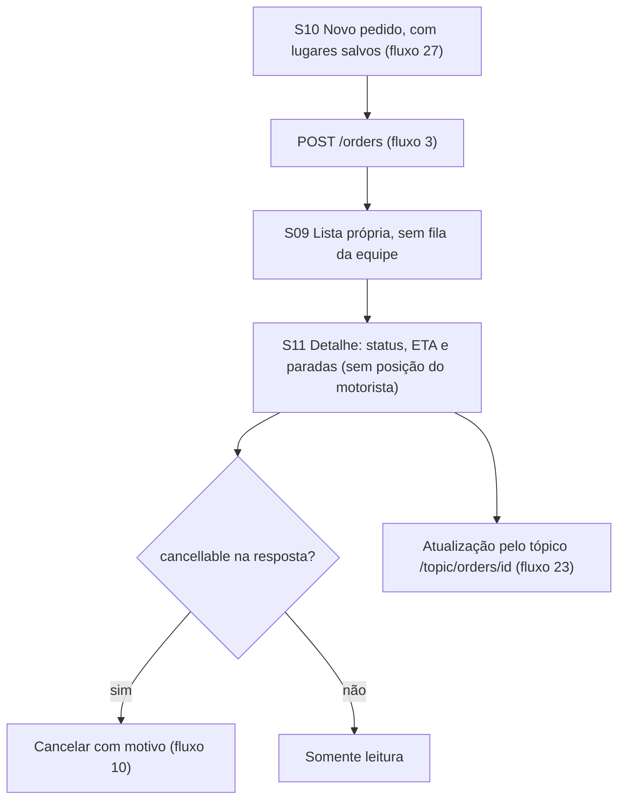

# Fluxos — Pedido nas telas

Ciclo de vida de um pedido vista pelas telas da equipe (S09 a S12) e pelo cliente (S09 a S11). A regra de transição está no [fluxo 2 do backend](../backend/flow-pedidos.md). Índice em [flow-index.md](flow-index.md). As peças de composição (painel esquerdo, faixa inferior, `SidePanel`) estão descritas no índice.

## Estados e quem move cada um

`UNASSIGNED` e `ASSIGNED` não são status: são etapas do funil (S04) para pedido sem motorista e com motorista sem despacho. O cancelamento e a falha exigem motivo, e o histórico (fluxo 21) mostra quem fez cada passo.

## S09 Lista de pedidos

- Os filtros ficam na URL (`?status=`, `?active=`, `?from=`, `?to=`, `?driverId=`, `?customerId=`, `?q=`, `?sortBy=`).
- Cada status da barra é um botão que liga e desliga o filtro e mostra a contagem daquele status.
- Um novo clique na mesma linha fecha o `SidePanel`, assim como o "Fechar" e o Esc.
- "Novo pedido" fica nas ações do bloco de título, para quem pode criar.

## S10 Novo pedido

Abaixo de 1024 px, o mapa da pré-visualização fica recolhido em "Mostrar mapa" e abre sozinho quando o usuário escolhe um ponto no mapa.

## Equipe: da criação ao despacho

Na tela S12, "Calcular plano" não grava nada. "Aplicar plano" grava as atribuições de uma vez, depois da confirmação em modal, e o plano em lote grava só o que o usuário confirmou. "Despachar todos" chama uma operação de despacho por pedido e mostra o resultado em cada linha do plano.

## S12 Despacho

- Só a aba "Sem motorista" tem caixa de seleção. Sem seleção, o plano considera todos os pedidos da fila.
- O pedido parado acima do limite mostra "Parado · N min" no cartão. O mais antigo deles ganha também o rótulo "Parado" no mapa.
- "Em andamento" mostra o motorista, o ETA e a barra de paradas de cada pedido.

## S11 Detalhe do pedido, equipe

- **Painel esquerdo:** status grande, linha do tempo das paradas (com "Concluir" nas paradas intermediárias pendentes, quando há rota) e as ações. As ações e o "Concluir" só aparecem para ADMIN e DISPATCHER.
- **Coluna direita:** o `VehicleCard` com o render do veículo na cor cadastrada, a placa, o status, o nome do veículo (`vehicleName`: "Marca Modelo" ou, sem eles, o tipo), o último sinal e o motorista com link para o perfil. Abaixo, as abas "Carga" (itens, prova de entrega, motivo e observação), "Linha do tempo" (histórico, fluxo 21) e "Cliente" (cliente, identificador e "Copiar link público").
- **Faixa inferior:** algoritmo, modo (pelas ruas ou linha reta), data do cálculo, a sequência de paradas, a legenda, Total, Original, Economia e "Chegada em". "Calcular rota" e "Recalcular" (fluxo 13) aparecem para ADMIN e DISPATCHER enquanto o pedido está ativo.
- **Mapa:** o padding da câmera é medido a partir dos painéis, para a rota caber na área livre.
- Abaixo de 1280 px, a coluna direita desce para dentro da coluna esquerda. Abaixo de 768 px, o mapa fica no topo e os painéis vêm em uma coluna.

### Câmera de acompanhamento e "Seguir veículo"

- **Visão geral:** a câmera enquadra a rota com inclinação de 30° e relevo 1,3, e a rota se desenha aos poucos.
- **Seguindo:** quando a câmera chega à visão geral, ela voa até o veículo (zoom 15,4 e inclinação de 68°), virada para a rota à frente. Cada posição que chega pelo tópico do motorista desliza a câmera até o veículo em 800 ms.
- **Suspenso:** um gesto do usuário no mapa suspende o acompanhamento, e o botão de vidro "Seguir veículo" aparece acima da faixa inferior (centralizado na base, no celular). O clique retoma com um novo voo.
- Entrar em outra tela volta o estado para "seguindo". Com movimento reduzido, a câmera salta direto. No tablet, a inclinação para em 60°; no celular, em 45° e sem relevo.
- O marcador do veículo só aparece quando o motorista tem posição e o pedido não terminou.

## Equipe: andamento e encerramento

O botão principal do painel esquerdo mostra o próximo passo do pedido: "Despachar", "Motorista a caminho", "Chegou à retirada", "Iniciar entrega", "Registrar prova de entrega" ou "Concluir". "Falhou" e "Cancelar" pedem o motivo em modal.

## Cliente: o mesmo pedido, em versão reduzida

A tela do cliente nunca mostra motorista internos, fila nem histórico de operação. O rastreio público (fluxo 17) vale para quem tem o código, sem login.

No cliente, nenhuma tela usa o mapa contínuo. A S09 é a mesma mesa da equipe, sem as colunas Veículo e Cliente, sem os filtros de Motorista e Cliente e com a prévia do `SidePanel` sem os envolvidos. A composição da S11 do cliente está em [flow-cliente.md](flow-cliente.md).
